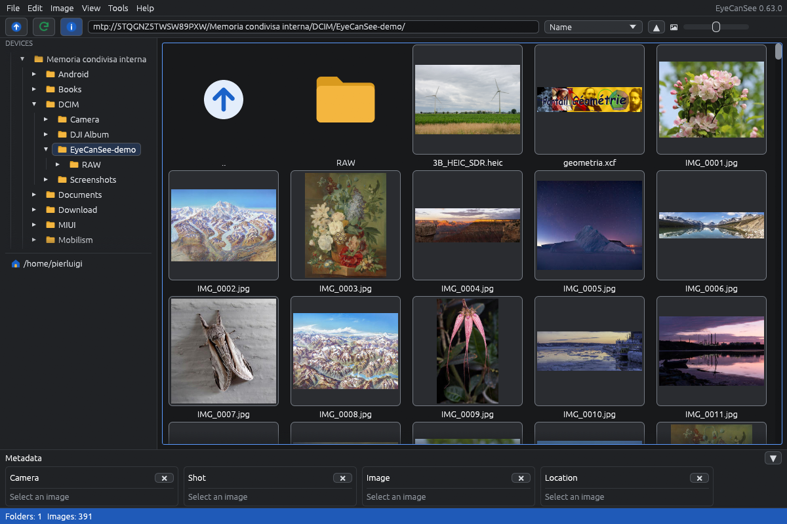
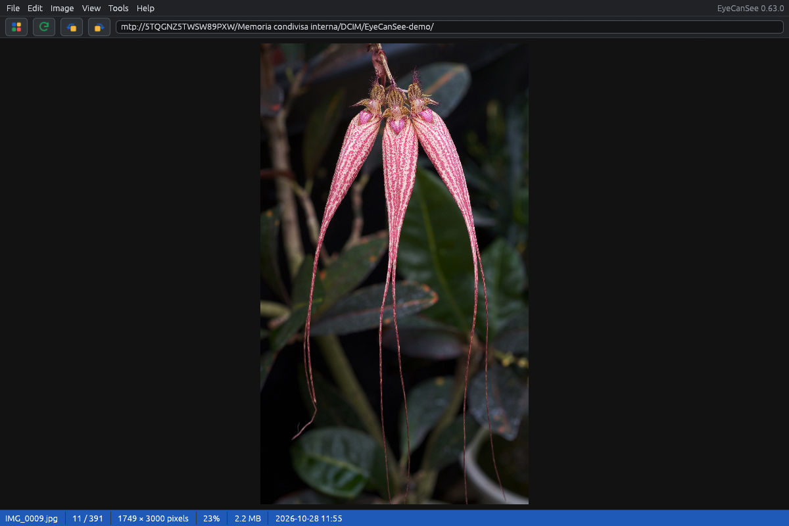
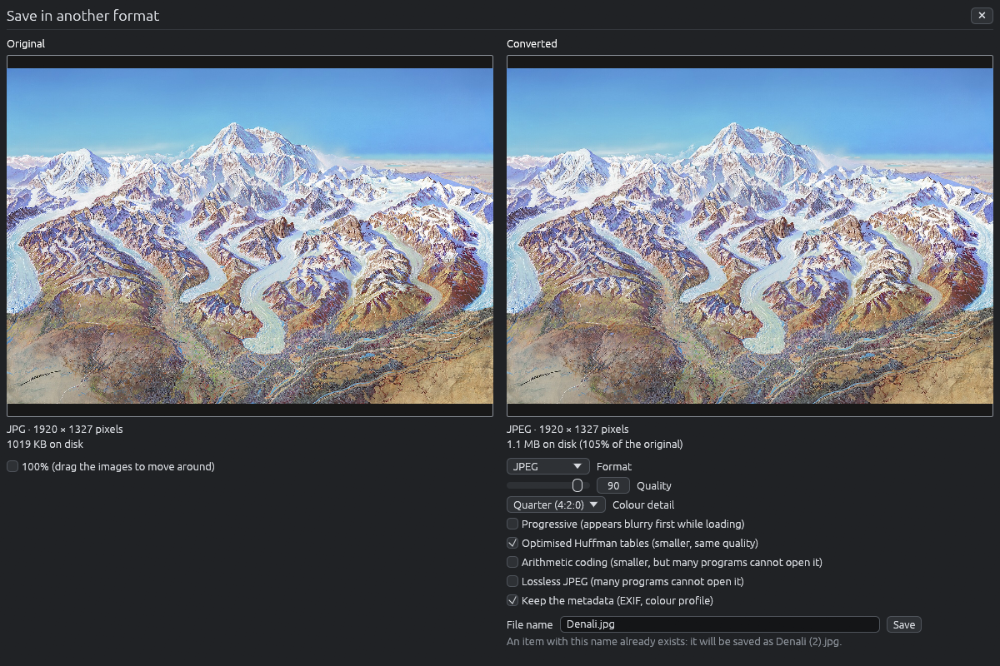
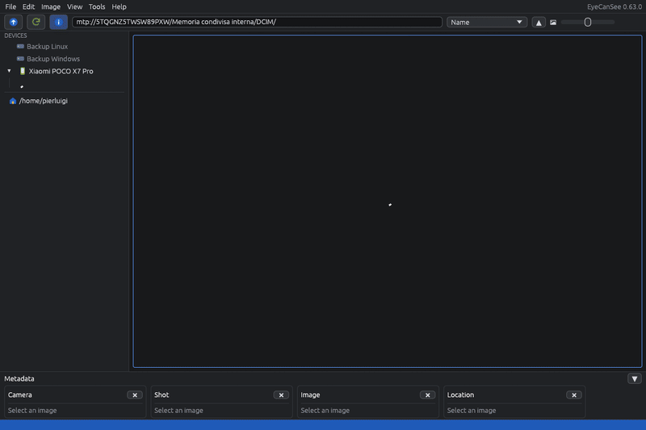

# EyeCanSee

An image and video viewer and manager for Linux and Windows, written in Rust: it browses photos and videos on computers, disks, servers and phones, copies and moves them from one device to another, finds duplicate copies, and converts them to other formats. Free and open source.

It is early in development. This page lists only what works now: new features arrive step by step, each one only when it is ready and tested.

- No import and no database: you open a folder and the photos are there.
- Folders, disks, SFTP and FTP servers and Android phones are browsed the same way.
- Modern and camera formats: HEIC, AVIF, JPEG XL, Camera RAW, PSD and videos.
- Photo and video conversion, on the graphics card when it can.
- Signed releases that update themselves.







## About

I am not a programmer any more, and have not been for years. I needed a photo and video viewer that just opens, without importing or cataloguing anything, and that treats folders, disks, servers and the phone the same way, on both Linux and Windows, so I started writing EyeCanSee with the help of [Claude Code](https://claude.com/claude-code). I test every feature on my own computers and devices before it goes in, and the manual says what is known not to work.

Bug reports and suggestions are welcome in the [issues](https://github.com/IoSonoPiero/eyecansee/issues).

## Why another image and video manager?

EyeCanSee does not do heavy editing, catalogues or batch tools: for that, mature programs like XnView, IrfanView or digiKam remain the better choice. What it does is browse, view, convert and clean up photos and videos on whatever device they are on, the computer, an external disk, a server or a phone, without a database to build first: you open a folder and the photos are there. It works the same way on Linux and Windows, and it is open source. On Linux it talks to the phone directly over USB, so a folder with hundreds of photos that took minutes through the file manager opens in seconds.

## What it does today

What comes next is in [ROADMAP.md](ROADMAP.md).

- **Browsing** of folders on the computer, external disks (also USB sticks, SD cards and dashcams that connect as a USB disk) and Android phones and cameras (opened directly over USB), with cached thumbnails; folders on the computer and on phones update by themselves when files change. Sorting by name, date, size or type; images and videos shown together or apart; "Open with" from the file manager, for images and videos, shows the file in the window already open. On Linux the phone opens directly over USB, in seconds.
- **Viewer** with zoom (mouse wheel and keys) and preloading, so moving between images never waits, photo details such as camera, exposure, date and location, and a full-screen slideshow with fades.
- **File management**: copy and move (also from one device to another), create folders, rename and delete, also several items at once, with a trash on every device to restore or empty.
- **Videos**: thumbnails in the grid, playback with sound and volume control in the viewer and their details (date, length, format, location from phones), on the computer, external disks and phones (with the system's libmpv on Linux, otherwise a video engine downloaded the first time a video is opened, as always on Windows).
- **Duplicates**: finds identical images in a folder and its subfolders, on any device, and deletes the copies you choose, always keeping at least one.
- **Rotating and cropping**: flips and quarter turns on one or many images at once, and rotation by any angle with a crop on a single image, saved over the original or as a new file.
- **Saving in another format** (JPEG, PNG, WebP, AVIF, TIFF and others) with every option of each format, the original and the result side by side, and the file size before you save.
- **Converting and resizing many files at once**: format, turn, size and filter for a whole selection of images and videos, into new files next to the originals, in a subfolder or in another folder, also on another device.
- **Video conversion** with FFmpeg (the system's, or downloaded once: 63 MB on Windows, 67 MB on Linux): MP4, MKV, WebM, MOV, AVI and GIF with H.264, HEVC, AV1, VP9 and other codecs, turned and resized, on the graphics card when it can (NVIDIA, Intel, AMD, VA-API), or copied as they are without re-encoding; the metadata go into the new file, including a dashcam's GPS position and speeds (`gps.sqlite` on the card) and a DJI drone's position (`.SRT`), so the copy keeps them away from the card. Details in [docs/video-formats.md](docs/video-formats.md).
- **Servers**: SFTP, FTP and FTPS, on Linux and Windows, browsed like any folder (thumbnails, viewer, videos, copy and move to and from any other device, rename, trash). A server manager keeps the servers you use, with password or SSH key, in the left panel next to the disks, in a file that a master password can encrypt. Tested on a Synology NAS, a Hetzner Storage Box and Linux servers.
- English and Italian, light and dark theme, built-in manual.

### Formats

- JPEG, PNG, WebP, GIF, BMP, TIFF, HEIC, AVIF, JPEG XL, SVG, and less common ones such as PSD, JPEG 2000, PCX, DDS and OpenRaster.
- Further rare formats through ImageMagick (XCF, PSB, DPX, FITS and others).
- Camera RAW files: CR2, CR3, NEF, ARW, RAF, ORF, RW2, DNG and others (tested with real files from Canon, Nikon, Sony, Fujifilm, Olympus, Panasonic and Google cameras, and a Samsung Galaxy phone).

All the formats it opens and saves, on Linux and Windows: [docs/formats.md](docs/formats.md). Sample files to try them, including real HEIC and Camera RAW photos: [download the test files](https://github.com/IoSonoPiero/eyecansee/releases/download/test-files/EyeCanSee-test-files.zip) (zip, 139 MB; sources and licences in the [release page](https://github.com/IoSonoPiero/eyecansee/releases/tag/test-files)).

The full list of features, keys and limits is in the manual: [English](docs/manual.en.md), [Italiano](docs/manual.it.md).

## Phones



*Opening a folder of 400 files on a POCO X7 Pro over USB (Fedora 44, EyeCanSee 0.63.0, cold caches): the file manager (gvfs) takes 9.3 s to list the names; EyeCanSee lists them in 0.07 s after a 0.5 s open and shows the first thumbnails within 0.8 s. Test images: public-domain photos, copied several times.*

| Model | System | Notes |
|---|---|---|
| POCO X7 Pro (Android 16, HyperOS 3) | Fedora 44, Windows | All features; the phone used for most of the testing |
| POCO X6 Pro (Android 16, HyperOS 3) | Fedora 44, Windows | All features |
| Samsung Galaxy A57 5G (Android 16, One UI 8.5) | Windows 10, Fedora 44 | Browsing, copying and video conversion on Windows; on Windows, after a driver error (`0x8007001f`) the phone has to be unplugged and plugged in again |
| Samsung Galaxy A56 5G (Android 16, One UI 8.5) | Fedora 44, Windows | Connection, listing and transfer tests of the MTP library |
| Samsung Galaxy Tab S11 5G (Android 16, One UI 8.5) | Fedora 44, Windows | Connection, listing and transfer tests of the MTP library |

Other Android phones open directly when mtp-rs supports them, otherwise through the file manager's mount, slower (see the [manual](docs/manual.en.md)). iPhones open through the file manager's mount only.

On Windows, Windows' own MTP driver can stall for minutes after a photo is taken or a file deleted on the phone: after 15 s EyeCanSee says so and explains what to do ([docs/phone-stall.en.md](docs/phone-stall.en.md)).

## Servers

| Server | Protocols | Systems | Notes |
|---|---|---|---|
| Synology DS725+ | FTP, FTPS, SFTP | Linux, Windows | FTPS with the NAS's own certificate, SFTP with password |
| Hetzner Storage Box | FTP, FTPS, SFTP | Linux, Windows | FTP and FTPS over IPv6, SFTP on ports 22 and 23 |
| Linux servers (Ubuntu, Fedora) | SFTP | Linux, Windows | SFTP with key |
| Rebex and Wing FTP public test servers | FTP, FTPS, SFTP | Linux | Read only |

No SMB, WebDAV or cloud services for now. FTPS on servers that want the data connection to resume the TLS session is a known limit, in the [roadmap](ROADMAP.md).

## Download

- **Windows**: from the [latest release](https://github.com/IoSonoPiero/eyecansee/releases/latest), either run the installer (`-setup.exe`: Start menu entry, optional desktop shortcut, "Open with" for images and videos, removal from Settings, no administrator rights needed) or download the zip, extract the whole folder anywhere and run `eyecansee.exe` (it needs the files next to it). The program is not signed, so Windows may warn you the first time: click **More info**, then **Run anyway**.
- **Fedora** (43 and later): install it from the [COPR repository](https://copr.fedorainfracloud.org/coprs/iosonopiero/eyecansee/), and updates arrive with the system ones:
  ```bash
  sudo dnf copr enable iosonopiero/eyecansee
  sudo dnf install eyecansee
  ```
  HEIC photos also need `libheif-freeworld` from [RPM Fusion](https://rpmfusion.org/), which `dnf` installs by itself if RPM Fusion is enabled.
- **Other Linux distributions**: download the `.AppImage` file from the [latest release](https://github.com/IoSonoPiero/eyecansee/releases/latest), make it executable (`chmod +x EyeCanSee-*.AppImage`, or Properties → "Allow executing file as program" in the file manager) and run it. Nothing else to install: videos use the system's libmpv if there is one, otherwise EyeCanSee offers to download its video engine (10 MB) the first time a video is opened. It needs a distribution from 2022 or later (glibc 2.35).
  To have it in the applications menu (and in "Open with" for images and videos), open the AppImage with [Gear Lever](https://flathub.org/apps/it.mijorus.gearlever), available from the software centre of most distributions, and let it move the file into its folder and add it to the menu. EyeCanSee keeps updating itself there.

On Linux it is tested on GNOME, Cinnamon (Linux Mint) and KDE Plasma 5 and 6. Other desktops that use gvfs for phones (Xfce, MATE) should work the same way, but they have not been tried. On KDE, opening a phone asks first: KDE holds it in its kiod service, and closing that service also makes KDE forget the passwords of network folders open in Dolphin.

The Windows installer, the zip and the AppImage update themselves: at startup EyeCanSee checks the latest release on GitHub in the background, downloads the new version, checks its SHA-256 and its signature, and offers to install it with one click. Only files signed with the developer's [minisign](https://jedisct1.github.io/minisign/) key are installed; the key is not on GitHub, so whoever could upload files to a release could not ship an update. The check can be turned off in Options. On Fedora updates come from `dnf`.

From version 0.28.0, every file of a release has its signature next to it (`.minisig`). To check a file you downloaded by hand:

```bash
minisign -Vm EyeCanSee-<version>-x86_64.AppImage -P RWRgiMFmEPRN5JASovMqT3NdY1Ui/mhebEzDTdsmKDiXno3K/9B4/biD
```

The trusted comment it prints names the file and the version it was signed for.

## Build

### Linux (Fedora)

```bash
sudo dnf install libheif-devel ImageMagick-devel clang-devel cmake nasm
cargo build --release
./target/release/eyecansee ~/Pictures
```

`./install-linux.sh` builds and installs it for the current user (applications menu, "Open with"), without `sudo`. `./install-linux.sh --uninstall` removes it.

`tools/copr-build.sh` builds the source RPM from `eyecansee.spec` and sends it to COPR. `tools/build-appimage.sh` builds the AppImage in an Ubuntu 22.04 container (needs `podman`), with libheif, its decoders and ImageMagick compiled from source.

### Windows

In PowerShell, once:

```powershell
winget install --id Git.Git -e
winget install --id Rustlang.Rustup -e
winget install --id Kitware.CMake -e
winget install --id NASM.NASM -e
winget install --id Microsoft.VisualStudio.2022.BuildTools -e --override "--quiet --wait --add Microsoft.VisualStudio.Workload.VCTools --includeRecommended"
```

Then open a new PowerShell window (so that `PATH` is reloaded) and check that every tool answers:

```powershell
git --version; cargo --version; cmake --version; nasm -v
```

If `nasm` is not found, add its folder to `PATH` for the current user and open a new window. The folder depends on the NASM installer: look for `nasm.exe` in `%LOCALAPPDATA%\bin\NASM` or `C:\Program Files\NASM`. For example:

```powershell
[Environment]::SetEnvironmentVariable("Path", [Environment]::GetEnvironmentVariable("Path", "User") + ";$env:LOCALAPPDATA\bin\NASM", "User")
```

HEIC and AVIF need libheif, built once with [vcpkg](https://vcpkg.io) (a few minutes):

```powershell
git clone https://github.com/microsoft/vcpkg.git $env:USERPROFILE\vcpkg
& $env:USERPROFILE\vcpkg\bootstrap-vcpkg.bat -disableMetrics
& $env:USERPROFILE\vcpkg\vcpkg.exe install "libheif[core,libde265,dav1d]:x64-windows-static"
```

The rare formats (XCF, PSB, DPX, FITS and others) need the official ImageMagick build with its development files, and LLVM (libclang generates the bindings):

```powershell
winget install LLVM.LLVM
# ImageMagick-<version>-Q16-HDRI-x64-dll.exe from https://imagemagick.org/script/download.php#windows
.\ImageMagick-7.1.2-34-Q16-HDRI-x64-dll.exe /SILENT /TASKS=install_devel /DIR="$env:USERPROFILE\ImageMagick"
```

Build and run (without `--features magick` the rare formats are left out and ImageMagick and LLVM are not needed; without `heif` HEIC and AVIF are left out too, and vcpkg is not needed):

```powershell
git clone https://github.com/IoSonoPiero/eyecansee.git
cd eyecansee
$env:VCPKG_ROOT = "$env:USERPROFILE\vcpkg"
$env:IMAGE_MAGICK_DIR = "$env:USERPROFILE\ImageMagick"
$env:LIBCLANG_PATH = "C:\Program Files\LLVM\bin"
$env:Path += ";$env:IMAGE_MAGICK_DIR"   # the ImageMagick DLLs, for the exe in target\release
cargo build --release --no-default-features --features heif,magick
.\target\release\eyecansee.exe $env:USERPROFILE\Pictures
```

## Built on

The phones are read with [mtp-rs](https://github.com/vdavid/mtp-rs), a pure Rust MTP library by vdavid. Working on EyeCanSee I contributed to it: dates on Windows ([#41](https://github.com/vdavid/mtp-rs/pull/41)), folder listings with `GetObjectPropList` ([#45](https://github.com/vdavid/mtp-rs/pull/45)) and sequential reads on Windows for fast copies ([#46](https://github.com/vdavid/mtp-rs/pull/46)); I tested the maintainer's mapping of Windows HRESULTs to MTP error codes ([#42](https://github.com/vdavid/mtp-rs/pull/42)), and device testing on a POCO X6 Pro found a cancel bug ([issue #43](https://github.com/vdavid/mtp-rs/issues/43)), fixed in mtp-rs 0.34.2. On the maintainer's phones, listing a folder with #45 went from 5.5 s to 0.40 s (Galaxy S23 Ultra, 3248 photos) and from 2.8 s to 0.24 s (Pixel 9 Pro XL, 274 photos).

## Translations

The interface is available in English and Italian. To add a language, see [CONTRIBUTING.md](CONTRIBUTING.md).

## License

EyeCanSee is released under the GNU General Public License, version 3 or later: see [LICENSE](LICENSE).
