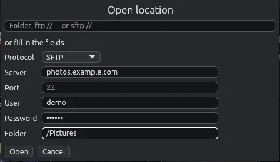

# Address bar and Open location

The address bar, in the toolbar, shows where you are and takes you anywhere: a folder on this computer, a picture, a phone or a server.

## The address bar

Click in the address bar, type an address and press **Enter**. You can type:

- a folder on this computer or on a disk, for example `/home/anna/Pictures` on Linux or `C:\Users\Anna\Pictures` on Windows;
- a picture, for example `/home/anna/Pictures/beach.jpg`: it opens in the [viewer](viewer.md), with its folder behind it;
- a server: `ftp://…`, `ftps://…` or `sftp://…`, for example `sftp://anna@nas.lan/Photos` or `ftp://nas.lan:2121/Photos` (see [Servers (FTP and SFTP)](servers.md));
- a folder of a phone, as the bar shows it when the phone is open: `mtp://…` (see [Android phones](phone.md)).

Quotes around the whole address, such as those added by **Copy as path** in Windows, and spaces before or after it are removed. On Windows a drive letter alone, such as `C:`, opens the drive's main folder (`C:\`). A `~` at the start is your home folder: `~/Pictures` opens the Pictures folder in it.

When you change folder, the bar shows the new one. At its end  copies the address and  puts the copied one in its place, ready for **Enter**; in a narrow window these two buttons go on a row under the bar, with the sorting and the size of the thumbnails. A password is never shown in the bar, even when you typed it there. If the address cannot be opened, a message with a warning triangle at the bottom of the window says why (it goes away when you change folder, or earlier with its ✕), and the bar goes back to the folder you were in. The same message says why a folder, a phone, a picture or a video does not open, and goes away by itself once it opens;  copies it, detail included. When a window asks what to do (the password of a server that refused the login, a server's key to confirm, KDE holding the phone), the message is only in that window, not at the bottom, not even after **Cancel**.

## Open location

**File > Open location…** opens a window where you can type a server address piece by piece, without having to remember how it is written.

1. Either type the whole address in the field at the top, or leave it empty and fill in the fields below it.
2. **Protocol**: FTP, FTPS or SFTP.
3. **Server**: the name or the address of the server.
4. **Port**: only if it is not the usual one (21 for FTP, 22 for SFTP).
5. **User** and **Password**. With FTP, an empty user logs in as `anonymous`.
6. **Folder**: the folder to open (`/` when empty).
7. **Open** (or **Enter**) opens it without saving anything; **Save and open** also saves the server with its password in the [server manager](server-manager.md), then opens it; **Cancel** (or **Esc**) closes the window.

**Save and open** works only for a server: for a folder on this computer it is greyed out. If a saved server already has this login (same protocol, server, port and user), it gets the password you typed and keeps its name, folder and key; otherwise a new saved server is added, named after the server. If the saved servers are protected by a master password, EyeCanSee asks for it first (see [Saved passwords](passwords.md)).

The fields are greyed out while the field at the top has something in it. Spaces before or after a value, for example pasted along with it, are removed, except in the password, where they can be part of it.

## When a server asks for the password

If a server refuses the login, Open location opens by itself with the address already filled in and, at the top, why it was refused: type the password and click **Open** to use it only this time, or **Save and open** to keep it (also when a saved server's password has changed). **Enter** works as **Save and open** when the server is among the saved ones, otherwise **Open**. The same happens at startup when the last folder was on an FTP server with a user that is not among the saved servers, since EyeCanSee does not keep that password.

To avoid typing the password every time, click **Save and open**, or save the server in **File > Server manager…**: an address that matches a saved server (same protocol, server, port and user), also typed in the address bar, uses its password and key. See [Managing servers](server-manager.md).

## Starting EyeCanSee on an address

EyeCanSee can be started with a folder, a picture or a server address, for example from another program with "Open with": it opens that place instead of the last folder. If EyeCanSee is already open, the place is shown in the window that is already open. If that window has the image editor open, the place opens when you close the editor (its status bar says so): the image being edited is saved where it is.
