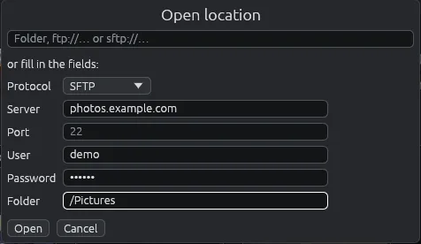

# Address bar and Open location

The address bar, in the toolbar, shows where you are and takes you anywhere: a folder of this computer, a picture, a phone or a server.

## The address bar

Click in the address bar, type an address and press **Enter**. You can type:

- a folder of this computer or of a disk, for example `/home/anna/Pictures` on Linux or `C:\Users\Anna\Pictures` on Windows;
- a picture, for example `/home/anna/Pictures/beach.jpg`: it opens in the [viewer](viewer.md), with its folder behind it;
- a server: `ftp://…`, `ftps://…` or `sftp://…`, for example `sftp://anna@nas.lan/Photos` or `ftp://nas.lan:2121/Photos` (see [Servers (FTP and SFTP)](servers.md));
- a folder of a phone, as the bar shows it when the phone is open: `mtp://…` (see [Android phones](phone.md)).

When you change folder, the bar shows the new one. A password is never shown in the bar, even when you typed it there. If the address cannot be opened, a yellow band with a warning triangle at the bottom of the window says why (its ✕ closes it), and the bar goes back to the folder you were in.

## Open location

**File > Open location…** opens a window where you can type a server address in pieces, without remembering how it is written.

1. Either type the whole address in the field at the top, or leave it empty and fill in the fields below it.
2. **Protocol**: FTP, FTPS or SFTP.
3. **Server**: the name or the address of the server.
4. **Port**: only if it is not the usual one (21 for FTP, 22 for SFTP).
5. **User** and **Password**. With FTP, an empty user logs in as `anonymous`.
6. **Folder**: the folder to open (`/` when empty).
7. **Open** (or **Enter**) opens it; **Cancel** (or **Esc**) closes the window.

The fields are greyed out while the field at the top has something in it.

## When a server asks for the password

If a server refuses the login, Open location opens by itself with the address already filled in: type the password and press **Enter**. The same happens at startup when the last folder was on an FTP server with a user that is not among the saved servers, since EyeCanSee does not keep that password.

To avoid typing the password every time, save the server in **File > Server manager…**: an address that matches a saved server (same protocol, server, port and user), also typed in the address bar, uses its password and key. See [Managing servers](server-manager.md).

## Starting EyeCanSee on an address

EyeCanSee can be started with a folder, a picture or a server address, for example from another program with "Open with": it opens that place instead of the last folder. If EyeCanSee is already open, the place is shown in the window already open.
