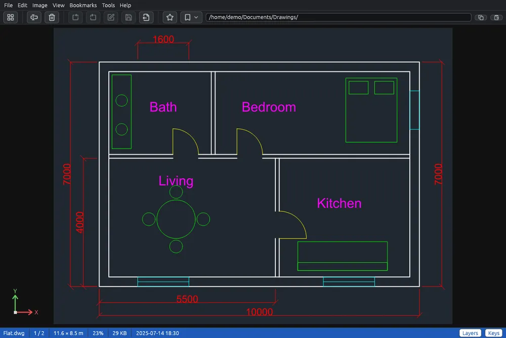

# CAD drawings

AutoCAD drawings (**DWG** and **DXF**) and plotter files (**HP-GL** and **HP-GL/2**: `.plt`, `.hpgl`) appear in the grid with a picture of the drawing as their thumbnail, and open in the viewer like a picture.

## Looking at a drawing

Double-click a drawing, or select it and press **Enter**. The drawing is seen from above, as in the model space of a CAD program, on its dark background, with its colours, line types and line weights. Layers that are off or frozen in the file start hidden (see Layers below).

| Key or mouse | What it does |
|---|---|
| Mouse wheel, + and − | Zoom in and out |
| Drag | Move the drawing |
| 0 | The whole drawing |
| →, ← | Next, previous file |
| L, **Shift + L** | Next, previous layout |
| **Ctrl + L** | Layers panel |
| M | Measure |
| N, **Shift + N** | Next, previous change, when comparing two drawings |
| **Ctrl + Shift + S** | Save as a picture |
| F11 | Full screen |
| Esc | Back to the grid |
| Double click | Back to the grid, or full screen and back, as set in the [Options](options.md) |

When the view stops moving, the part on the screen is drawn again from the drawing, so thin lines and small texts stay sharp at any zoom. The **Keys** button in the status bar lists the keys; while Measure is on, the keys of Measure.

## Layouts

A drawing with layouts (paper space) shows **Model** or the name of the layout in the status bar. **L** goes to the next layout and **Shift + L** to the previous one, each with its sheet, title block and viewports onto the model.

## Layers

**Ctrl + L**, the **Layers** button in the status bar or **View > Layers of the drawing** open the layers panel on the right of a DWG or DXF drawing. It lists the layers with something drawn on them, each with its colour and a box: untick a layer to hide it, tick it to show it again, even a layer that is off or frozen in the file. **All on** and **All off** act on the layers listed; with many layers, type part of a name in **Search** to list only those. The panel says how many layers are shown.

A block on a hidden layer is hidden entirely, including its parts on other layers. The choice applies to the model and the layouts (layers frozen in one viewport of a layout stay hidden there), and changes only what is shown: the file is not changed. Each drawing keeps its choice until EyeCanSee is closed, even when you move to other files and back. **Save as…** and **Export drawing…** (pictures and SVG) save the drawings with the layers as they are shown; drawings whose layers were not touched are saved as their file has them.

## Measuring

**M**, or **View > Measure**, turns on the Measure tool. Nothing covers the drawing: while you click, the value is written next to the pointer, and the results go to the status bar, which also says how to go on. Press **D** (distance), **A** (area) or **G** (angle), then click on the drawing:

- **Distance**: two points. The box shows the distance and how far apart the points are along X and Y.
- **Area**: the corners of a shape, one after the other; **Enter** or a double click closes it. The box shows the area and the perimeter, also while you click.
- **Angle**: a point, the corner, then a point on the other side.

A click snaps to what is under the pointer, as in CAD programs: the end of a line (a square), its middle (a triangle), the centre of a circle or arc (a circle), where two lines cross (a cross); with nothing nearby, the point you clicked (a small cross). Hidden layers are left out. Results are in the drawing's unit (the same as its size in the status bar; when the drawing does not say its unit, the status bar says so). On a layout they are measured on the sheet. **Copy** in the status bar, or **Ctrl + C**, puts them on the clipboard. **Backspace** takes back the last point, **Esc** clears the points, and **Esc** again or **M** closes the tool. Dragging still moves the drawing.

## Comparing two versions of a drawing

Select two drawings in the grid (**Ctrl + click**), then choose **Compare drawings** in the right-click menu or in the File menu. The viewer shows them one over the other, aligned by their coordinates: what is in both is grey, what is only in the first is red, what is only in the second is blue. The status bar says what the drawing is compared with and how many places changed; **N** zooms to the next change and **Shift + N** to the previous one.

The layers panel opens with three layers, **In both**, **Only in** the first and **Only in** the second, with their colours: it is the legend, and unticking one shows the first drawing alone, the second alone or only the changes. Zoom, Measure and **Save as…** work as on any drawing, so the comparison can be saved as a picture.

Things match when they are of the same kind in the same place (lines in either direction, texts with the same words): a block that moved shows as removed and added, and a change of colour or layer alone is not shown. Layers hidden in the files are left out; the model space is compared, not the layouts. When the two drawings have different units (or one has none), a warning in the status bar names both: they are compared as they are, not converted. Moving to another file or leaving the viewer ends the comparison.

## Drawing number and title block

In the grid, a DWG or DXF drawing shows its number and revision under its thumbnail, before its size ("A-101 rev. C · 350 KB"): from its title block, or else from its title and revision number. When it is selected, its **Drawing** box in the metadata panel lists the drawing properties and the title block's attributes. See [Image information](metadata.md) and, to leave the number out, [Options](options.md).

## The status bar

A drawing has no pixels: the status bar shows its size in its own unit (as the drawing stores it; millimetres for a plotter file; a large size moves to a larger unit, for example metres instead of millimetres), the layout and the zoom. In the bottom left corner the drawing's X (red) and Y (green) axes show which way they point.

## Texts and pictures

Texts are written with the drawing's SHX fonts when the font files are next to the drawing or in a `fonts` folder there (on Windows also in an AutoCAD installation); otherwise with a font of the system. Pictures attached to the drawing are shown when their files are next to it.

## Saving a drawing as a picture or in the other AutoCAD format

- **Ctrl + Shift + S** or **Save as…** (in the File menu or in the right-click menu) saves the drawing as a picture: in the viewer what you see (the layout shown, with the layers shown), in the grid the whole drawing. See [Save as](save-as.md).
- **File > Export drawing…** (also in the right-click menu, in the grid and in the viewer) saves the drawings selected in the grid, or the one in the viewer, all at once. Choose the **format**: a picture format, **SVG** (sharp at any zoom, without layers and blocks), or **DWG** / **DXF** (the whole drawing in the other AutoCAD format, with its layers, blocks, layouts and styles). For pictures choose the **Long side** in pixels: the drawing is drawn again at that size, so it stays sharp even when large. Then choose where the files go, as in [Converting and resizing images](convert.md), and press **Export**.

Pictures and SVG show the model space, not the layouts. A drawing saved as DWG or DXF is read back and compared with the original (the model, each layout and the layers with something on them): if anything would be lost, it is not saved, and the summary at the end says so.

Rotating and flipping from the Image menu do not apply to drawings.
