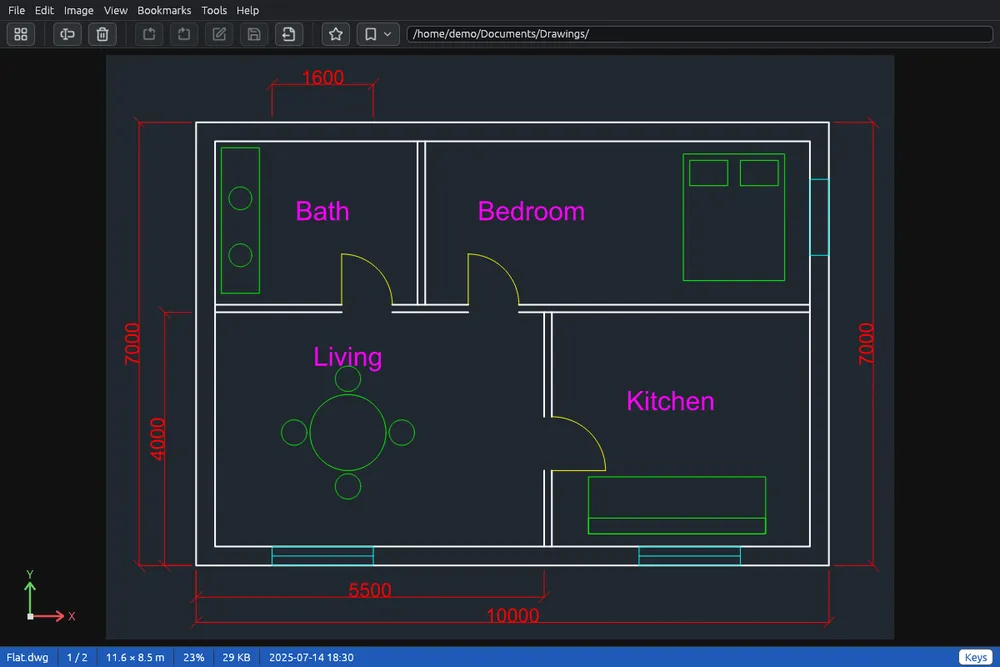

# CAD drawings

AutoCAD drawings (**DWG** and **DXF**) and plotter files (**HP-GL** and **HP-GL/2**: `.plt`, `.hpgl`) appear in the grid with a picture of the drawing as thumbnail, and open in the viewer like a picture.

## Looking at a drawing

Double-click a drawing, or select it and press **Enter**. The drawing is seen from above, as in the model space of a CAD program, on its dark background, with its colours, line types and line weights. Hidden and frozen layers are left out.

| Key or mouse | What it does |
|---|---|
| Mouse wheel, + and − | Zoom in and out |
| Drag | Move the drawing |
| 0 | The whole drawing |
| →, ← | Next, previous file |
| L, Shift+L | Next, previous layout |
| Ctrl+Shift+S | Save as a picture |
| F11 | Full screen |
| Esc, double click | Back to the grid |

When the view stops moving, the part on the screen is drawn again from the drawing, so thin lines and small texts stay sharp at any zoom. The **Keys** button in the status bar lists the keys.

## Layouts

A drawing with layouts (paper space) shows **Model** or the name of the layout in the status bar. **L** goes to the next layout and **Shift+L** to the one before, each with its sheet, title block and viewports onto the model.

## The status bar

A drawing has no pixels: the status bar shows its size in its own unit (as the drawing stores it; millimetres for a plotter file; a large size moves to a larger unit, for example metres instead of millimetres), the layout and the zoom. In the bottom left corner the drawing's X (red) and Y (green) axes show which way they point.

## Texts and pictures

Texts are written with the drawing's SHX fonts when the font files are next to the drawing or in a `fonts` folder there (on Windows also in an AutoCAD installation); otherwise with a font of the system. Pictures attached to the drawing are shown when their files are next to it.

## Saving a drawing as a picture or in the other AutoCAD format

- **Ctrl+Shift+S** or **Save as…** (in the File menu or in the right-click menu) saves the drawing as a picture: in the viewer what you see (the layout shown), in the grid the whole drawing. See [Save as](save-as.md).
- **File > Export drawing…** (also in the right-click menu, in the grid and in the viewer) saves the drawings selected in the grid, or the one in the viewer, all at once. Choose the **format**: a picture format, **SVG** (sharp at any zoom, without layers and blocks), or **DWG** / **DXF** (the whole drawing in the other AutoCAD format, with its layers, blocks, layouts and styles). For pictures choose the **Long side** in pixels: the drawing is drawn again at that size, so it stays sharp even when large. Then choose where the files go, as in [Converting and resizing images](convert.md), and press **Export**.

Pictures and SVG show the model space, not the layouts. A drawing saved as DWG or DXF is read back and compared with the original: if anything would be lost, it is not saved, and the summary at the end says so.

Turning and flipping from the Image menu do not apply to drawings.
