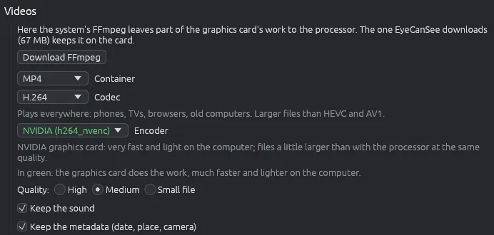

# Converting videos

Converts videos into another format or size, turns them, makes them smaller or turns a short clip into a GIF. Three more tools work on videos without converting them: **Copy with the metadata**, **Copy without sound** and **Save the sound as a file**. The originals are never touched.

## Starting

Select the videos in the grid (pictures can be selected too) and choose  **Convert…** from the toolbar, the **Tools** menu (**Ctrl+B**) or the right-click menu. With videos among the files, the window has a **Videos** part. Turn and flip, size and destination work as for pictures: see [Converting and resizing images](convert.md).

## FFmpeg

Videos are converted by FFmpeg.

- If the computer has FFmpeg 4.3 or later, EyeCanSee uses it. Otherwise the window offers **Download FFmpeg**, with its size: it is downloaded once into the app's data folder and checked before use (see [Add-on components](components.md)).
- If the computer's FFmpeg is too old, the window says which version it found. The same when it cannot read H.264 and HEVC, the formats phones record in (Fedora's own FFmpeg, for example), with the Automatic choice in **Options > Video**. That FFmpeg is still used for what copies the streams as they are, without reading them: **Same as the original**, **Copy with the metadata**, **Copy without sound** and **Save the sound as a file**; the download is offered only when you choose a codec that converts.
- The first time, EyeCanSee checks which encoders work on this computer ("Checking which encoders work on this computer…") and then shows only those.
- When the computer's FFmpeg leaves part of the graphics card's work to the processor, and the choice in **Options > Video** is Automatic, the window says so and offers to download EyeCanSee's own, used from the next start.

## The choices

- **Container**: MP4 (the default), MKV, WebM, MOV, AVI or GIF.
- **Codec**: the ones the container can hold, among H.264 (the default), HEVC, AV1, VP9, VP8, MPEG-4, ProRes and GIF. A line says what the codec chosen is good for. A codec with no working encoder on this computer is greyed out.
- **Same as the original (no re-encoding)**, in MP4, MKV and MOV: video and sound are copied as they are, in seconds and without any loss, with the metadata. Turn and size do not apply.
- **Encoder**: the graphics card's first, in green (NVIDIA, Intel Quick Sync, AMD, VA-API on Linux), then Windows' own and the processor's. The graphics card is much faster and leaves the computer free; the processor makes slightly smaller files at the same quality. A line says what the encoder chosen is good for.
- **Quality**: **High**, **Medium** (the default) or **Small file**.
- **Keep the sound** and **Keep the metadata (date, place, camera)**, both on at first.

With an NVIDIA, Intel Quick Sync or VA-API encoder the graphics card also reads, turns and resizes the video where it can. A video the card cannot read is converted again on the processor, by itself.

## Dashcams and drones

Some dashcams keep the GPS track in a `gps.sqlite` file on the card, and DJI drones write the position in a `.SRT` file beside the video. With **Keep the metadata**, the new video gets the starting point; for dashcams also the altitude and the average and top speed.

## While it works

The box at the bottom right shows how far it got; the bar moves during a long video too. **Cancel** stops at once and deletes the half-made video. Videos on a phone or a server are first copied into a temporary file on this computer, and the result is written back at the end.

## Copy with the metadata

**Tools > Copy with the metadata…** (also in the right-click menu) opens the same window on the videos and pictures chosen, already set on **Same as the original**; the other files chosen are left out and named at the end. You usually only choose where the copy goes. The video is rewritten in seconds, with its metadata inside: for dashcams and drones also the position taken from the files beside it. A picture is copied as it is, with all its metadata; turned or resized in the window, it keeps them as a conversion does.

## Copy without sound and Save the sound as a file

**Tools > Copy without sound…** and **Tools > Save the sound as a file…** (also in the right-click menu) open a short window on the videos chosen, where you only choose the destination. At first it is next to the originals.

- **Copy without sound** makes a new video, the same as the original but without its sound. The picture and the other tracks (subtitles, chapters) are copied as they are, with the metadata. The new file gets a free name, for example `video (2).mp4`.
- **Save the sound as a file** writes each sound track into a file of its own, copied as it is: AAC as `.m4a`, Opus as `.opus`, MP3 as `.mp3`, FLAC as `.flac`, Vorbis as `.ogg`, AC-3 as `.ac3`, E-AC-3 as `.eac3`, AMR as `.amr`, uncompressed sound mostly as `.wav`, the rarer ones as `.mka`. A video with two tracks gives `video.m4a` and `video-2.m4a`. For another format (for example MP3 from AAC), use Convert….

A video without sound is left out and named at the end.

## Things to know

- They work on the computer, on phones and on servers.
- The full table of containers, codecs and encoders is in [docs/video-formats.md](https://github.com/IoSonoPiero/eyecansee/blob/main/docs/video-formats.md).
