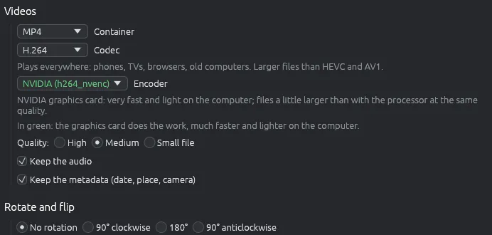

# Converting videos

Converts videos into another format or size, rotates them, makes them smaller or turns a short clip into a GIF. It also converts audio files into another audio format. Three more tools work on videos without converting them: **Copy with the metadata**, **Copy without audio** and **Save the audio to a file**. The originals are not changed: the new files are written beside them or where you choose.

## Starting

Select the videos in the grid (pictures can be selected too) and choose  **Convert…** from the toolbar, the **Tools** menu (**Ctrl + B**) or the right-click menu. When there are videos among the files, the window has a **Videos** section. Rotate and flip and the destination work as they do for pictures; of the sizes only **Unchanged**, **Percent of the original** and **Inside** can be chosen: see [Converting and resizing images](convert.md).

## FFmpeg

Videos are converted by FFmpeg.

- If the computer has FFmpeg 4.3 or later, EyeCanSee uses it. Otherwise the window offers **Download FFmpeg** and shows its size: it is downloaded once into the app's data folder and checked before use (see [Add-on components](components.md)).
- If the computer's FFmpeg is too old, the window says which version it found. It does the same when that FFmpeg cannot read H.264 and HEVC, the formats phones record in (Fedora's own FFmpeg, for example), if the choice in **Tools > Options… > Video** is Automatic. That FFmpeg is still used for the operations that copy the streams as they are, without reading them: **Same as the original**, **Copy with the metadata**, **Copy without audio** and **Save the audio to a file**; the download is offered only when you choose a codec that converts.
- The first time, EyeCanSee checks which encoders work on this computer ("Checking which encoders work on this computer…") and then shows only those.
- When the computer's FFmpeg leaves part of the graphics card's work to the processor, and the choice in **Tools > Options… > Video** is Automatic, the window says so and offers to download EyeCanSee's own, which is used from the next start.

## The choices

- **Container**: MP4 (the default), MKV, WebM, MOV, AVI or GIF.
- **Codec**: those the container can hold, among H.264 (the default), HEVC, AV1, VP9, VP8, MPEG-4, ProRes and GIF. A line says what the chosen codec is good for. A codec with no working encoder on this computer is greyed out.
- **Same as the original (no re-encoding)**: video and audio are copied as they are, in seconds and without any loss, with the metadata. The rotation and the size do not apply. At first the container is the originals' own (a WebM stays WebM), and the list shows only the containers that can hold their streams. Videos of different formats chosen together are copied as MKV, which holds them all. If the chosen container cannot take a video's streams after all, that video is copied as MKV, so the copy does not fail because of that.
- **Encoder**: first those of the graphics card, in green (NVIDIA, Intel Quick Sync, AMD, VA-API on Linux), then Windows' own and those of the processor. The graphics card is much faster and leaves the computer free; the processor makes slightly smaller files at the same quality. A line says what the chosen encoder is good for.
- **Quality**: **High**, **Medium** (the default) or **Small file**.
- **Keep the audio** and **Keep the metadata (date, place, camera)**, both on by default.

With an NVIDIA, Intel Quick Sync or VA-API encoder the graphics card also reads, rotates and resizes the video where it can. If the card cannot read a video, the video is converted again on the processor, automatically.

## Dashcams and drones

Some dashcams keep the GPS track in a `gps.sqlite` file on the card, and DJI drones write the position in a `.SRT` file beside the video. With **Keep the metadata**, the new video gets the starting point; for dashcams also the altitude and the average and top speed.

## While it works

The box at the bottom right shows the progress; the bar moves during a long video too. **Cancel** stops at once and deletes the half-made video. Videos on a phone or a server are first copied into a temporary file on this computer. When the destination is on a phone or a server, the new video is made in a temporary file on this computer and sent there at the end.

## Copy with the metadata

**Tools > Copy with the metadata…** (also in the right-click menu) opens the same window on the chosen videos. Here the window is called **Copy with the metadata** and its button is **Copy**. It is already set to **Same as the original**, in the originals' own container (MKV for videos of different formats), with no rotation or flip. Usually you only choose where the copy goes. The video is rewritten in seconds, with its metadata inside: for dashcams and drones, also the position taken from the files beside it.

It is for videos only: a photo already has its metadata inside its file, so a plain copy (**Edit > Copy** and **Paste**) keeps them. If photos, audio files or other files are chosen together with the videos, the entry is marked with **\***: those files are left out and listed at the end. With no video chosen, the entry is greyed out; point at it to see why.

## Copy without audio and Save the audio to a file

**Tools > Copy without audio…** and **Tools > Save the audio to a file…** (also in the right-click menu) open a short window for the chosen videos. You only choose the destination, which at first is next to the originals, then click **Copy** (or **Save** for the audio).

- **Copy without audio** makes a new video, the same as the original but without its audio. The picture and the other tracks (subtitles, chapters) are copied as they are, with the metadata. The new file gets a name that is not taken yet, for example `video (2).mp4`. The preview that the camera stores inside the video (as a dashcam does) goes into the new file too. If it cannot be written there (for example, because the disk is full), the copy is made again without it, and the summary at the end names that copy.
- **Save the audio to a file** writes each audio track into a file of its own, copied as it is: AAC as `.m4a`, Opus as `.opus`, MP3 as `.mp3`, FLAC as `.flac`, Vorbis as `.ogg`, AC-3 as `.ac3`, E-AC-3 as `.eac3`, AMR as `.amr`, uncompressed audio mostly as `.wav`, the rarer ones as `.mka`. A video with two tracks gives `video.m4a` and `video-2.m4a`. For another format (for example MP3 from AAC), use Convert… on the new file (see below).

A video without audio is left out and listed at the end.

## Converting audio files

**Convert…** works on audio files too, even many at once: when there are audio files among the files chosen, the window has an **Audio files** section. Choose the **Format** (MP3, AAC (M4A), Opus, FLAC, WAV or Ogg Vorbis; only those that the FFmpeg in use can write are listed) and, except for FLAC and WAV, which lose nothing, the **Quality**. Then the destination, as for pictures, and **Convert**. The originals are not touched: each new file has the original's name with the new extension, for example `song.mp3` from `song.flac`.

The tags (title, artist, album, track…) are kept. The cover is kept too in MP3, M4A and FLAC; Opus, Ogg Vorbis and WAV have no room for it. As with videos, FFmpeg is needed: if the computer does not have it, the window offers to download it.

## Things to know

- Conversion and these tools work on the computer, on phones and on servers.
- The full table of containers, codecs and encoders is in [docs/video-formats.md](https://github.com/IoSonoPiero/eyecansee/blob/main/docs/video-formats.md).
