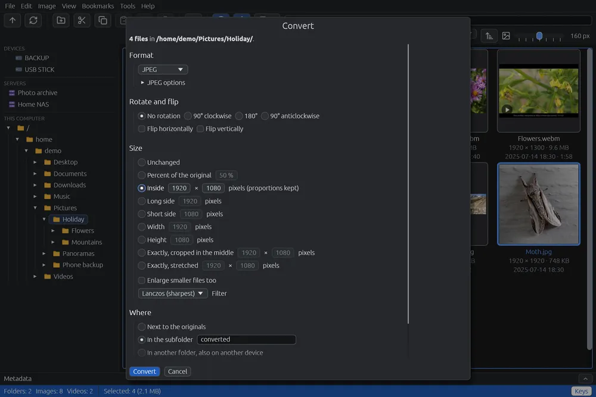

# Converting and resizing images

Converts many pictures at once: into another format, smaller or larger, rotated or flipped, into the same folder, a subfolder or another folder, also on another device. The originals are not changed: the new files are written beside them or where you choose.

Convert works on the files selected in the grid, as they are on disk, all with the same settings. For one image, as you see it in the viewer or the editor, with the name you choose, there is [Save as](save-as.md).

For one image with a live preview use [Save as](save-as.md). Videos go through the same window: see [Converting videos](convert-video.md).

## Starting

1. In the grid, select the pictures (see [Selecting files](selection.md)). With nothing selected, the image under the cursor is used.
2. Click  in the toolbar, or choose **Tools > Convert…** (**Ctrl + B**), or right-click one of the selected files and choose **Convert…**. The window opens at the format choice, with the size **Unchanged** and no rotation or flip; **Resize > Custom…** opens it at the size choice (see below).
3. Make your choices in the window and click **Convert**.

The window works on pictures, videos and audio files (see [Converting videos](convert-video.md)). Other files you selected (3D models, CAD drawings) are left out: the window says how many, the summary at the end which ones. It does not work from the viewer, and only one conversion runs at a time.

## Resizing in one click

To only make smaller copies of photos, without the window: right-click the selected files, or open **Tools**, and choose **Resize** and one of its sizes: **Small (long side 1280 px)**, **Medium (long side 1920 px)**, **Large (long side 2560 px)** or **Half (50%)**. You can change the sizes in **Tools > Options… > Resize** (see [Options](options.md)).

The work starts at once on every picture chosen, with the same box and **Cancel** as below and the summary at the end. The copies go next to the originals, in their format and with their metadata (an **Ultra HDR** photo stays Ultra HDR), with the size in their names: `photo (1920 px).jpg`, `photo (50%).jpg`. A name already taken gets " (2)". Pictures already of that size, or smaller (they are never enlarged), get no copy, and the message names them: so resizing a copy again does not make `photo (1920 px) (1920 px).jpg`. Pictures in a format EyeCanSee cannot write (HEIC, RAW…) are left out, and the message says why. Videos, 3D models, CAD drawings and audio files are left out too, and the message names them. If some of them are among the files chosen, **Resize** is marked with **\***; if no picture is chosen, it is greyed out.

**Resize > Custom…** opens this window on the pictures, at the rotation and size choices. Here the window is called **Resize** and its button is **Resize**; the format is **Same as the original** and the copies go next to the originals. It starts from the size and the rotation of the last Custom… (by default **Long side** 1920 px, no rotation); **Convert…** instead always starts from **Unchanged**, with no rotation or flip. As with the sizes above, the copies of the pictures that are really resized have the size in their names (those only rotated or flipped say what was done), in whatever format and wherever they go:

| Size | Name of the copy |
|---|---|
| Long side, Short side, Width or Height of 600 px | `photo (600 px).jpg` |
| Inside 800 × 600 | `photo (800x600).jpg` |
| Percent of the original, 50 | `photo (50%).jpg` |
| Exactly 800 × 600, cropped or stretched | `photo (800x600).jpg` |
| Unchanged, rotated (flipped too or not) | `photo (rotated).jpg` |
| Unchanged, only flipped | `photo (flipped).jpg` |

With a size and a rotation, the name says only the size. A picture left at its size (already smaller than the size asked, not enlarged) keeps its own name: in another format only its extension changes, `photo.png`. A name already taken gets " (2)" after it: `photo (600 px) (2).jpg`, `photo (rotated) (2).jpg`.

## Format

- **Same as the original**: each image stays in its own format and is written as Save writes it (a JPEG keeps its own quality). Images in a format EyeCanSee cannot write (HEIC, RAW…) are left out.
- One of the formats of [Save as](save-as.md). Its options are under **JPEG options** (with the name of the format you chose): click the title to open them. **Metadata** is there too: all, all but the place, or none but the colour profile, as in [Save as](save-as.md).
- **Ultra HDR** phone photos stay HDR only in JPEG. When JPEG photos are among the files and you choose another format, the window warns you.

## Rotate and flip

- **No rotation**, **90° clockwise**, **180°** or **90° anticlockwise**.
- **Flip horizontally** and **Flip vertically**. With a rotation too, the flips come first, then the rotation.
- JPEG photos that are only rotated, in their own format, are rotated without losing quality when their size allows it, as Save does.

## Size

- **Unchanged**.
- **Percent of the original** (50% by default).
- **Inside** a box of pixels (1920 × 1080 by default): each image is made as large as will fit in the box, keeping its proportions, after the rotation.
- **Long side**, **Short side**, **Width** or **Height** of a given number of pixels, keeping the proportions: a long side of 1920 makes landscape and portrait photos alike 1920 pixels on their longer side.
- **Exactly, cropped in the middle**: exactly the size written; what does not fit the proportions is cut off equally on both sides.
- **Exactly, stretched**: exactly the size written, with the picture stretched or squeezed to fit.
- With videos among the files chosen, only **Unchanged**, **Percent of the original** and **Inside** can be chosen: the other sizes are for pictures only.
- **Enlarge smaller files too**: off by default, so images already smaller than the size asked stay as they are (with an exact size, no side grows larger than the original's). In the format **Same as the original**, a picture that would come out the same as the original gets no copy, and the message names it.
- **Filter**, how the new pixels are worked out: **Lanczos** (sharpest, the default), **Catmull-Rom**, **Gaussian** (soft), **Bilinear** (fast), **Nearest pixel** (keeps the hard edges of pixel art).

If nothing would change (same format, same size, no rotation), **Convert** (or **Resize**) stays off and a red line says so: the images would only lose quality.

## Where

- **Next to the originals**.
- **In the subfolder**, with the name you write ("converted" by default). It is created if it does not exist.
- **In another folder, also on another device**: type a folder or an address as in the address bar (`mtp://…` for a phone, `sftp://…` for a server), or click **Browse…**. The chooser shows your home folder, the disks, the connected phones and the saved servers on the left: click a folder to go into it, then **Use this folder**. A saved server opens in the folder it starts in, as in the grid.  next to the address makes a new folder there: a small window asks for its name, as **New folder** does in the grid ("New folder" already written and selected); type the one you want, then **Enter** or **Create**. The chooser then goes into it.

A name already taken gets " (2)": nothing is ever written over a file. So you can, for example, convert the photos of a phone straight into a folder of the computer.

The window remembers the choices you confirm until EyeCanSee is closed. **Cancel** (or **Esc**) forgets those made since it opened: the next time it opens as it was before.

## While it works

A box at the bottom right shows how many files are done, a bar and the file being worked on, with **Cancel**. You can go on using EyeCanSee meanwhile. Cancel stops after the current image.

At the end a summary, titled with the command, says:

- how many files were saved, and where; how many were saved as JPEG without a part of their metadata (EXIF, XMP or IPTC) too large for it, each named in a group with that part in brackets; how many were left out; how many were not done, when you stopped the work (a count of zero is not shown);
- how long it took and, when files were saved, their size on disk before and after, with the percentage;
- the files left out, grouped by reason (another kind of file, a format EyeCanSee cannot write, already of that size, animated or with several pages, too large for the memory of this computer, FFmpeg missing, an error), each group with its file names, in order. A group of more than five files is collapsed: click its line to expand it. The list scrolls when it is long.  at the right of the buttons copies the summary with every file left out, including those in collapsed groups.
- after them, for **Copy without audio**, the copies saved without the preview stored by the camera, which could not be written into them (see [Converting videos](convert-video.md)).

**Open the folder** shows the thumbnails of the folder where the files went, on this computer, a phone or a server; it is there only when something was saved in a folder other than the one on screen, and it is greyed out while a page (the editor, Save as, the slideshow or the duplicates) covers the thumbnails. **Close**, **Enter** or **Esc** close the summary.

When a copy or a move ends while this summary is open, or ends with something to say while the work runs, there is one report, **Jobs finished**, with a part for each job in the order they ended: **Enter** or **Esc** close it all. Its **Open the folder** shows the folder of the conversion; when the conversion has none, the one of a copy that went to a folder not on screen. A message that comes while another is open waits for it to close.

## Things to know

- Animated images and images with several pages are left out: the new file would keep only the first picture.
- A picture that would need more than half of the computer's memory once read whole (for example a HEIC, a 16-bit TIFF or a JPEG XL of hundreds of megapixels, on a computer with 8 GB) is left out, without asking: the summary lists it. A picture you chose to open anyway since EyeCanSee started (in the viewer, the editor, Save as or when saving a rotation) is not left out, nor is a JPEG only rotated or flipped without losing quality, which is not decoded. For a file larger than 32 MB, only the start is read, when the size of the picture is written there.
- A phone's motion photo keeps its video only when it is just rotated and stays a JPEG; otherwise the new file is the picture alone, and the video stays in the original.
- It works on every source: the computer, disks, phones and servers.
- In the window **Enter** starts the conversion (when no field is being typed in) and **Esc** cancels.
