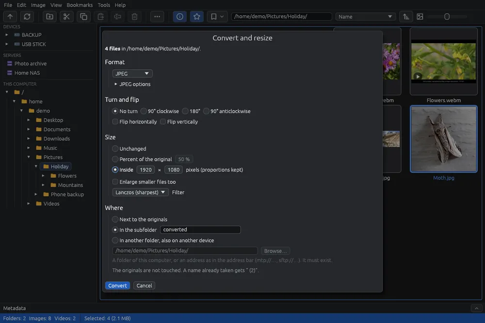

# Converting and resizing images

Converts many pictures at once: into another format, smaller or larger, turned or flipped, into the same folder, a subfolder or another folder, also on another device. The originals are never touched: the new files are written beside them or where you choose.

For one image with a live preview use [Saving in another format](save-as.md). Videos go through the same window: see [Converting videos](convert-video.md).

## Starting

1. In the grid, select the pictures (see [Selecting files](selection.md)). With nothing selected, the image under the cursor is used.
2. Click  in the toolbar, or choose **Tools > Convert and resize…** (**Ctrl+B**), or right-click one of the selected files and choose **Convert and resize…**.
3. Make your choices in the window and click **Convert**.

The window works on pictures and videos. Other files you selected (3D models, CAD drawings, audio files) are left out, and the window says how many. It does not work from the viewer, and only one conversion runs at a time.

## Format

- **Same as the original**: each image stays in its own format and is written as Save writes it (a JPEG keeps its own quality). Images in a format EyeCanSee cannot write (HEIC, RAW…) are left out.
- One of the formats of [Saving in another format](save-as.md). Its options are under **JPEG options** (or the name of the format you chose): click the title to open them. **Keep the metadata** is there too.
- **Ultra HDR** phone photos stay HDR only in JPEG. When JPEG photos are among the files and you choose another format, the window warns you.

## Turn and flip

- **No turn**, **90° clockwise**, **180°** or **90° anticlockwise**.
- **Flip horizontally** and **Flip vertically**. With a turn too, the flips come first, then the turn.
- JPEG photos that are only turned, in their own format, are turned without losing quality when their size allows it, as Save does.

## Size

- **Unchanged**.
- **Percent of the original** (50 % at first).
- **Inside** a box of pixels (1920 × 1080 at first): each image is made as large as fits in the box, keeping its proportions, after the turn.
- **Enlarge smaller files too**: off at first, so images already smaller than the size asked stay as they are.
- **Filter**, how the new pixels are worked out: **Lanczos** (sharpest, the default), **Catmull-Rom**, **Gaussian** (soft), **Bilinear** (fast), **Nearest pixel** (keeps the hard edges of pixel art).

If nothing would change (same format, same size, no turn), **Convert** stays off and a red line says so: the images would only lose quality.

## Where

- **Next to the originals**.
- **In the subfolder**, with the name you write ("converted" at first). It is created if missing.
- **In another folder, also on another device**: type a folder or an address as in the address bar (`mtp://…` for a phone, `sftp://…` for a server), or click **Browse…**. The chooser shows your home folder, the disks, the connected phones and the saved servers on the left: click a folder to go into it, then **Use this folder**. The folder must already exist.

A name already taken gets " (2)": nothing is ever written over a file. So you can, for example, convert the photos of a phone straight into a folder of the computer.

The window remembers your choices until EyeCanSee is closed.

## While it works

A box at the bottom right shows how many files are done, a bar and the file under way, with **Cancel**. You can go on using EyeCanSee meanwhile. Cancel stops after the image under way.

At the end a message says how many files were saved and where, and which were left out and why.

## Things to know

- Animated images and images with several pages are left out: the new file would keep only the first picture.
- A phone's motion photo keeps its video only when it is just turned and stays a JPEG; otherwise the new file is the picture alone, and the video stays in the original.
- It works on every source: the computer, disks, phones and servers.
- In the window **Enter** starts the conversion (when no field is being typed in) and **Esc** cancels.
