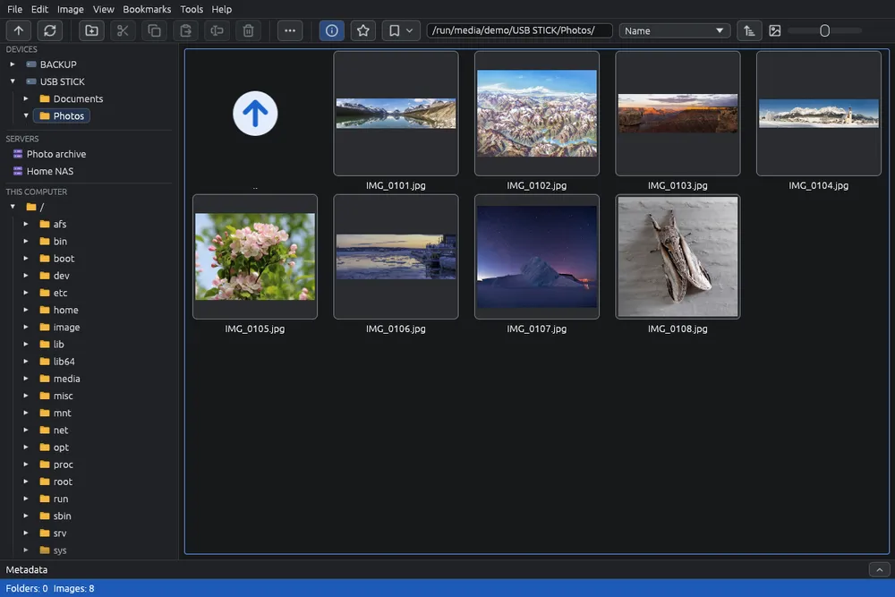

# Disks and USB sticks

External disks, USB sticks and memory cards appear in the panel on the left as soon as you connect them, and work like the folders of the computer: browse, view, copy, move, delete and convert. Phones have a page of their own: [Android phones](phone.md).

## Where they appear

- When you connect a disk, a USB stick, a memory card or a phone, the **Devices** block appears at the top left, with its folders to expand like the tree. Disks have the  icon, phones .
- Under **This computer** is the folder tree of the computer; on Windows also its own drives ().
- Click a device to open it on the right. When you disconnect it, it disappears; if you were looking at it, EyeCanSee goes back to your home folder.

## On Linux

- External disks appear wherever the system mounts them, also in `/mnt`.
- A partition the system did not mount by itself (for example because it has its own line in `/etc/fstab`) appears with a dimmed name: one click mounts it and opens it. If needed, the system asks for your password.
- Cameras and iPhones open through the desktop's connection.

## On Windows

- USB sticks, memory cards and disks connected by USB appear with the name they have in File Explorer, for example "Backup (D:)".
- The internal drives (C: and any others) are under **This computer**: one click opens another drive.
- Network drives and CDs or DVDs do not appear in the panel: open them with **File > Open location…**, for example `E:\` (see [Address bar and Open location](address.md)).
- USB sticks, memory cards and network drives have no Recycle Bin: a file deleted there goes into a hidden `.EyeCanSee-trash` folder next to it, which you can open from EyeCanSee (see [Deleting and the trash](delete.md)).

## Things to know

- Thumbnails of a device stay in the cache after you disconnect it, so it opens quickly the next time.
- Folders on this computer and on disks update by themselves: files added, deleted or renamed by another program appear and disappear without F5.
- On Linux, a folder opened through the file manager's connection (gvfs, for example a network folder opened from the Files app) is never saved over: there replacing a file can lose the original. Use **Save as…** instead.
- On Linux, on an **NTFS** disk the Files app cannot restore from the trash: see [Known limits](limits.md).
