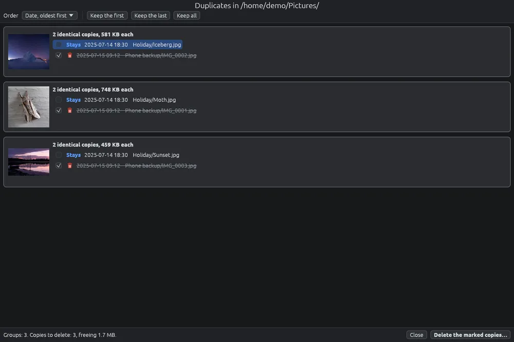

# Finding duplicates

Finds identical files in a folder and its subfolders, so you can delete the extra copies and free space. Identical means the same file byte for byte, also under another name or in another folder. Photos that were resized, converted or saved again are not identical, and are not found. It works on every source: the computer, external disks, phones and servers.

## Searching

1. Open the folder to search, or right-click a folder.
2. Click  in the toolbar, or choose **Tools > Find duplicates…** (**Ctrl+D**), or **Find duplicates…** from the right-click menu of a folder or of an empty spot of the grid.
3. Choose whether to look **Also in subfolders** (on at first).
4. Click **Search** (or press **Enter**; **Esc** cancels).

A window shows how many files have been examined out of those found, and how much has been read; **Cancel** stops the search. Only files with the same size are read and compared, so on a computer it is quick. On a phone every file that could be a copy is read in full, and it takes time: the window says so.

Trash folders and hidden folders are left out. A folder or a file reached again through a link counts once: it is the same file, not a copy.

## The results

The results fill the window. Every group of identical files has its thumbnail and one line per copy, with its date and its path below the folder searched (the full path when you point at it).

- The box on each line means **Delete this copy**. A click on the text of the line ticks or unticks it too.
- The copies to delete are faded and struck through; the one that stays says **Stays**.
- At least one copy of every group always stays: the last box left unticked cannot be ticked.
- Click a thumbnail to open the image in the viewer; **Esc** brings you back to the results.

## Choosing which copy stays

At the start every group keeps its first copy and marks the others. **Order** decides which copy is first, for all the groups:

- **Date, oldest first** (the default): to the minute, as shown; with the same date, the shorter path.
- **Shortest name**: copies usually have something added to the name, such as "photo copy.jpg" or "photo (2).jpg", so the original stays even when the dates are the same.
- **Path**: alphabetical order of folder and name.

**Keep the first**, **Keep the last** and **Keep all** mark every group at once; then you can change single boxes.

## Deleting

The line at the bottom says how many groups there are, how many copies will be deleted and how much space is freed. **Delete the marked copies…** asks for confirmation and deletes them as **Del** does: to the trash, to the folder's own trash, or for good, as set in the options (see [Deleting and the trash](delete.md)). **Close** or **Esc** closes the results.

## Keys

| Key | Action |
|---|---|
| ↑, ↓ | Move between the copies of all the groups |
| Space | Tick or untick the copy |
| Esc | Close the results |

Enter does not delete: only the **Delete the marked copies…** button does.
