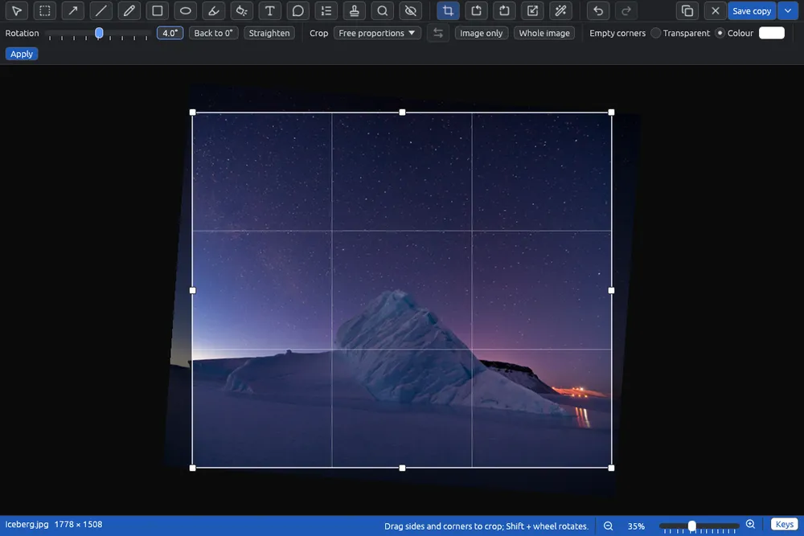

# Crop and rotate

 **Crop and rotate** (C) straightens the image, rotates it by any angle and crops it to the part you want. **Image > Rotate and crop…** opens the editor with this tool already chosen.

With this tool the whole image is shown, with the crop frame over it and the parts outside darkened. With the other tools you see only the result.

## Rotating

- **Rotation**: use the slider, or type the degrees in the box next to it, from -180° to 180° in tenths of a degree, with a mark every 45°. Both a dot and a comma work.
- Hold Shift and turn the mouse wheel over the image: 0.1° per notch. Handy for lining up a horizon with the thirds lines.
- **Back to 0°** sets the angle back to 0°.
-  and  in the toolbar (**Ctrl + Shift + R**, **Ctrl + R**) rotate the image by a quarter turn, together with what is drawn on it and the crop.

## Straighten

1. Click **Straighten**.
2. Draw a line along the horizon, or along something upright such as a wall.
3. When you let go, the image rotates to make that line level (or upright), and Straighten turns itself off.

## Cropping

- Drag a corner or a side of the frame to resize it. Drag inside the frame to move it. Dragging outside the frame moves the view.
- **Crop**: the proportions. **Free proportions**, **As the original**, 1:1, 5:4, 4:3, 3:2, 16:9, or **Custom** with your own numbers. With fixed proportions only the corners can be dragged.
-  turns landscape proportions into portrait ones and back.
- **Image only**: the largest crop with no empty corners. It follows the rotation, and it is chosen at first.
- **Whole image**: all of the rotated image, with empty corners.

The size of the result is in the status bar. The crop stops at 20,000 pixels a side (or at the size of a larger photo), and the status bar says so.

## Empty corners

Where the crop goes past the image, the corners are **Transparent** (shown as grey squares) or filled with a **Colour** you choose. JPEG has no transparency: there they become white.

## Apply

**Apply** (or Enter) goes back to the tool you used before and shows the cropped result. **Ctrl + Z** undoes the crop.

## Good to know

- Esc during a drag puts the crop back as it was; otherwise Esc with this tool closes the page (asking first if there are unsaved changes).
- You can come back to this tool and change the rotation and the crop at any time.
- An Ultra HDR photo stays HDR: its HDR part is rotated and cropped together with the photo.
- To only rotate or flip an image in the viewer, without the editor, see [Rotating and flipping](rotate.md).
