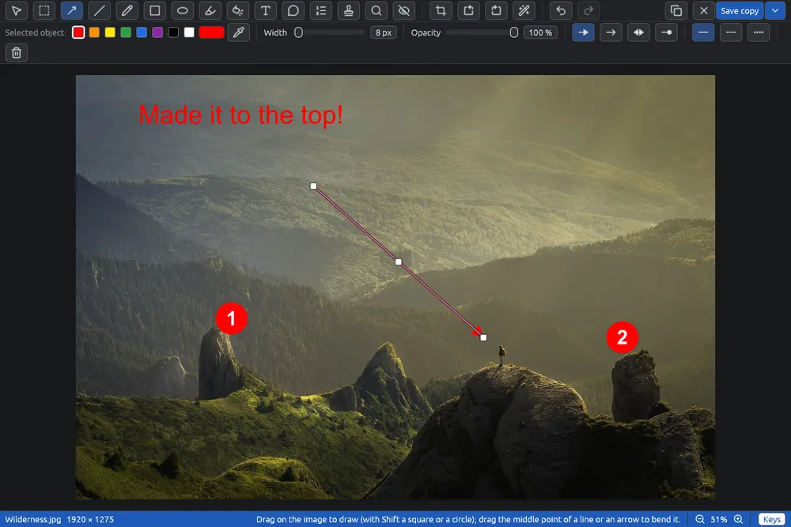

# Editing an image

The editor is a page of its own where you draw on one image, cover private details, add filters, and rotate and crop it. The original file is never changed unless you choose to overwrite it.

## Opening the editor

- **Image > Edit image…** (Ctrl+E), the  button on the toolbar, or **Edit image…** in the right-click menu.
- **Image > Rotate and crop…** opens the same page with the crop tool already chosen. See [Crop and rotate](editor-crop.md).
- **File > New image…** (Ctrl+N) opens an empty image in the editor. See [New image](new-image.md).

The editor works on one image at a time. With several images selected, these items are off; to turn several images at once use [Rotating and flipping](rotate.md) or [Converting and resizing images](convert.md). They are also off for an animated image or one with several pages, because only the first picture would be saved.

## The page

- **Toolbar** (top): one button per tool, then  and , ,  and . On the right: ,  and **Save copy** with its arrow . The tool in use is highlighted. Point at a button to see its name and key; on a button that is off you also see why.
- **Properties bar** (under the toolbar): the style of the selected object, or of the next one the tool will draw. With the crop tool it holds the crop controls. See [Colours, lines and the eyedropper](editor-colors.md).
- **Status bar** (bottom): the file name, the size of the result in pixels, a short hint for the tool, the zoom, and the **Keys** button.

## The tools

| Tool | Key | Page |
|---|---|---|
|  Select | V | this page |
|  Selection | M | [Selecting an area](editor-marquee.md) |
|  Arrow | A | [Lines and arrows](editor-lines.md) |
|  Line | L | [Lines and arrows](editor-lines.md) |
|  Freehand | P | [Pen, highlighter and shapes](editor-draw.md) |
|  Rectangle | R | [Pen, highlighter and shapes](editor-draw.md) |
|  Ellipse | E | [Pen, highlighter and shapes](editor-draw.md) |
|  Highlighter | H | [Pen, highlighter and shapes](editor-draw.md) |
|  Spotlight | S | [Magnifier and spotlight](editor-lens.md) |
|  Text | T | [Text, bubbles and steps](editor-text.md) |
|  Speech bubble | U | [Text, bubbles and steps](editor-text.md) |
|  Step numbers | N | [Text, bubbles and steps](editor-text.md) |
|  Stamps | K | [Stamps](editor-stamps.md) |
|  Magnifier | Z | [Magnifier and spotlight](editor-lens.md) |
|  Cover | B | [Covering parts of an image](editor-cover.md) |
|  Crop and rotate | C | [Crop and rotate](editor-crop.md) |

The tool keys are single letters, without Ctrl. They do nothing while you are typing in a field.

## Selecting and changing objects

Everything you draw stays a separate object until you save: you can move it, change its style or delete it at any time.

1. Choose  **Select** (V).
2. Click an object to select it. The properties bar shows its style; change it there.
3. Drag the object to move it. Drag a corner or an end to resize it; hold Shift to keep the proportions of a box.
4. Press **Del**, or click  in the properties bar, to remove it.

Good to know:

- With a drawing tool, a click selects only an object of that tool's kind (an arrow with Arrow, a step with Step numbers). Anywhere else the tool does its own work, even on top of other objects.
- The corners of the selected object can be dragged with any tool.
- A rectangle or an ellipse with no fill is picked by its border, not by its empty inside.
- Filters, highlighters and spotlights lie under the other objects: a click picks them only where no other object is.
- Objects are stacked in the order you draw them.
- Changing tool lets go of the selected object (except when you choose Select).

## Undo and redo

 **Undo** (Ctrl+Z) and  **Redo** (Ctrl+Y or Ctrl+Shift+Z) go back and forward through every change, rotation and crop included. While you type in a text field, Ctrl+Z undoes the typing in that field.

## Moving around the image

- Mouse wheel (or Ctrl+wheel, or a pinch): zoom around the pointer.
- **+** and **−**: zoom around the middle. **0**, a click on the percentage, or a double click: everything in view.
- Drag with the right or middle button to move the view. With Select, dragging on an empty spot moves the view too.
- The zoom buttons  and  are in the status bar.

## Keys

The **Keys** button in the status bar lists the keys and mouse moves of the tool in use. Point at it to see the list, or click it to keep the list open.

- **Ctrl+C** (or  **Copy**) puts the whole result, at full size, on the clipboard, to paste in another program. With Selection it copies only the chosen part.
- **Ctrl+R** and **Ctrl+Shift+R** turn the image a quarter to the right or left.
- **Esc** does one thing at a time: it stops the eyedropper or a drag, ends the text being typed, lets go of the selected area or object. When there is nothing left to stop, it closes the page.

## Closing

 **Close**, the window's ✕ or Esc close the page. With changes not saved, EyeCanSee first asks whether to **Save…** (a copy, as Save copy does), **Save as…** or **Don't save**; **Cancel** goes back to the page. See [Saving an edited image](editor-save.md).

## Phones and servers

An image on a phone or a server is edited in a copy on this computer, and the status bar says so. When you save, the result is sent back. See [Saving an edited image](editor-save.md).
