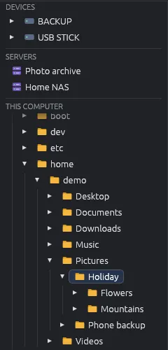

# Folders and the side panel

The panel on the left of the window takes you to every place EyeCanSee can open: the folders of this computer, your disks and phones, and your saved servers. You can make it wider or narrower by dragging its right edge.

## The parts of the panel

- **Devices**: the disks, USB sticks, SD cards  and Android phones  connected to the computer. This part appears only when something is connected. See [Disks and USB sticks](devices.md) and [Android phones](phone.md).
- **Servers**: the servers saved in **File > Server manager…** . See [Servers (FTP and SFTP)](servers.md).
- **This computer**: the folder tree of this computer. On Windows the drives of the computer  are here too.

## Opening a folder

Click the name of a folder: the grid shows what is inside it, and the folder opens in the tree to show its subfolders. The small arrow in front of a folder opens or closes it without changing the folder shown in the grid. A folder's subfolders are read only when you open it, so phones and servers stay quick.

When you change folder in another way (from the grid, the address bar or a bookmark), the tree opens down to that folder and highlights it.

## Devices and servers

- A click on a device opens it. On Linux a disk that the system has not opened yet has a dimmed name: a click opens it.
- A click on a saved server connects to it and opens its folder. A right click offers **Close connection** and **Edit…**. If your saved servers are protected by a master password, the panel shows **Unlock the saved servers…** until you type it (see [Saved passwords](passwords.md)).
- While a phone or a server is open, **This computer** shows your home folder  and the last folder of the computer you were in (with a server or a phone opened directly, also the drives of the computer): one click takes you back there.

## The right-click menu of a folder

A right click on a folder in the tree offers **Open**, **New folder inside…**, **Cut**, **Copy**, **Paste into this folder** (when you have copied something), **Add this folder to the bookmarks** (see [Bookmarks](bookmarks.md)), **Find duplicates…**, **Rename…**, **Delete…** and **Delete for good…**. See [Copying and moving](copy-move.md), [Renaming and new folders](rename.md), [Deleting and the trash](delete.md) and [Finding duplicates](duplicates.md).

The top folder of a disk, a phone or a server, and the storages of a phone, cannot be renamed or deleted; they can become bookmarks.

## Keys

In the folder tree:

| Key | What it does |
|---|---|
| Down, Up | Next, previous folder |
| Right | Opens the folder; if it is already open, goes to its first subfolder |
| Left | Closes the folder; if it is already closed, goes to the folder above |
| Backspace | Parent folder |

Among the devices: **Down** and **Up** change device (Down on an open device enters its first folder), **Right** and **Left** open and close it, **Enter** opens it in the grid.

**Tab** goes round the parts of the window: in the grid it goes to the next item, and from the last one to the devices; among the devices to the next one, and from the last one to the tree; in the tree to the next folder, and from the last one back to the grid. **Shift+Tab** goes the other way. The part that receives the keys has a thin frame, and its selection is solid blue; in the other parts the selection is paler.
