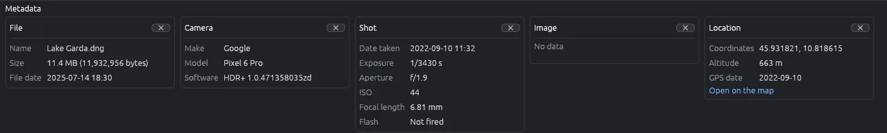

# Image information

Under the grid, the metadata panel shows what is known about the selected file: its name and size, and what the camera or phone wrote in it (when, with which camera, where).

## The boxes

- **File**: name, size (also in bytes), file date and size in pixels. Every file has it, also without metadata.
- **Camera**: make, model, lens and software.
- **Shot**: date taken, exposure, aperture, ISO, focal length and flash.
- **Image**: format, width and height, colour and bits per channel, colour space. For a Camera RAW photo they are those of the picture EyeCanSee develops from it (cut as the camera says); an SVG drawing has its own size and no colour or bits.
- **Location**: GPS coordinates and altitude, with **Open on the map**, which opens the place on OpenStreetMap in your browser.

A box shows "No data" when the file has nothing for it, and "This file contains no metadata" when the file has no metadata at all.

## Videos

For a video the panel shows, when the file has them: make and model of the phone or camera (and the Android version), date and time of recording, length, frame rate, size, video and audio format, bit rate, and the place where the video was taken. Some dashcams keep their GPS track in a file beside the videos: then the panel shows where the video starts, the altitude, and the average and top speed during the video. See [Playing videos](video.md).

## Showing and hiding the boxes

- Each box closes with its  and reopens from **View > Metadata boxes**.
-  in the toolbar closes all the boxes when one is open, and opens them all again otherwise.
-  at the right of the panel's title bar, or a click on the title bar, collapses the panel to just its bar and opens it again. While the panel is collapsed, the metadata is not read.

EyeCanSee remembers which boxes are open and whether the panel is collapsed.

## Good to know

- The panel follows the selected file in the grid; it is not shown in the viewer. The viewer's status bar shows the date taken once the metadata have been read in the grid (see [Viewing images](viewer.md)).
- To read the metadata EyeCanSee reads the file again, so on a phone or a server it takes a moment. Once read, it is kept with the thumbnails and shows at once the next time, until the file changes.
- When you convert or save a picture, its metadata is kept in the new file where the format allows it. See [Saving in another format](save-as.md).
