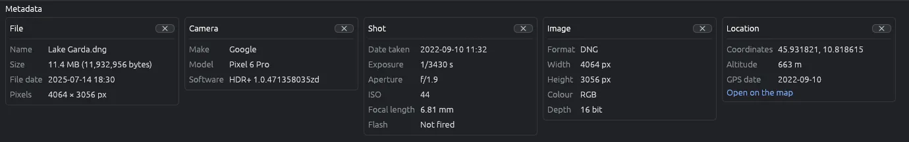

# Image information

Under the grid, the metadata panel shows what is known about the selected file: its name and size, and what the camera or phone wrote in it (when, with which camera, where).

## The boxes

- **File**: name, size (also in bytes), file date and size in pixels. Every file has it, also without metadata. The same details appear when you rest the mouse on a file in the grid (see [The thumbnail grid](grid.md)).
- **Camera**: make, model, lens and software.
- **Shot**: date taken, exposure, aperture, ISO, focal length and flash.
- **Image**: format, width and height, colour and bits per channel, colour space. For a Camera RAW photo they are those of the picture EyeCanSee develops from it (cut as the camera says); an SVG drawing has its own size and no colour or bits.
- **Location**: GPS coordinates and altitude, with **Open on the map**, which opens the place on OpenStreetMap in your browser.
- **Description**: what was written about the photo in its XMP: title, caption, keywords, rating (from 1 to 5, or rejected), colour label, author and copyright.

## Photos and their .xmp files

Lightroom, Camera Raw, darktable and digiKam keep what you set about a photo (rating, label, keywords, title, position) in a small file beside it, with the same name and the `.xmp` extension, a "sidecar": always for a RAW photo, which they do not write into, and for any photo with darktable, or with digiKam when set so. EyeCanSee reads it for every photo: the Description box and the Location box show what it holds, and the box says which file it came from.

- **The names**: `IMG_0001.CR2.xmp` (darktable, digiKam) and `IMG_0001.xmp` (Lightroom, Camera Raw, digiKam "compatible with commercial programs"). With both, the first counts, since it cannot belong to another file.
- **Whose `IMG_0001.xmp` is**: the file whose extension it names, when it names one (Lightroom does); otherwise the RAW photo with that name, if there is one (Lightroom treats a JPEG taken with a RAW as part of the RAW); otherwise the photo with that name.
- **With the XMP inside the photo**: a RAW photo's .xmp file counts instead of it, as in Lightroom; for the other photos the two add up, and where both say something the .xmp file counts, as in digiKam. Its position counts instead of the camera's.

When you convert a photo or save it in another format, what the .xmp file holds goes into the new file, so the copy keeps it on its own (for a RAW photo the position goes into its EXIF too). The development settings of Lightroom, Camera Raw and darktable in the .xmp file are left out: they are not in the pixels EyeCanSee writes.

The .xmp files are not shown in the grid, and they follow their photo: when you copy, move, rename or delete it, and when you restore it from EyeCanSee's trash. See [Copying and moving](copy-move.md).

A box shows "No data" when the file has nothing for it, and "This file contains no metadata" when the file has no metadata at all.

## Videos

For a video the panel shows, when the file has them: make and model of the phone or camera (and the Android version), date and time of recording, length, frame rate, size, video and audio format, bit rate, and the place where the video was taken. Some dashcams keep their GPS track in a file beside the videos: then the panel shows where the video starts, the altitude, and the average and top speed during the video. See [Playing videos](video.md). These details are read by the video engine, for audio files too: without it the panel shows only the File box and, beside it, a note that says so and how to download it, see [Add-on components](components.md).

## Showing and hiding the boxes

- Each box closes with its  and reopens from **View > Metadata boxes**.
-  in the toolbar closes all the boxes when one is open, and opens them all again otherwise.
-  at the right of the panel's title bar, or a click on the title bar, collapses the panel to just its bar and opens it again. While the panel is collapsed, the metadata is not read.

EyeCanSee remembers which boxes are open and whether the panel is collapsed.

## Good to know

- The panel follows the selected file in the grid; it is not shown in the viewer. The viewer's status bar shows the date taken once the metadata have been read in the grid (see [Viewing images](viewer.md)).
- To read the metadata EyeCanSee reads the file again, so on a phone or a server it takes a moment. Once read, it is kept with the thumbnails and shows at once the next time, until the file changes.
- When you convert or save a picture, its metadata, the resolution (dpi) included, is kept in the new file where the format allows it. See [Save as](save-as.md).
