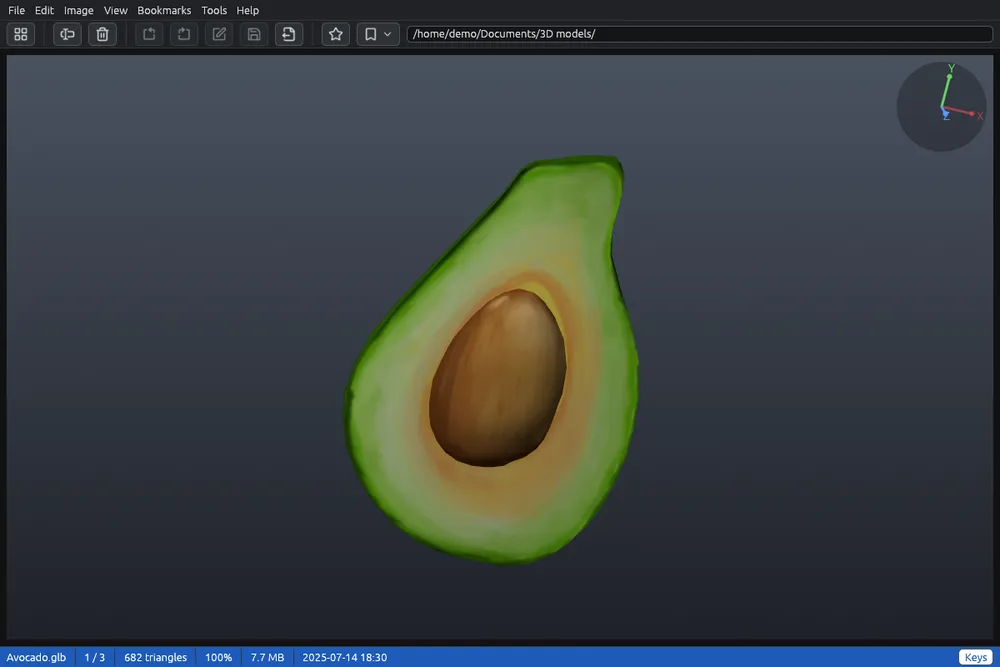

# 3D models

3D models appear in the grid next to the pictures, with a picture of the model as thumbnail. In the viewer the graphics card draws them, and you can turn them and look at them from every side.

## Which models

- **STL**, **3MF** and **AMF** (3D printing), **OBJ** (with the colours of its materials, from the `.mtl` file next to it), **PLY** (also 3D scans; point clouds show as dots).
- **glTF** (`.glb`, and `.gltf` with its files), **FBX**, **Collada** (`.dae`, `.zae`), **3DS**, **OFF**, **VRML** and **X3D**.
- **IFC**: building models (walls, slabs, windows, structures) in their colours.
- **STEP**, **IGES** and **BREP**, the solid models of mechanical CAD programs. They need the CAD engine, downloaded once: the first one you open offers it, and so does the red **Download the CAD engine** button in the menu bar. Until then their thumbnail is a cube  with a download sign. See [Add-on components](components.md).

The full list is in [Supported formats](formats.md).

## Looking at a model

Double-click a model, or select it and press **Enter**.

| Key or mouse | What it does |
|---|---|
| Arrows, or drag | Turn the model (hold an arrow to keep turning) |
| Shift+drag, or drag with the middle button | Move the model in the window |
| Mouse wheel, + and − | Zoom in and out |
| 0 | Back to the starting view |
| Page Down, Space | Next file |
| Page Up, Backspace | Previous file |
| Home, End | First, last file |
| Esc, double click | Back to the grid |
| F11 | Full screen: the model alone |

The arrows turn the model, so they do not change file here. The **Keys** button in the status bar lists these keys.

In the top right corner the axes of the file (X red, Y green, Z blue) turn with the model, as in CAD programs. The status bar shows how many triangles the model has, the zoom and, while it moves, how many frames a second are drawn.

## What is shown

The colours stored in the file are shown, and in many formats also the pictures on the surfaces (textures). A model without colours is light grey. Curved surfaces look smooth and edges stay sharp, also in models that do not store this information.

Without a graphics card EyeCanSee can use, the viewer shows the still picture of the model.

## Saving

- **Ctrl+S**, or **Save as…** in the right-click menu of the viewer, saves the model as it is shown, as a picture, at least 1920 pixels on its long side. See [Save as](save-as.md).
- **Export as a 3D model** saves it in another 3D format. See [Exporting 3D models](model-export.md).

Turning and flipping from the Image menu do not apply to models: a model turns with the mouse and the arrows.
