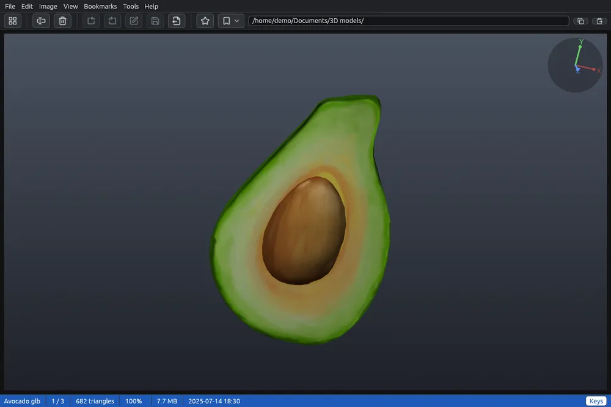

# 3D models

3D models appear in the grid next to the pictures, with a picture of the model as thumbnail. In the viewer the graphics card draws them, and you can turn them and look at them from every side.

## Which models

- **STL**, **3MF** and **AMF** (3D printing), **OBJ** (with the colours of its materials, from the `.mtl` file next to it), **PLY** (also 3D scans; point clouds show as dots).
- **glTF** (`.glb`, and `.gltf` with its files), **FBX**, **Collada** (`.dae`, `.zae`), **3DS**, **OFF**, **VRML** and **X3D**.
- **IFC**: building models (walls, slabs, windows, structures) in their colours.
- **STEP**, **IGES** and **BREP**, the solid models of mechanical CAD programs. They need the CAD engine, downloaded once: the first one you open offers it, and so does the red **Download the CAD engine** button in the menu bar. Until then their thumbnail is a cube  with a download sign. See [Add-on components](components.md).

The full list is in [Supported formats](formats.md).

## Looking at a model

Double-click a model, or select it and press **Enter**.

| Key or mouse | What it does |
|---|---|
| Arrows, or drag | Turn the model (hold an arrow to keep turning) |
| Shift+drag, or drag with the middle button | Move the model in the window |
| Mouse wheel, + and − | Zoom in and out |
| 0 | Back to the starting view |
| M | Measure |
| S | Section |
| Page Down, Space | Next file |
| Page Up, Backspace | Previous file |
| Home, End | First, last file |
| Esc, double click | Back to the grid |
| F11 | Full screen: the model alone |

The arrows turn the model, so they do not change file here. The **Keys** button in the status bar lists these keys.

In the top right corner the axes of the file (X red, Y green, Z blue) turn with the model, as in CAD programs. The status bar shows how many triangles the model has, the zoom and, while it moves, how many frames a second are drawn.

## Measuring

**M**, or **View > Measure**, turns on the Measure tool: the status bar shows the overall size of the model along X, Y and Z, its surface and its volume. The volume is given only for a closed model (every edge shared by two triangles, as a model for 3D printing must be); otherwise the status bar says how many edges are open. Click two points on the model for their distance, written next to the pointer and in the status bar; a third click starts again. Measures are in the file's unit when the format or the file says it (glTF, IFC, X3D and VRML in metres, STEP and IGES in millimetres, 3MF and AMF as they say); STL, OBJ, PLY and others have no unit, and the status bar says so. **Copy** in the status bar, or **Ctrl+C**, puts the results on the clipboard; **Esc** clears the points, **Esc** again or **M** closes the tool. Dragging still turns the model.

## Section

**S** cuts the model with a plane, to see inside it: what is beyond the plane is left out, and where the plane crosses the solid it is filled in red, so walls and thicknesses stand out. The plane starts through the middle of the model, across Z for a model with Z up (for a building in IFC, a plan of the floor it crosses), otherwise across Y. The status bar says the axis, where the plane is and the keys:

- **X**, **Y**, **Z**: the axis the plane goes across;
- **Alt** and the mouse wheel, **,** and **.**: move the plane;
- **F**: keep the other side;
- **S** again: the whole model.

**Save as…** saves the model with its section, as it is shown. The red fill is right for closed models (as a model for 3D printing must be), whichever way their triangles face; where a model has holes in its surface the fill can be missing or spill over.

## What is shown

The colours stored in the file are shown, and in many formats also the pictures on the surfaces (textures). A model without colours is light grey. The materials of glTF and FBX models, and of OBJ models (their `.mtl` file), also show how shiny or metallic a surface is, the light it gives (a lamp), and the small bumps of a normal map. Curved surfaces look smooth and edges stay sharp, also in models that do not store this information.

Without a graphics card EyeCanSee can use, the processor draws the model, more slowly: it turns, zooms, is measured and cut the same way, and each new view comes after a moment.

## Saving

- **Ctrl+Shift+S**, or **Save as…** in the File menu or in the right-click menu of the viewer, saves the model as it is shown, as a picture, at least 1920 pixels on its long side. See [Save as](save-as.md).
- **Export as a 3D model…** saves it in another 3D format. See [Exporting 3D models](model-export.md).

Turning and flipping from the Image menu do not apply to models: a model turns with the mouse and the arrows.
