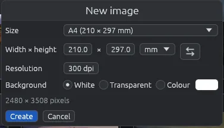

# New image

**File > New image…** (Ctrl+N) makes an empty image and opens it in the editor, to draw a diagram, a sign or a picture for social media.

## Making a new image

1. In the grid, choose **File > New image…** or press Ctrl+N.
2. Choose a **Size**, or type your own.
3. Choose the **Background**.
4. Click **Create** (or press Enter).

## Size

- Ready-made sizes: A3, A4, A5, Letter, Legal (paper), Full HD, 4K UHD, HD (screens), **Square** (1080 × 1080) and **Upright, for stories** (1080 × 1920).
- **Width × height**: your own numbers, in px, mm, cm or in. Changing a number or the unit turns the size into **Custom**.
-  swaps width and height, for landscape or portrait.
- **Resolution**: for sizes in millimetres, centimetres or inches, how many dots per inch. The window shows below how many pixels that makes. It starts at A4 at 300 dpi.

No side can be longer than 20,000 pixels.

## Background

**White**, **Transparent**, or **Colour** with the colour button next to it.

## Saving it

The new image has no file yet. In the editor its main button is **Save as…** (also Ctrl+S): it opens [Saving in another format](save-as.md), where you choose the name, the format and the folder. **Overwrite the original…** is off.

If you close the editor without drawing anything, nothing is asked and nothing is saved.

Everything else works as for any image: see [Editing an image](editor.md).
