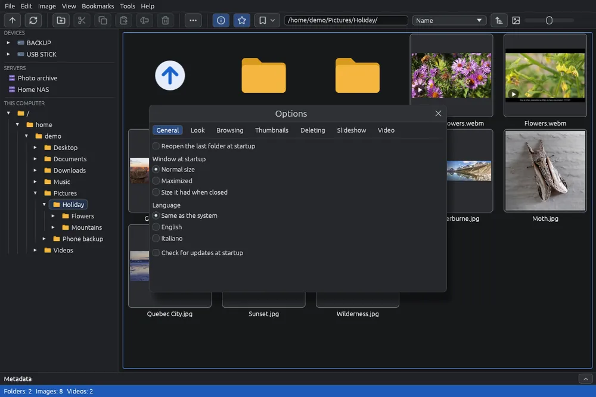

# Options

The options change how EyeCanSee starts, looks, moves between images, deletes, shows slideshows, plays videos and saves in the editor.

## Opening the options

Choose **Tools > Options…** (). The window is divided into tabs: **General**, **Look**, **Browsing**, **Thumbnails**, **Deleting**, **Slideshow**, **Video** and **Editor**. Pointing at many options shows a short explanation.

Every change is saved at once in `settings.json`: in `~/.config/eyecansee` on Linux and in `%APPDATA%\eyecansee` on Windows. It is a text file you can also edit by hand.

## General

- **Reopen the last folder at startup** (on): when EyeCanSee starts without a folder, for example from the applications menu, it opens the folder you were looking at when you closed it. If that folder no longer exists, or its disk or phone is not connected, it opens your home folder. A saved server opens with its saved password; an FTP server with a user that is not saved opens **File > Open location…** with everything filled in except the password.
- **Window at startup**: **Normal size**, **Maximized** (fills the screen, leaving the system bars visible) or **Size it had when closed** (if it was maximized, it reopens maximized).
- **Language**: **Same as the system** (English if the system's language is not available) or one of the languages listed, each shown by its own name. The change applies at once, this guide included.
- **Check for updates at startup** (on): see [Updates](updates.md). Not shown in the copies from the Microsoft Store and in the Flatpak, which are updated by their own.

## Look

- **Colors**: **Same as the system** (light or dark as the system, and it follows it when it changes), **Light** or **Dark**. The change applies at once.

## Browsing

- **Remember the scroll position of each folder** (off): going back to a folder you already viewed, the grid starts where you left it. It lasts until EyeCanSee is closed.
- **In the viewer, after the last image start again from the first** (off): and from the first image, going back shows the last one. When off, the viewer stops at the first and the last image.
- **In the viewer, the window's ✕ goes back to the grid** (on): the ✕ at the top right does as Esc. When off, the ✕ closes EyeCanSee from the viewer too.
- **Mouse wheel in the viewer**: **Zooms in and out** (the default) or **Shows the next or previous image**. Holding Ctrl, the wheel always zooms.
- **Largest zoom in the viewer** (2000% at first): how far the wheel and **+** can enlarge an image.

## Thumbnails

- **Clean up the thumbnail cache** (off): once per session, for each location you open, removes the thumbnails of deleted images and makes again those of changed images; then removes the least recently used thumbnails until the cache is within **Cache limit** (1024 MB at first). Folders that cannot be found or reached are skipped, so a disconnected disk or a switched-off NAS keeps its thumbnails.
- **Empty the thumbnail cache…**: deletes all the saved thumbnails, after a confirmation saying how many and how much space is freed. Your images are not touched: the thumbnails of the open folder are made again at once, the others when you open their folder.

## Deleting

- **Delete files on this computer for good, without the trash (dangerous)** (off): deleted files cannot be recovered.
- **Deleting on phones and servers (they have no trash)**: **Move to the hidden .EyeCanSee-trash folder next to the image** (the default) or **Delete for good**.

See [Deleting and the trash](delete.md).

## Slideshow

- **Each image stays for** a number of seconds (5 at first).
- **Passage between images**: **None (straight cut)**, **Crossfade** (the default), **Fade through black**, **Slide**, **Zoom and fade**.
- **Start again after the last image** (on).

See [Slideshow](slideshow.md).

## Video

**Video engine (libmpv) and FFmpeg to use**: libmpv plays the videos, FFmpeg converts them.

- **Automatic: the best for this computer** (the default): the system's when it is recent enough, otherwise the downloaded one; for FFmpeg also the downloaded one when it does more of the work on the graphics card.
- **Always the system's, whatever its version**: nothing is downloaded.
- **Always the downloaded one**.

The tab also shows which ones are in use now, with their versions. A change applies the next time EyeCanSee starts. See [Add-on components](components.md).

## Editor

- **After saving, go back to the thumbnails** (off): after **Save copy**, **Update copy** or **Overwrite the original…** the editor closes as soon as the file is written, and the grid selects the saved image. When off, the editor stays open to go on editing.

See [Saving an edited image](editor-save.md).
