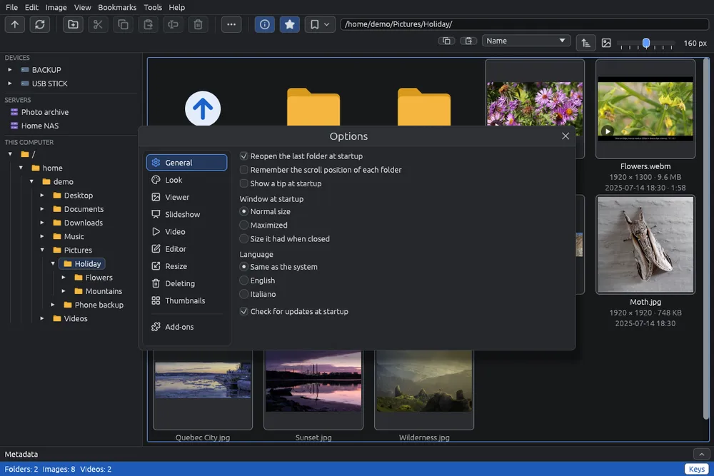

# Options

The options change how EyeCanSee starts, looks, moves between images, deletes, shows slideshows, plays videos, saves in the editor, and whether it writes a diagnostic log.

## Opening the options

Choose **Tools > Options…** (). The window is divided into tabs: **General**, **Look**, **Viewer**, **Slideshow**, **Video**, **Editor**, **Resize**, **Deleting**, **Thumbnails**, **Diagnostics** and **Add-ons**, in a column on the left. Pointing at many options shows a short explanation. **Esc** or the window's ✕ closes it.

Every change is saved at once in `settings.json`: in `~/.config/eyecansee` on Linux and in `%APPDATA%\eyecansee` on Windows. It is a text file you can also edit by hand. If EyeCanSee cannot read it (for example because it was saved as UTF-16 or is not valid JSON), the file is set aside as `settings.json.bad` and EyeCanSee starts with the default settings. If it can read the file but does not know one of the values, that setting takes its default and the others are kept; a copy of the file as it was goes to `settings.json.bad`.

On Windows, **Tools > Create desktop icon**, just above **Options…**, puts an EyeCanSee icon on the desktop. If an icon that starts this copy is already there, it says so and does not make another one. The Microsoft Store copy gets an icon like the one dragged from Start; uninstalling the installer copy also removes the icon this entry made.

## General

- **Reopen the last folder at startup** (on): when EyeCanSee starts without a folder, for example from the applications menu, it opens the folder you were looking at when you closed it. If that folder no longer exists, or its disk or phone is not connected, it opens your home folder. A saved server opens with its saved password; an FTP server with a user that is not saved opens **File > Open location…** with everything filled in except the password.
- **Remember the scroll position of each folder** (off): going back to a folder you already viewed, the grid starts where you left it. It lasts until EyeCanSee is closed.
- **Show a tip at startup** (on): once a day, when EyeCanSee starts, a window shows one thing it can do (see [Getting started](start.md)). You can also turn it off with **Don't show at startup** in that window.
- **Window at startup**: **Normal size**, **Maximized** (fills the screen, leaving the system bars visible) or **Size it had when closed** (the default; if it was maximized, it reopens maximized; at the very first start there is no size yet, and the window opens at its normal size). On Windows a window that is not maximized opens centred in the free area of its screen, above the taskbar, and smaller if it would not fit.
- **Language**: **Same as the system** (English if the system's language is not available) or one of the languages listed, each shown by its own name. The change applies at once, this guide included.
- **Check for updates at startup** (on): see [Updates](updates.md). Not shown in the Flatpak or in the Fedora package, which the system updates; in the copy from the Microsoft Store it asks the Store.

## Look

- **Colors**: **Same as the system** (light or dark as the system, and it follows it when it changes), **Light** or **Dark**. The change applies at once.
- **Smooth pictures shown below 100%** (on): a picture shown smaller than its own pixels is filtered, so edges stay smooth and fine details (grass, hair, thin lines) do not turn into grain or stripes; in the viewer, the slideshow, the editor and the thumbnails. When off, pictures are shown as up to version 0.76, a little sharper but with jagged edges and grain. Above 100% nothing changes. The change applies at once. Under it, the filter: **Exact: from the whole picture** (the default), with almost no false patterns on very fine details; **Fast: from the halved copies**, lighter for the graphics card, where some faint false patterns may stay; **Soft: Mitchell from the whole picture**, with less halo around edges and a little less sharp.
- **Graphics: draw with** (on Windows only): **DirectX 12** (the default) or **Vulkan**, the two ways EyeCanSee can draw on the graphics card. With DirectX 12 the screen does not flash when entering full screen (F11, the slideshow). Vulkan is what EyeCanSee used up to version 0.76: choose it if pictures or videos are not drawn well with DirectX 12. The change applies the next time EyeCanSee starts. If a start with Vulkan stops before the window is shown (a graphics card driver that closes EyeCanSee), the next start goes back to DirectX 12 by itself, puts it back here and says so. If the graphics card cannot draw with DirectX 12 either, EyeCanSee draws without it, more slowly, and says at every start to update the driver; choosing Vulkan here tries the card again (see [Known limits](limits.md)).

## Viewer

- **After the last image start again from the first** (off): and from the first image, going back shows the last one. When off, the viewer stops at the first and the last image.
- **The window's ✕ goes back to the grid** (on): the ✕ at the top right works like Esc, one step at a time: first it closes the editor, then the viewer, then EyeCanSee. When off, the ✕ closes EyeCanSee even from the viewer and the editor, and so does **Esc** in the viewer (from version 0.78; in full screen the first Esc leaves full screen, and holding Esc down does not close EyeCanSee); with changes not saved it asks once whether to save them. Esc in the editor still closes the editor only, and **Enter** in the viewer always goes back to the grid.
- **Mouse wheel in the viewer**: **Zooms in and out** (the default) or **Shows the next or previous image**. Holding Ctrl, the wheel always zooms.
- **Double click in the viewer**: **Goes back to the grid** (the default) or **Goes to full screen**: then at full screen another double click goes back to the window, as Esc does. While measuring, the double click stays Measure's.
- **Largest zoom in the viewer** (2000% by default): how far the wheel and **+** can enlarge an image, in percent of its pixels (for an SVG drawing smaller than 2048 pixels, of the 2048 pixels it is drawn at).

## Slideshow

- **Each image stays for** a number of seconds (5 by default).
- **Passage between images**: **None (straight cut)**, **Crossfade** (the default), **Fade through black**, **Slide**, **Zoom and fade**.
- **Start again after the last image** (on).

See [Slideshow](slideshow.md).

## Video

**Video engine (libmpv) and FFmpeg to use**: libmpv plays the videos, FFmpeg converts them.

- **Automatic: the best for this computer** (the default): the system's when it is recent enough and can play H.264 and HEVC, the formats phones record in, otherwise the downloaded one; for FFmpeg also the downloaded one when it does more of the work on the graphics card.
- **Always the system's, whatever its version**: nothing is downloaded.
- **Always the downloaded one**.

The tab also shows which ones are in use now, with their versions. A change applies the next time EyeCanSee starts. See [Add-on components](components.md).

## Editor

- **Main save button (also Ctrl + S)**: **Save copy** (the default) or **Overwrite the original**. The other one stays in the menu of the arrow next to it; **Save…** in the question on closing follows the same choice. Where the original cannot be overwritten (HEIC, RAW…) the main button is Save copy.
- **After saving**: what happens after **Save copy**, **Update copy** or **Overwrite the original…**. **Stay in the editor** (the default): the editor stays open to go on editing. **Go back to where you were (thumbnails or viewer)**: the editor closes as soon as the file is written; if you opened it from the grid, the grid selects the saved image; if you opened it from the viewer, the viewer shows it. **Go back to the thumbnails**: the editor closes and you are always back in the thumbnails with the saved image selected, even when you opened it from the viewer.

See [Saving an edited image](editor-save.md).

## Resize

The sizes of **Resize**, in the right-click menu of the thumbnails and in **Tools** (see [Converting and resizing images](convert.md)). By default they are **Small** (long side 1280 px), **Medium** (long side 1920 px), **Large** (long side 2560 px) and **Half** (50%).

Each row is one size: its **Name** (it can stay empty: the menu then shows only the size), the kind (**Percent of the original**, **Inside**, **Long side**, **Short side**, **Width**, **Height**, **Exactly, cropped in the middle**, **Exactly, stretched**) and the pixels or the percent.  removes it, **Add** adds one, **Back to the first ones** puts back the four sizes you started with. Until you change them, their names follow the language of EyeCanSee.

## Deleting

- **Delete files on this computer for good, without the trash (dangerous)** (off): deleted files cannot be recovered.
- **Deleting on phones and servers (they have no trash)**: **Move to the hidden .EyeCanSee-trash folder next to the image** (the default) or **Delete for good**.

See [Deleting and the trash](delete.md).

## Thumbnails

- **Under the thumbnails**: what is written under each thumbnail. **Name**, **Dimensions in pixels**, **Size**, **Date**, **Duration** and **Drawing number and revision**, all ticked by default. Dimensions and size go on one row ("1920 × 1080 · 350 KB"; for a DWG or DXF drawing its number and revision first, "A-101 rev. C · 350 KB", from the title block or else from the drawing's title and revision number), the date and the duration of videos and audio files on the row below; with small thumbnails only the name stays. The date is when the photo was taken, if the file says so, otherwise when the file was modified: with the mouse over it, a tip says which one ("Taken on…" or "Modified on…"). Dimensions and date taken are read from each photo with its thumbnail and kept with it, so they come at once the next time, even from phones and servers. The dimensions, date recorded and duration of a video or an audio file are read once, as the File box reads them, and kept the same way; the tip over its date says "Recorded on…".
- **Clean up the thumbnail cache** (off): once per session, for each location you open, removes the thumbnails of deleted images and makes again those of changed images; then removes the least recently used thumbnails until the cache is within **Cache limit** (1024 MB by default). Folders that cannot be found or reached are skipped, so a disconnected disk or a switched-off NAS keeps its thumbnails.
- **Empty the thumbnail cache…**: deletes all the saved thumbnails, after a confirmation saying how many and how much space is freed. Your images are not touched: the thumbnails of the open folder are made again at once, the others when you open their folder.

## Diagnostics

- **Write a diagnostic log, from the next start** (off): every start of EyeCanSee then writes what it does to its own file, `eyecansee-<date>_<time>.log`, with the version, the system and the graphics card first, and any error it meets. Attach it when you report a problem. The log contains the names of the folders and files you open, and the addresses and user names of your servers: read it before attaching it to a public report. A file that reaches 5 MB is followed by a new one, and only the 10 newest files are kept: the older ones are deleted. A start that only hands a file to the EyeCanSee already open writes no log.
- **Open the logs folder**: the folder in the file manager. It is `logs` in the data folder of EyeCanSee: `~/.local/share/eyecansee/logs` on Linux, `%LOCALAPPDATA%\eyecansee\logs` on Windows.

The tab also shows the file this session is writing to. If the `EYECANSEE_LOG` environment variable is set, it decides where the log goes (`1` sends it to standard error, otherwise the file it names) and the switch is grey.

## Add-ons

The parts of EyeCanSee that are downloaded only if you want them (the video engine, FFmpeg, the CAD engine), one card each, with what it is for, its size and where it is: **Downloaded**, **Already on this computer** (the system's, when it fits), a newer version available, or the progress while it downloads. **Download** or **Update** starts the same download the red buttons start, and EyeCanSee uses the component as soon as it arrives. See [Add-on components](components.md).
