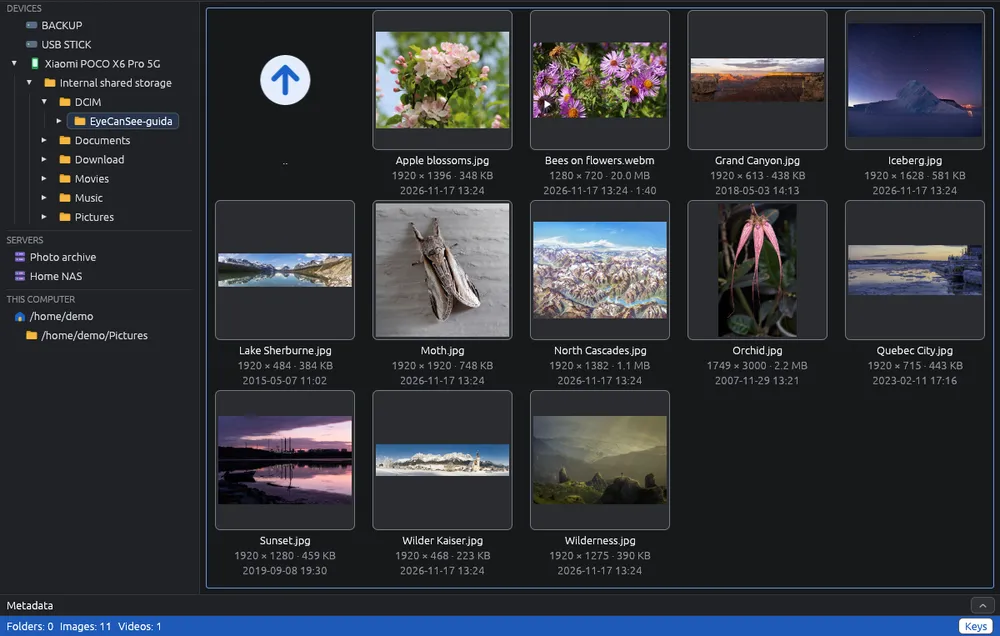

# Android phones

Connect an Android phone with its USB cable to look at its photos and videos, copy them to the computer, convert them or delete them, without any other program. EyeCanSee talks to the phone directly, which is much faster than the desktop's file manager, especially in folders with hundreds of photos.

## Connecting the phone

1. Connect the phone with the cable and unlock it.
2. In the phone's USB notification choose **File transfer** (MTP) to see the whole storage, or **Transfer photos** (PTP) to see only the photo folders (`DCIM`, `Pictures`).
3. The phone appears in the **Devices** block at the top left with the  icon, within a couple of seconds. Click it to open it.

The first level shows the phone's storages (for example "Internal shared storage"; the phone gives the name, in its own language): open one to see its folders. Two storages with the same name show their number in brackets after it. Under **This computer** there is your home folder, to go back to the computer.

## What you can do

Everything you do with the folders on the computer: view photos and videos, copy and move them to and from the computer (see [Copying and moving](copy-move.md)), rename, delete, convert, find duplicates, make folders. When you save a changed image, it is first kept on this computer and then sent to the phone: if sending fails (cable pulled), the original on the phone stays as it was, and a window says where the changed image is, with **Try again**, **Save as…** and **Open the folder**.

Photos taken, deleted or moved on the phone itself while its folder is open appear and disappear by themselves, a few seconds after the phone has finished. If the file was open in the viewer, the viewer closes and a message says which file was removed.

## Messages you may see

- **"The device shows no storage"**: the phone was locked or set to charging only when it was connected. Unlock it and choose File transfer: EyeCanSee tries again by itself every 2 seconds.
- **"The device was not found"**: the phone is reconnecting (it does so when you choose File transfer) or was unplugged. EyeCanSee tries again by itself every 2 seconds.
- **"EyeCanSee cannot open the device"**: another program is using the phone. If the desktop had connected it, EyeCanSee switches to that connection by itself (slower). Otherwise close the file manager and the other programs using the phone and press **F5**, or unplug the phone, plug it back in, choose File transfer and open it in EyeCanSee first.
- **"Opened through the file manager: slower"**: the direct connection failed and EyeCanSee uses the desktop's connection. In folders with hundreds of files it makes about one thumbnail per second.
- A phone that does not answer a request: the status bar says so, with the seconds and the file. EyeCanSee carries on by itself as soon as the phone answers.
- **"Please wait: the phone is writing …"**, in the status bar while that phone is open: the phone is writing a big file and does not respond until it is done, so its folders open only then. The folders on the computer open at once.

## Big files: through the computer

A file of 32 MB or more copied or moved between the internal storage and the memory card of the same phone goes through this computer: EyeCanSee reads it from the phone, then writes it to its destination. The copy box says which of the two it is doing, with **Why through the computer?** to open this section.

- While the phone copies a file by itself, it does not respond until it is done and cannot say how far it has got: there is no real progress bar, **Cancel** waits for the end of the file, and its folders wait.
- Through the computer the bar, the speed and the time left are real. **Cancel** stops the reading at once; the writing stops at the end of the file, because a phone that receives half a file stops answering.
- It takes longer: 2 GB to the memory card in about 3 and a half minutes instead of 2.
- It needs free space on this computer, as much as the file and a little more: if there is not enough, the copy stops before it starts and says so. The file is kept in EyeCanSee's cache folder and removed as soon as it has been written, even after an error or **Cancel**.
- **On Windows** a big file copied inside one storage goes through the computer too: more than 1 GB inside the internal storage, more than 128 MB inside a memory card. Windows waits only half a minute for the phone; when the copy takes longer it loses track of it, and the file would only show up after the phone is unplugged and plugged in again. If a phone or a card slower than expected still takes more than half a minute, EyeCanSee waits for the phone to finish and then says to unplug it and plug it in again to see the copy. On Linux the phone copies files of any size by itself.
- Files under 32 MB and everything that stays inside one storage are done by the phone: a move there only changes the folder, instantly, and a copy is fast (2 GB in about 20 seconds, six times less than through the computer). For that short time its folders wait, with **Please wait** in the status bar; a copy inside one storage makes the whole of EyeCanSee wait instead (see the next section).

## Copies inside one storage: the phone works alone

A copy inside one storage of the phone (from a folder of the internal storage to another one, for example) is made by the phone itself, file by file, much faster than through the computer (on Windows the biggest files go through the computer, see the previous section: the same window then says whether it is reading or writing, with a real bar). While it copies a file the phone does not respond to anything, not even to EyeCanSee, and cannot say how far it has got. So for the whole copy a window in the middle, **The phone is copying**, keeps the rest of EyeCanSee waiting, including the folders on the computer. **Why do I have to wait?** in it opens this section.

- The window shows only what is known: the name of the file being copied, its size and how long ago it started. With several files, also which file it is (**File 2 of 5**), how much data is already copied, counted as each file ends, and a bar that moves file by file.
- While the phone works on a file a strip moves along the bar: it measures nothing, it only says the phone is working. With one file there is only the strip.
- The speed and the time left come only from the big files (32 MB or more) already copied in this paste: before the first one ends, there are none.
- **Cancel**: the phone cannot be interrupted halfway through a file. It finishes the file being copied, then EyeCanSee removes that copy and stops. The files copied before stay, the others are not copied; the original is not touched. Until the phone is done the window stays open and says **Cancelled**. **Esc** does not close the window.
- **Stop waiting**, which appears after Cancel: EyeCanSee stops waiting for the phone, and the window closes within a few seconds (up to half a minute if it was reading the phone just then). The phone may finish the file by itself, and does not respond until it is done: the copy then stays where the phone put it, under the original's name; if it was to get another name or replace a file, EyeCanSee removes it the next time it reads that folder.
- EyeCanSee's ✕, while the phone copies by itself, asks first. **Close EyeCanSee** stops waiting and closes the program as soon as the copy allows it, 40 seconds later at the latest; **Keep waiting** leaves everything as it is.
- After 3 minutes on the same file the window says so. Unplugging the phone does not stop its copy: the phone finishes it by itself, and EyeCanSee only stops waiting. Leave it plugged in until the window closes.
- A move inside one storage only changes the folder, at once: no window.

## Linux: GNOME and KDE

- On GNOME and KDE, opening the phone in EyeCanSee takes it away from the file manager. To see it there again, close EyeCanSee and click the phone in the file manager, or unplug it and plug it back in.
- A phone photo opened from the file manager (a double click in the Files app on GNOME) opens through the direct connection too, and the status bar says so.
- On KDE, EyeCanSee asks first: to take the phone it has to close KDE's kiod service, and this also clears the passwords of the network folders open in Dolphin. **Cancel** leaves the phone to KDE; **F5** asks again.
- **Flatpak on KDE**: the phone can stay held by kiod even after Dolphin is closed. EyeCanSee offers **Release the phone**: close Dolphin and press it. When EyeCanSee lets the phone go (closing, or going to another folder), KDE sees it again.

## Windows

- Right after a photo is taken, or a file is deleted, on the phone, Windows can stop talking to the phone for about six minutes. After 15 seconds a message says so (a large file being written to the phone counts only when its data stops moving), and it closes by itself when the phone answers again. Unplugging the cable and plugging it in again (then File transfer) frees it at once. More in [Windows stops talking to the phone](https://github.com/IoSonoPiero/eyecansee/blob/main/docs/phone-stall.en.md).
- A video on the phone is first copied whole to the computer, then it plays, with a bar showing how much has been read.
- A phone photo opened with a double click in File Explorer is a temporary copy Windows made, not the file on the phone: EyeCanSee cannot save over it, and the status bar says so. Use **Save as…**.

## Things to know

- Unplugging the phone while one of its folders is open opens the home folder, and the status bar says which device was unplugged (see [Disks and USB sticks](devices.md)).
- Deleting on a phone moves the file into a hidden `.EyeCanSee-trash` folder next to it, unless you chose otherwise in the options (see [Deleting and the trash](delete.md)).
- A phone accepts file names of at most 254 characters (an emoji counts as two): a longer name is refused, and nothing is copied.
- On a phone, videos get their thumbnail after the pictures, since a video is often read whole to make it.
- Only one copy of EyeCanSee runs at a time, because a phone can be used by only one program.
