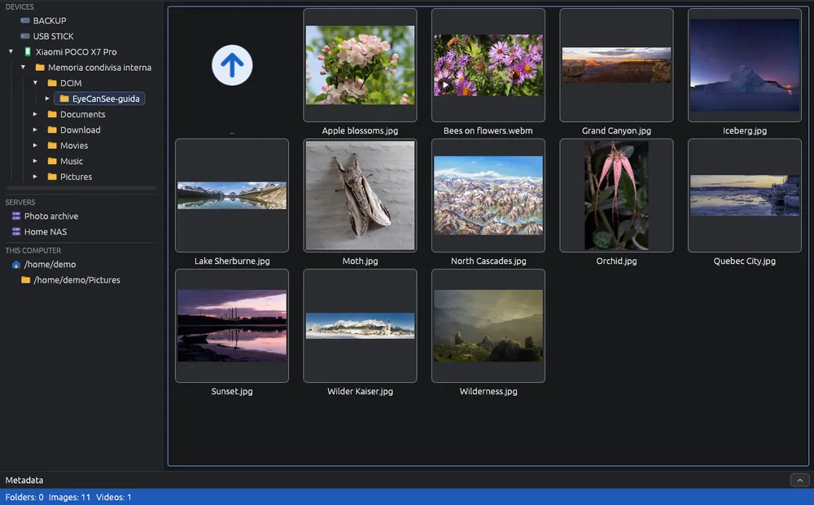

# Android phones

Connect an Android phone with its USB cable to look at its photos and videos, copy them to the computer, convert them or delete them, without another program. EyeCanSee talks to the phone directly, which is much faster than the desktop's file manager, especially in folders with hundreds of photos.

## Connecting the phone

1. Connect the phone with the cable and unlock it.
2. In the phone's USB notification choose **File transfer** (MTP) to see the whole storage, or **Transfer photos** (PTP) to see only the photo folders (`DCIM`, `Pictures`).
3. The phone appears in the **Devices** block at the top left with the  icon, within a couple of seconds. Click it to open it.

The first level shows the phone's storages (for example "Internal shared storage"; the phone gives the name, in its own language): open one to see its folders. Under **This computer** there is your home folder, to go back to the computer.

## What you can do

Everything you do with the folders of the computer: view photos and videos, copy and move them to and from the computer (see [Copying and moving](copy-move.md)), rename, delete, convert, find duplicates, make folders. When you save a changed image, it is first kept on this computer and then sent to the phone: if sending fails (cable pulled), the original on the phone stays as it was, and a window says where the changed image is, with **Try again**, **Save as…** and **Open the folder**.

Photos taken, deleted or moved on the phone itself while its folder is open appear and disappear by themselves, a few seconds after the phone has finished. If the file was open in the viewer, the viewer closes and a message says which file was removed.

## Messages you may see

- **"The device shows no storage"**: the phone was locked or set to charging only when it was connected. Unlock it and choose File transfer: EyeCanSee tries again by itself every 2 seconds.
- **"The device was not found"**: the phone is reconnecting (it does so when you choose File transfer) or was unplugged. EyeCanSee tries again by itself every 2 seconds.
- **"EyeCanSee cannot open the device"**: another program is using the phone. If the desktop had connected it, EyeCanSee switches to that connection by itself (slower). Otherwise close the file manager and the other programs using the phone and press **F5**, or unplug the phone, plug it back in, choose File transfer and open it in EyeCanSee first.
- **"Opened through the file manager: slower"**: the direct connection failed and EyeCanSee uses the desktop's one. In folders with hundreds of files it makes about one thumbnail per second.
- A phone that does not answer a request: the status bar says so, with the seconds and the file. EyeCanSee carries on by itself as soon as the phone answers.

## Linux: GNOME and KDE

- On GNOME and KDE, opening the phone in EyeCanSee takes it away from the file manager. To see it there again, close EyeCanSee and click the phone in the file manager, or unplug and plug it back in.
- A phone photo opened from the file manager (a double click in the Files app on GNOME) opens through the direct connection too, and the status bar says so.
- On KDE, EyeCanSee asks first: to take the phone it has to close KDE's kiod service, which also forgets the passwords of network folders open in Dolphin. **Cancel** leaves the phone to KDE; **F5** asks again.
- **Flatpak on KDE**: the phone can stay held by kiod even after Dolphin is closed. EyeCanSee offers **Release the phone**: close Dolphin and press it. When EyeCanSee lets the phone go (closing, or going to another folder), KDE sees it again.

## Windows

- Right after a photo is taken, or a file is deleted, on the phone, Windows can stop talking to the phone for about six minutes. After 15 seconds a message says so, and it closes by itself when the phone answers again. Unplugging the cable and plugging it in again (then File transfer) frees it at once. More in [Windows stops talking to the phone](https://github.com/IoSonoPiero/eyecansee/blob/main/docs/phone-stall.en.md).
- A video on the phone is first copied whole to the computer, then it plays, with a bar showing how much has been read.
- A phone photo opened with a double click in File Explorer is a temporary copy Windows made, not the file on the phone: EyeCanSee cannot save over it, and the status bar says so. Use **Save as…**.

## Things to know

- Deleting on a phone moves the file into a hidden `.EyeCanSee-trash` folder next to it, unless you chose otherwise in the options (see [Deleting and the trash](delete.md)).
- A phone accepts file names of at most 254 characters (an emoji counts as two): a longer name is refused, and nothing is copied.
- On a phone, videos get their thumbnail after the pictures, since a video is often read whole to make it.
- Only one EyeCanSee runs at a time, because a phone can be used by only one program.
