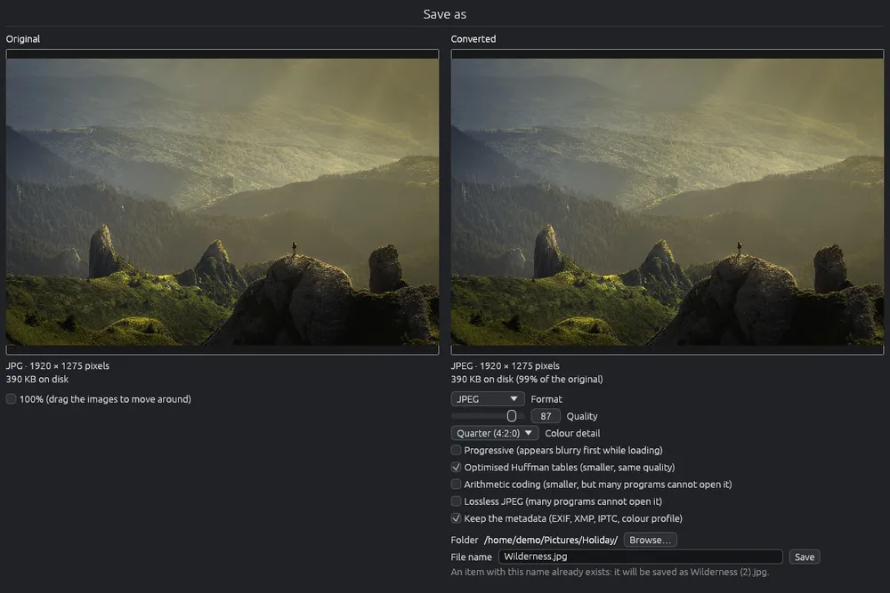

# Saving in another format

Saves one image as a new file in another format, for example a phone's HEIC photo as a JPEG, or a PNG as a smaller WebP. Before saving you see exactly how the new file will look and how large it will be. The original is never changed.

To convert or resize many images at once, use [Converting and resizing images](convert.md).

## Opening the page

- In the grid, select one image and click  in the toolbar, or choose **File > Save as…**, or right-click the image and choose **Save as…**.
- In the viewer, press **Ctrl+Shift+S**, or use the same menu items. If you turned or flipped the image in the viewer, it is saved turned.
- In the viewer, a 3D model or a CAD drawing can be saved as a picture too, as it is shown on screen: a model at least 1920 pixels on its long side, a drawing with the layout you are looking at. On a 3D model **Ctrl+S** does the same.
- In the editor, **Save as…** opens this page with the edited image (see [Saving an edited image](editor-save.md)). Closing it without saving goes back to the editor, with the changes.

## What the page shows

The page takes the whole window. On the left is the original, on the right the converted image, each with its format, its size in pixels and its size on disk; for the converted one also as a percentage of the original. A new image from the editor has no file yet, so its size on disk and the percentage are not shown.

The image on the right is the real file: every time you change an option, EyeCanSee makes the file again and shows it. While it works, the size says "Working out the size…" and **Save** waits, so the size you see is always the size of the file you will get.

Tick **100%** to see the real pixels. Then drag either image to move both, so you compare the same spot.

## Saving

1. Choose the **Format**. The page opens on the format of the last image saved from it while EyeCanSee is open; the first time on JPEG. A new image from the editor always opens on PNG. An image too large for that format (WebP holds at most 16383 pixels on a side, JPEG 65500, GIF and TGA 65535) opens on JPEG or PNG as the first time. The options of the format start as described below.
2. Change its options if you want (see below).
3. Check the name in **File name**, then click **Save**.

The new file goes into the same folder as the original. If the name is already taken, " (2)" is added, and the page tells you before you save. Once saved, the page closes.

**Esc** or the ✕ of the window closes the page without saving.

## Formats and options

| Format | Options |
|---|---|
| JPEG | Quality, Colour detail, Progressive, Optimised Huffman tables, Arithmetic coding, Lossless JPEG |
| PNG | Compression level (0 to 9), Filter |
| WebP | Lossy (Quality, Sharper colour edges) or Lossless (Near lossless); Effort |
| AVIF | Quality, Transparency quality (for images with transparency), Speed, 10 bits per channel, RGB inside the file |
| TIFF | Compression (None, LZW, Deflate fast, normal or maximum, PackBits), Horizontal predictor |
| GIF | Colour reduction quality (at most 256 colours) |
| TGA | Compressed (RLE) |
| BMP, QOI, ICO, PNM, OpenEXR, Radiance HDR, Farbfeld | none |

- For a JPEG original, its own quality and colour detail are proposed, read from the file; otherwise quality 90 and colour detail Quarter (4:2:0).
- Under the options a line says when the new file keeps exactly the same pixels ("Lossless").
- Arithmetic coding and Lossless JPEG make smaller or exact files, but many programs cannot open them.

## Metadata

**Keep the metadata (EXIF, XMP, IPTC, colour profile)** is on at first. It keeps the camera, the date the photo was taken, the place (GPS), author, copyright, descriptions, keywords and the colour profile.

- Only JPEG, PNG, WebP, AVIF and TIFF can hold metadata. With another format, or when the original has none, the box is greyed out; pointing at it says why.
- The orientation is set to upright, since the saved pixels are already turned, and the sizes written inside are those of the new image.
- Left out: the small previews that cameras store inside the file, the Lightroom and Camera Raw settings, and the video of a motion photo, which the new file does not have.
- An **Ultra HDR** phone photo stays HDR when you save it as JPEG with the metadata, also from the editor: its HDR part is turned, cropped and covered together with the photo. In another format, or without the metadata, it loses its HDR, and the page tells you before you save.

## Things to know

- JPEG and Radiance HDR have no transparency: transparent parts become white. The page says so.
- An icon (ICO) holds at most 256 × 256 pixels: a larger image is reduced. The page says so.
- EyeCanSee cannot write HEIC or JPEG XL: see [Supported formats](formats.md).
- Only JPEG, PNG, WebP, AVIF, TIFF, BMP, GIF, QOI and PSD files (flattened) can also be written back over the original after a turn (see [Rotating and flipping](rotate.md)); the other formats only through this page.
- The table of every format and its options is in [Supported formats](formats.md).
