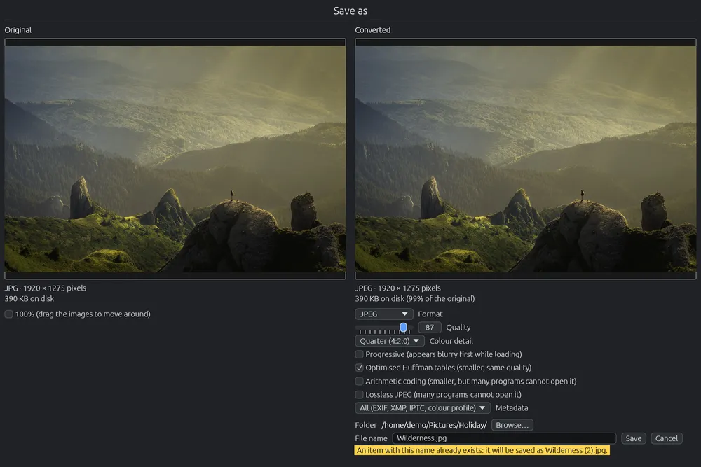

# Save as

Saves one image as a new file, in the format and the folder you choose, for example a phone's HEIC photo as a JPEG, or a PNG as a smaller WebP. Before saving you see exactly how the new file will look and how large it will be. The original is never changed.

Save as works on **one** image, as you see it, with the changes not saved yet. For many images at once, as they are on disk, there is [Converting and resizing](convert.md).

To convert or resize many images at once, use [Converting and resizing images](convert.md).

## Opening the page

- In the grid, select one image and click  in the toolbar, or choose **File > Save as…**, or right-click the image and choose **Save as…**.
- In the viewer, press **Ctrl + Shift + S**, or use the same menu items. If you rotated or flipped the image in the viewer, it is saved that way.
- A 3D model or a CAD drawing can be saved as a picture too. In the viewer, as it is shown on screen: a model at least 1920 pixels on its long side, a drawing with the layout you are looking at. From the grid, a model from its starting view at 1920 × 1440 pixels, and a drawing whole. With other files selected too, **Save as…** is marked with **\*** and works on the one picture, model or drawing among them. **Ctrl + S** and **File > Save** save over the original, which is not possible for a model or a drawing: for these they are greyed out, and pointing at **Save** says what to use instead.
- In the viewer of a video, **Save frame as…** (also **Ctrl + Shift + S**) pauses it and opens this page with the frame shown: see [Playing videos](video.md). The frame has no file of its own, so its size on disk and the percentage are not shown.
- In the editor, **Save as…** opens this page with the edited image (see [Saving an edited image](editor-save.md)). Closing it without saving (**Cancel**, **Esc** or the window's ✕) goes back to the editor, with the changes.

## What the page shows

The page takes the whole window. On the left is the original, on the right the converted image, each with its format, its size in pixels and its size on disk; for the converted one also as a percentage of the original. The converted image's size in pixels is that of the file that will be written: swapped after a quarter turn in the viewer, reduced for an icon. A new image from the editor has no file yet, so its size on disk and the percentage are not shown.

The image on the right is the real file: every time you change an option, EyeCanSee makes the file again and shows it. While it works, the size says "Working out the size…" and **Save** waits, so the size you see is always the size of the file you will get.

An image flipped or rotated in the viewer is shown that way on both sides, so that the two match; under the original its size on disk stays, with what the viewer did, for example "rotated 90° clockwise in the viewer".

Tick **100%** to see the real pixels. Then drag either image to move both, so you compare the same spot.

## Saving

1. Choose the **Format**. The page opens with the format of the last image saved from it while EyeCanSee is open; the first time, with JPEG. A new image from the editor always opens with PNG. An image too large for that format (WebP holds at most 16383 pixels on a side, JPEG 65500, GIF and TGA 65535) opens with JPEG or PNG, as the first time. The options of the format start as described below.
2. Change its options if you want (see below).
3. Check the folder in **Folder**: at first it is the original's. To save somewhere else click **Browse…** and choose another folder, also on another device: a phone, a disk or a saved server, as in [Converting and resizing images](convert.md). **Enter** or **Use this folder** chooses it, **Esc** or **Cancel** keeps the folder you had.
4. Check the name in **File name**, then click **Save**.

If the name is already taken in that folder, " (2)" is added, and the page tells you before you save. Once saved, the page closes.

If you opened the page from the viewer, the viewer then shows the new file, already turned or flipped as you left it. The original stays as it is on disk: it is no longer marked as modified, and closing asks nothing. If you saved into another folder, the viewer stays on the original and a message says where the new file is. If you close the page without saving, or saving fails, the viewer stays as it was, turns included. The same holds when you open it from the editor started in the viewer: once the file is saved the editor closes, and the viewer does as above.

**Cancel**, next to **Save**, closes the page without saving, as **Esc** or the window's ✕ do: from the editor you are back in the editor, otherwise where you opened it. While the file is being written it is greyed out.

## Formats and options

| Format | Options |
|---|---|
| JPEG | Quality, Colour detail, Progressive, Optimised Huffman tables, Arithmetic coding, Lossless JPEG |
| PNG | Compression level (0 to 9), Filter |
| WebP | Lossy (Quality, Sharper colour edges) or Lossless (Near lossless); Effort |
| AVIF | Quality, Transparency quality (for images with transparency), Speed, 10 bits per channel, RGB inside the file |
| TIFF | Compression (None, LZW, Deflate fast, normal or maximum, PackBits), Horizontal predictor |
| GIF | Colour reduction quality (at most 256 colours) |
| TGA | Compressed (RLE) |
| BMP, QOI, ICO, PNM, OpenEXR, Radiance HDR, Farbfeld | none |

- For a JPEG original, its own quality and colour detail are proposed, read from the file; otherwise quality 90 and colour detail Quarter (4:2:0).
- Under the options a line says when the new file keeps exactly the same pixels ("Lossless").
- Arithmetic coding and Lossless JPEG make smaller or exact files, but many programs cannot open them.

## Metadata

**Metadata** says what the new file keeps of the original's, and starts on **All (EXIF, XMP, IPTC, colour profile)**: the camera, the date the photo was taken, the place (GPS), author, copyright, descriptions, keywords, the colour profile and the resolution (dots per inch). The other two choices are for a copy to share:

- **All but the place (no GPS position)**: the same without where the photo was taken: the GPS position (with its altitude and direction), and the city, state, country and location written in the XMP or the IPTC.
- **None (only the colour profile)**: nothing but the colour profile, which the picture needs to show its colours right.

The choice starts again on **All** each time the page opens.

- Only JPEG, PNG, WebP, AVIF and TIFF can hold metadata. BMP holds only the resolution: with BMP a box, **Keep the metadata (resolution only)**, takes the place of the list, and can be changed when the original has a resolution. With another format, or when the original has none, it is greyed out; pointing at it says why.
- The **resolution** (for example the 600 dpi of a scan) is part of the metadata: with **None** the file is saved without it, also when the original has nothing else.
- The orientation is set to upright, since the saved pixels are already turned, and the sizes written inside are those of the new image.
- Left out: the small previews that cameras store inside the file and the video of a motion photo, which the new file does not have; the Lightroom and Camera Raw settings of a RAW file, which EyeCanSee does not use when it develops it. Those of other photos stay, marked as already applied, also with **All but the place**; with **None** they go, as the maker note does.
- A JPEG holds at most 64 KB of EXIF and 64 KB of IPTC, and an XMP larger than that only when it can be split: an EXIF too large loses first the thumbnail of the original and then, if needed, the maker note, so that the camera, the date and the place stay. What does not fit even so is left out, and a line under **Metadata** says which part.
- An **Ultra HDR** phone photo stays HDR when you save it as JPEG with the metadata, also from the editor: its HDR part is turned, cropped and covered together with the photo. Without the place it stays HDR too. In another format, or with **None**, it loses its HDR, and the page tells you before you save.

## Things to know

- JPEG and Radiance HDR have no transparency: transparent parts become white. The page says so.
- An icon (ICO) holds at most 256 × 256 pixels: a larger image is reduced. The page says so.
- An animated image (GIF, WebP, APNG, AVIF) or one with several pages (TIFF) is saved as the picture shown, its first frame or page: the new file has only that one. The page says so.
- A glTF model that places one of its parts more than once in its hierarchy, which the format does not allow, shows that part once: the new file has it once, and the page says so.
- A picture that would need more than half of the computer's memory once read whole is not opened at once: a window says how much memory it needs and offers **Open anyway** (the computer may then become very slow, or the system may close EyeCanSee). The choice holds for that file until EyeCanSee is closed. **Cancel** is the default (also with **Enter** and **Esc**) and closes the page.
- EyeCanSee cannot write HEIC or JPEG XL: see [Supported formats](formats.md).
- Only JPEG, PNG, WebP, AVIF, TIFF, BMP, GIF, QOI and PSD files (flattened) can also be written back over the original after a turn (see [Rotating and flipping](rotate.md)); the other formats only through this page.
- The table of every format and its options is in [Supported formats](formats.md).
