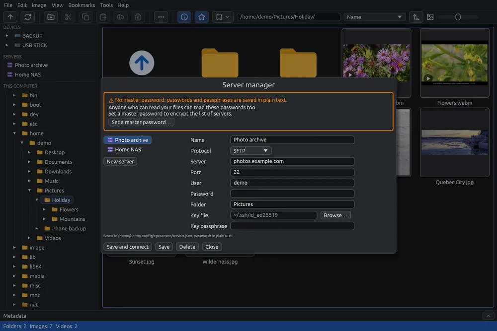

# Managing servers

The server manager keeps the servers you use, with their password or key, so they open with one click from the panel on the left, like a disk. It works like the site manager of FileZilla or WinSCP.

## Opening it

Choose **File > Server manager…** (). If the saved servers are protected by a master password, EyeCanSee asks for it first (see [Saved passwords](passwords.md)).

## The window

- At the top, the box of the master password: whether the list of servers is encrypted (see [Saved passwords](passwords.md)).
- On the left, the saved servers; **New server** below them empties the fields for a new one.
- On the right, the fields of the server chosen: **Name** (empty: the server's name is used), **Protocol** (FTP, FTPS or SFTP), **Server**, **Port**, **User**, **Password** and **Folder**. For SFTP also **Key file** (**Browse…** opens the system window in the `~/.ssh` folder, or in your home folder without it) and **Key passphrase**.
- At the bottom, the file where the servers are saved.

## The buttons

- **Save and connect**: saves the server and opens it.
- **Save**: saves the changes, or adds the new server.
- **Delete**: asks "Delete … from the saved servers?" in place of the buttons; **Delete** removes it, **Cancel** keeps it.
- **Close** (or **Esc**): closes the window.

## How a saved server logs in

A saved server logs in **only** with the password and key saved here, never with the SSH agent or the system's keys in `~/.ssh`. If the key does not open (wrong passphrase, missing file), there is no login, and the server manager opens on that server so you can fix it; the message says it is open there, and inside the window it is repeated in red above the fields of that server until you save it. If the server manager was already open, the message asks you to fix the key in **File > Server manager**.

An address that matches a saved server (same protocol, server, port and user), typed in the address bar or reopened at startup, uses its password and key too.

## The Servers section of the panel

Every saved server appears in the panel on the left, in the **Servers** section below the devices, with the  icon.

- One click opens it in its saved **Folder**, every time; with no folder, in the folder where the server starts (usually your home on it).
- Right click: **Close connection** (if it is open you go back to your home folder; not during a copy) and **Edit…**, which opens the server manager on that server.
- With a server or a phone open, the panel also shows **This computer**, with your home folder and the last folder of the computer you were in.

## Things to know

- Without a master password, passwords and passphrases are saved in plain text: the first time you save a server, EyeCanSee warns you once. See [Saved passwords](passwords.md).
- The port can be left empty: FTP uses 21, SFTP 22.
- Spaces before or after a value, for example pasted with it, are left out when the server is saved; not in passwords and passphrases, where they can be part of them.
- From the panel you copy and paste between servers, the computer, disks and phones as between two folders (see [Copying and moving](copy-move.md)).
