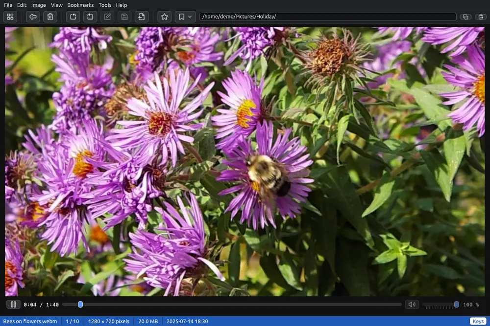

# Playing videos

Videos appear in the grid next to the pictures, with a frame of the video as their thumbnail and the  icon. They open in the viewer, where they play with audio. Audio files play there too.

## Playing a video

Double-click a video, or select it and press **Enter**: it opens in the viewer, fitted to the window, and starts playing.

- **Space**, a click on the video, or  /  under it play and pause.
- The bar under the video shows the time and the position: drag it, or click a point, to move there. With the pointer over the bar, the time of that point shows before you click. Hold **Shift** while dragging to move ten times more slowly, to reach a precise moment.
- **Ctrl + ←** and **Ctrl + →** go 5 seconds back and forward.
- **.** and **,** go one frame forward and back, and pause the video there. Going back takes longer, a second or so on a large video: meanwhile the status bar says **Preparing the previous frame…**, and each press is kept, one frame after the other.
- At the end the last frame stays; playing again starts from the beginning.

## Saving a frame as a picture

**Ctrl + Shift + S**,  **Save frame as…** in the toolbar, or the same item in the File menu and in the right-click menu, pause the video and open [Save as](save-as.md) with the frame shown, at the video's own size and turned as you see it. Choose the format, the options and the name there; the name proposed is the video's with the time of the frame (for example `clip 1m02s345.jpg`). Once saved, the viewer stays on the video, paused.

With **Metadata** on **All**, the picture keeps what the video says about itself: the camera, the date and time of that frame, and the place (a dashcam's track at that moment, the video's own position, or a drone's starting point). **All but the place** leaves the place out.

## Audio

The audio controls are at the right of the bar:  turns the audio off and  on again, and the slider sets the volume from 0 to 100, in steps of 5, with a mark every 10 and the volume written next to it.

- **↑** and **↓**, or the mouse wheel over the video, raise and lower the volume by 5.
- **M** turns the audio off and on.

The volume, and whether the audio is off, are kept for the next videos and the next time EyeCanSee starts. On a video without audio, the two controls are greyed out.

## Moving between files

| Key | What it does |
|---|---|
| →, Page Down | Next file |
| ←, Backspace, Page Up | Previous file |
| Home, End | First, last file |
| Esc | Back to the grid |
| Double click | Back to the grid, or full screen and back, as set in the [Options](options.md) |
| F11 | Full screen: the video alone, its bar over the picture while the mouse moves |

**F2** renames the video and **Del** deletes it, as for pictures. The **Keys** button in the status bar lists these keys.

## Audio files

Audio files (for example MP3, M4A, FLAC, Opus) appear in the grid with their cover and the  icon, or with a note when they have no cover. They play in the viewer with the same bar and the same volume; the cover shows as the picture.

## The video engine

Videos are played by mpv. When EyeCanSee needs its own copy (usually on Windows; on Linux when the system has none, one too old, or one that cannot play H.264 and HEVC, the formats phones record in), the viewer offers to download it the first time you open a video, and a red **Download the video engine** button appears at the top right of the menu bar as soon as the open folder holds a video or an audio file. It is downloaded once. See [Add-on components](components.md).

Until then the thumbnail of a video is the preview stored by the camera, when there is one, or the video icon with .

## Good to know

- Videos on a phone or a server are read a piece at a time while they play, even from a phone on Windows. Only a phone that cannot jump into the middle of a file (Windows notices on the first slow read) has its videos copied whole first, with a bar that shows how much has been read.
- A file that cannot be played says why in the middle of the viewer, with the whole message in the bar at the bottom, as for a picture that cannot be opened: **The file is not a video, or it is damaged**, **No frame can be shown: the video is damaged**, or, for a file with audio only, when no audio output can be opened (no audio device, the audio server off), **The audio cannot be played: no audio output could be opened**. When a phone or a server stops sending the video (unplugged, gone), its own message is shown. While a phone or a server is only slow, the video waits for it, however long it takes; when no data comes for 20 seconds, a message in the middle of the viewer says so. It goes as soon as data comes again, and the video starts; **Esc** goes back to the thumbnails at once.
- Editing in the viewer is for pictures; for a video, Save as… saves the frame shown. To turn, shrink or convert a video use [Converting videos](convert-video.md).
- The metadata panel shows the details of a selected video: see [Image information](metadata.md).
- Which formats play: see [Supported formats](formats.md).
