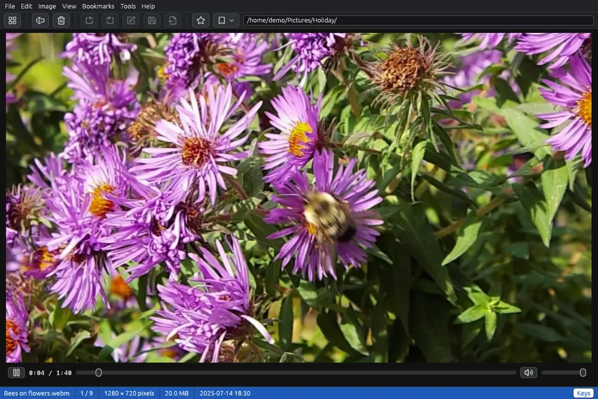

# Playing videos

Videos appear in the grid next to the pictures, with a frame of the video as thumbnail and the  sign. They open in the viewer, where they play with sound. Audio files play there too.

## Playing a video

Double-click a video, or select it and press **Enter**: it opens in the viewer, fitted to the window, and starts playing.

- **Space**, a click on the video, or  /  under it play and pause.
- The bar under the video shows the time and the position: drag it, or click a point, to move there.
- **Ctrl+←** and **Ctrl+→** go 5 seconds back and forward.
- At the end the last frame stays; playing again starts from the beginning.

## Sound

The sound controls are at the right of the bar:  turns the sound off and  on again, and the slider sets the volume from 0 to 100.

- **↑** and **↓**, or the mouse wheel over the video, raise and lower the volume by 5.
- **M** turns the sound off and on.

The volume and the sound off stay for the next videos and the next time EyeCanSee starts. On a video without sound, the two controls are greyed out.

## Moving between files

| Key | What it does |
|---|---|
| →, Page Down | Next file |
| ←, Backspace, Page Up | Previous file |
| Home, End | First, last file |
| Esc, double click | Back to the grid |
| F11 | Full screen: the video alone |

**F2** renames the video and **Del** deletes it, as for pictures. The **Keys** button in the status bar lists these keys.

## Audio files

Audio files (for example MP3, M4A, FLAC, Opus) appear in the grid with their cover and the  sign, or with a note when they have no cover. They play in the viewer with the same bar and the same volume; the cover shows as the picture.

## The video engine

Videos are played by mpv. When EyeCanSee needs its own copy (usually on Windows; on Linux when the system has none, one too old, or one that cannot play H.264 and HEVC, the formats phones record in), the viewer offers to download it the first time you open a video, and a red **Download the video engine** button appears at the top right of the menu bar as soon as the open folder holds a video or an audio file. It is downloaded once. See [Add-on components](components.md).

Until then the thumbnail of a video is the preview stored by the camera, when there is one, or the video sign with .

## Good to know

- Videos on a phone or a server are read a piece at a time while they play, also from a phone on Windows. Only a phone that cannot jump into the middle of a file (Windows notices on the first slow read) has its videos copied whole first, with a bar that shows how much has been read.
- Turning, saving and editing in the viewer are for pictures. To turn, shrink or convert a video use [Converting videos](convert-video.md).
- The metadata panel shows the details of a selected video: see [Image information](metadata.md).
- Which formats play: see [Supported formats](formats.md).
