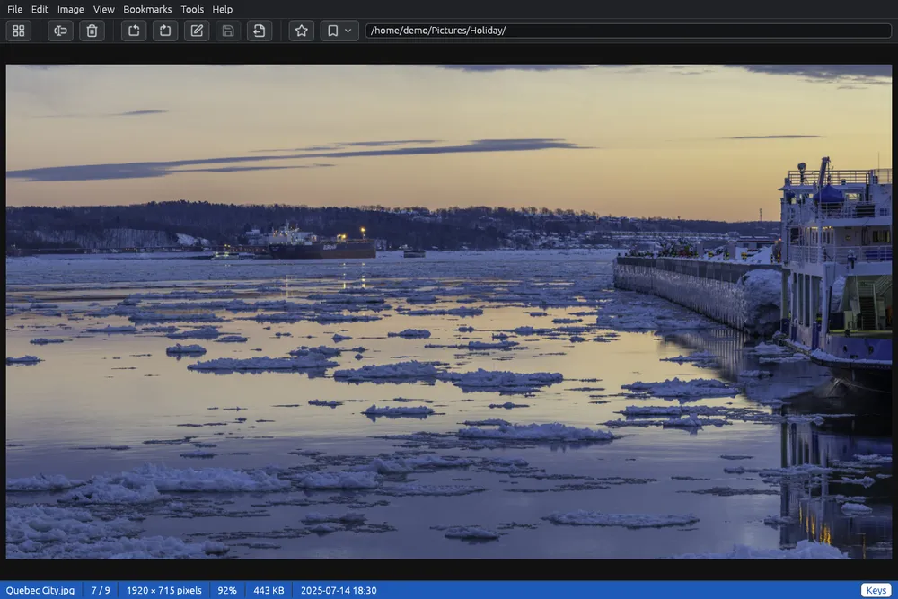

# Viewing images

The viewer shows one picture at a time, as large as the window allows. From there you move to the next picture, zoom in, turn the picture, and go back to the grid.

## Opening and closing the viewer

- Double-click a picture in the grid, or select it and press **Enter** (also **View > Open**).
- To go back to the grid: **Esc**, a double click on the picture,  **Back to the grid** in the toolbar, or **View > Back to the grid**. The picture you were looking at is then selected in the grid.
- The window's ✕ also goes back to the grid instead of closing EyeCanSee. You can change this in [Options](options.md).

With several files selected, Enter opens the first of them, and the viewer moves only among them.

## Moving between pictures

| Key | What it does |
|---|---|
| →, Space, Page Down | Next picture |
| ←, Backspace, Page Up | Previous picture |
| Home, End | First, last picture |

The same items are in the **View** menu (Next, Previous, First, Last). After the last picture the viewer stops; in [Options](options.md) you can make it start again from the first. The pictures around the one shown are read in advance, so moving between them is quick even on a phone or a server.

## Animations and pages

Animated GIF, WebP and PNG (APNG) pictures play in the viewer, over and over. **Space** pauses and plays them again, as does the button in the small bar at the bottom of the picture, which also shows the frame (for example Frame 3 / 20, also in the status bar). The animation stops when you move to another picture and starts again from the first frame when you come back. A very long or very large animation (more than 256 MB once decoded) is not played: the viewer shows its first frame and says why.

A TIFF with several pages (a scanned document, a fax) opens on its first page. **Page Down** and **Page Up** turn the pages, as do the arrows in the bar at the bottom, which shows the page (for example Page 2 / 5, also in the status bar); past the last page Page Down goes to the next file, and before the first Page Up to the previous one. Each page is fitted to the window.

## Zooming

- The **mouse wheel** zooms in and out around the pointer; **+** and **−** around the middle of the window. On a touchpad, pinch.
- **0** fits the picture to the window again; **1** shows it at 100%, one pixel of the picture for each pixel of the screen.
- Drag a zoomed picture to move it.

A picture is never shown smaller than fitted to the window, and a small picture is shown at its real size, not enlarged. The largest zoom (2000% at first) is set in [Options](options.md), where you can also make the wheel change picture instead of zooming: then **Ctrl** and the wheel still zoom. The next picture starts fitted again.

## The status bar of the viewer

At the bottom: the file name, its position in the folder (for example 12 / 51), its size in pixels (its own, as in the metadata panel, also when it is shown reduced, and for an SVG drawing the size it declares), the zoom, its size on disk, and its date: the date taken when its metadata were already read in the grid, otherwise the date the file was modified. After a turn not yet saved it also says **Changed, not saved**.

The **Keys** button on the right lists the keys of what you are looking at (a picture, a video, a 3D model or a CAD drawing): while the mouse is on it, or until you click it again.

## The toolbar in the viewer

The toolbar keeps only what works on the picture shown:  **Rename…**,  **Delete…**,  and  to turn it,  **Edit image…**,  **Save** and  **Save as…**, then the bookmarks and the address bar. New folder, cut, copy, paste and the tools are for the grid; they stay in the menus.

## Full screen

**F11** shows the picture alone, without menus and bars, on black. **Esc** first leaves full screen, then goes back to the grid.

## What else you can do

- Turn and flip the picture: see [Rotating and flipping](rotate.md).
- Draw on it, crop it, hide parts of it: see [Editing an image](editor.md) (**Ctrl+E**).
- Save a copy in another format: see [Save as](save-as.md) (**Ctrl+Shift+S**).
- **F2** renames the picture and **Del** deletes it, as in the grid; after a deletion the next picture appears.
- A right click on the picture opens a menu with these actions and more.
