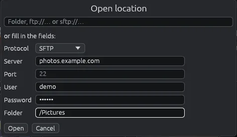

# Barra degli indirizzi e Apri indirizzo

La barra degli indirizzi, nella barra strumenti, mostra dove sei e porta ovunque: una cartella di questo computer, una foto, un telefono o un server.

## La barra degli indirizzi

Fai clic nella barra degli indirizzi, scrivi un indirizzo e premi **Invio**. Puoi scrivere:

- una cartella di questo computer o di un disco, per esempio `/home/anna/Immagini` su Linux o `C:\Users\Anna\Pictures` su Windows;
- una foto, per esempio `/home/anna/Immagini/spiaggia.jpg`: si apre nel [visore](viewer.md), con la sua cartella dietro;
- un server: `ftp://…`, `ftps://…` o `sftp://…`, per esempio `sftp://anna@nas.lan/Foto` o `ftp://nas.lan:2121/Foto` (vedi [Server (FTP e SFTP)](servers.md));
- una cartella di un telefono, come la mostra la barra quando il telefono è aperto: `mtp://…` (vedi [Telefoni Android](phone.md)).

Quando cambi cartella, la barra mostra quella nuova. Se c'è spazio, alla sua fine  copia l'indirizzo e  lo sostituisce con quello copiato, pronto per **Invio**. Una password non compare mai nella barra, anche se l'hai scritta lì. Se l'indirizzo non si apre, una fascia gialla con il triangolo di avviso in fondo alla finestra spiega perché (sparisce quando cambi cartella, o prima con la sua ✕), e la barra torna alla cartella in cui eri.

## Apri indirizzo

**File > Apri indirizzo…** apre una finestra in cui scrivere l'indirizzo di un server un pezzo alla volta, senza ricordare come si scrive.

1. Scrivi l'indirizzo intero nel campo in alto, oppure lascialo vuoto e compila i campi sotto.
2. **Protocollo**: FTP, FTPS o SFTP.
3. **Server**: il nome o l'indirizzo del server.
4. **Porta**: solo se non è quella solita (21 per FTP, 22 per SFTP).
5. **Utente** e **Password**. Con FTP, un utente vuoto entra come `anonymous`.
6. **Cartella**: la cartella da aprire (`/` se vuota).
7. **Apri** (o **Invio**) la apre senza salvare nulla; **Salva e apri** salva anche il server con la sua password nella [gestione server](server-manager.md), poi lo apre; **Annulla** (o **Esc**) chiude la finestra.

**Salva e apri** vale solo per un server: per una cartella di questo computer è grigio. Se un server salvato ha già questo accesso (stesso protocollo, server, porta e utente), prende la password che hai scritto e tiene nome, cartella e chiave; altrimenti si aggiunge un server salvato nuovo, col nome del server. Se i server salvati sono protetti da una password principale, EyeCanSee la chiede prima (vedi [Password salvate](passwords.md)).

I campi restano grigi finché il campo in alto contiene qualcosa. Gli spazi prima o dopo un valore, per esempio incollati insieme, vengono tolti; non nella password, dove possono farne parte.

## Quando un server chiede la password

Se un server rifiuta l'accesso, Apri indirizzo si apre da solo con l'indirizzo già compilato e, in alto, il motivo del rifiuto: scrivi la password e premi **Invio** per usarla solo questa volta, oppure fai clic su **Salva e apri** per tenerla (anche quando la password di un server salvato è cambiata). Succede lo stesso all'avvio quando l'ultima cartella era su un server FTP con un utente che non è tra i server salvati, perché EyeCanSee non conserva quella password.

Per non scrivere la password ogni volta, fai clic su **Salva e apri**, oppure salva il server in **File > Gestione server…**: un indirizzo che corrisponde a un server salvato (stesso protocollo, server, porta e utente), anche scritto nella barra degli indirizzi, usa la sua password e la sua chiave. Vedi [Gestire i server](server-manager.md).

## Avviare EyeCanSee su un indirizzo

EyeCanSee si può avviare con una cartella, una foto o l'indirizzo di un server, per esempio da un altro programma con "Apri con": apre quel posto invece dell'ultima cartella. Se EyeCanSee è già aperto, il posto compare nella finestra che c'è già.
