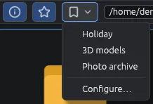

# Segnalibri

I segnalibri riportano con un clic nei posti che usi di più: una cartella di questo computer, un disco, una cartella di un telefono o di un server, oppure una singola foto. Sono comodi per copiare e incollare tra un telefono, un disco e un server.

## Aggiungere un segnalibro

Fai clic sulla  **stella** accanto alla barra degli indirizzi: la cartella aperta (nel visore, la foto mostrata) diventa un segnalibro. La barra di stato lo conferma per qualche secondo.

Puoi anche usare **Segnalibri > + Aggiungi la cartella corrente** nella barra dei menù (nel visore **+ Aggiungi questa immagine**).

Un segnalibro nuovo prende il nome della cartella o della foto; per la cima di un disco o di un telefono, il nome del dispositivo. Un posto che è già un segnalibro non viene aggiunto due volte: la stella è accesa, e la voce del menù è grigia.

## Aprire un segnalibro

- Fai clic su  **Segnalibri**, la tendina subito dopo la stella, e scegli un segnalibro. Passando col mouse su un segnalibro compare il suo indirizzo.
- Oppure usa il menù **Segnalibri** nella barra dei menù.
- Oppure premi **Ctrl+Maiusc+D**: si apre la tendina; la freccia **Giù** entra nell'elenco e **Invio** apre il segnalibro scelto.

Un segnalibro si apre proprio come se avessi scritto il suo indirizzo nella barra degli indirizzi: un server chiede la sua password o la password principale come al solito, e per una foto ruotata e non salvata EyeCanSee chiede prima cosa fare.

## Togliere un segnalibro

Quando il posto aperto è un segnalibro, la stella è accesa: un clic sulla stella lo toglie. La barra di stato lo conferma.

## Configura

**Configura…**, in fondo alla tendina e al menù Segnalibri, apre l'elenco dei tuoi segnalibri, un riquadro per ciascuno, con il nome e sotto l'indirizzo:

-  cambia il nome e l'indirizzo. **Fatto** o **Invio** per finire. Una password scritta nell'indirizzo non viene conservata.
-  e  spostano il segnalibro più in alto o più in basso nell'elenco.
-  lo toglie.

Le modifiche si salvano quando chiudi la finestra con **Chiudi** o **Esc**.

## Da sapere

- Un segnalibro il cui posto non esiste più, o il cui disco o telefono non è collegato, non viene mai tolto da solo: sceglierlo spiega perché non si apre, e resta nell'elenco per quando il dispositivo sarà di nuovo collegato.
- Un segnalibro a una cartella di un server che non esiste più apre invece la cartella del server salvato, o quella da cui parte il server.
- I segnalibri sono salvati con le altre impostazioni, in `settings.json`; l'indirizzo di un server viene conservato senza la password.
