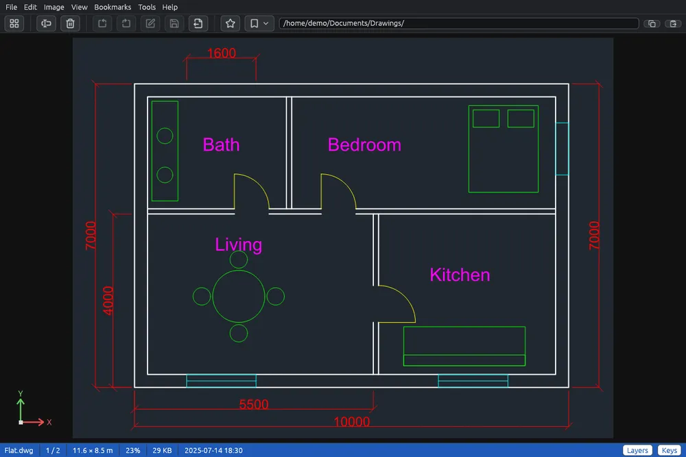

# Disegni CAD

I disegni di AutoCAD (**DWG** e **DXF**) e i file per plotter (**HP-GL** e **HP-GL/2**: `.plt`, `.hpgl`) compaiono nella griglia con un'immagine del disegno come miniatura, e si aprono nel visore come una foto.

## Guardare un disegno

Fai doppio clic su un disegno, oppure selezionalo e premi **Invio**. Il disegno si vede dall'alto, come nello spazio modello di un programma CAD, sul suo sfondo scuro, con i suoi colori, tipi di linea e spessori. I livelli spenti o congelati nel file all'inizio non si vedono (vedi Livelli più sotto).

| Tasto o mouse | Cosa fa |
|---|---|
| Rotellina, + e − | Ingrandiscono e rimpiccioliscono |
| Trascinare | Sposta il disegno |
| 0 | Tutto il disegno |
| →, ← | File successivo, precedente |
| L, Maiusc+L | Layout successivo, precedente |
| Ctrl+L | Riquadro dei livelli |
| M | Misura |
| Ctrl+Maiusc+S | Salva come immagine |
| F11 | Schermo intero |
| Esc, doppio clic | Torna alla griglia |

Quando la vista si ferma, la parte sullo schermo viene ridisegnata dal disegno, così linee sottili e testi piccoli restano nitidi a ogni ingrandimento. Il pulsante **Tasti** nella barra di stato elenca i tasti.

## Layout

Un disegno con layout (spazio carta) mostra nella barra di stato **Modello** o il nome del layout. **L** passa al layout successivo e **Maiusc+L** a quello prima, ciascuno col suo foglio, il cartiglio e le finestre sul modello.

## Livelli

**Ctrl+L**, il pulsante **Livelli** nella barra di stato o **Visualizza > Livelli del disegno** aprono il riquadro dei livelli a destra di un disegno DWG o DXF. Elenca i livelli su cui c'è qualcosa, ciascuno col suo colore e una casella: togli la spunta a un livello per nasconderlo, rimettila per mostrarlo di nuovo, anche un livello spento o congelato nel file. **Tutti accesi** e **Tutti spenti** valgono per i livelli elencati; con molti livelli scrivi parte di un nome in **Cerca** per elencare solo quelli. Il riquadro dice quanti livelli si vedono.

Un blocco su un livello nascosto si nasconde tutto, anche le sue parti su altri livelli. La scelta vale per il modello e per i layout (i livelli congelati in una finestra di un layout restano nascosti lì) e cambia solo ciò che si vede: il file non cambia. Ogni disegno tiene la sua scelta finché EyeCanSee resta aperto, anche passando ad altri file e tornando. **Salva come…** ed **Esporta disegno…** (immagini e SVG) salvano i disegni con i livelli come si vedono; i disegni di cui non hai toccato i livelli si salvano come li ha il file.

## Misurare

**M**, o **Visualizza > Misura**, accende lo strumento Misura; un riquadro in alto a destra (si può trascinare altrove) mostra cosa si misura e i risultati. Scegli **Distanza** (D), **Area** (A) o **Angolo** (G), poi fai clic sul disegno:

- **Distanza**: due punti. Il riquadro mostra la distanza e quanto distano i punti lungo X e Y.
- **Area**: gli angoli di una forma, uno dopo l'altro; **Invio** o un doppio clic la chiudono. Il riquadro mostra l'area e il perimetro, anche mentre fai clic.
- **Angolo**: un punto, il vertice, poi un punto dell'altro lato.

Un clic si aggancia a ciò che c'è sotto il puntatore, come nei programmi CAD: l'estremo di una linea (un quadrato), il suo punto medio (un triangolo), il centro di un cerchio o di un arco (un cerchio), dove due linee si incrociano (una croce); senza niente vicino, il punto cliccato (una crocetta). I livelli nascosti non contano. I risultati sono nell'unità del disegno (come nella barra di stato; quando il disegno non dice la sua unità, il riquadro lo dice). Su un layout si misura sul foglio. **Copia** li mette negli appunti. **Backspace** toglie l'ultimo punto, **Esc** cancella i punti, e **Esc** di nuovo o **M** chiudono lo strumento. Trascinare sposta ancora il disegno.

## Numero del disegno e cartiglio

Nella griglia un disegno DWG o DXF mostra sotto la miniatura il suo numero e la revisione, prima del peso ("A-101 rev. C · 350 KB"): dal cartiglio, o altrimenti dal titolo e dal numero di revisione. Selezionato, il riquadro **Disegno** del pannello dei metadati elenca le proprietà del disegno e gli attributi del cartiglio. Vedi [Informazioni sul file](metadata.md) e, per togliere il numero, [Opzioni](options.md).

## La barra di stato

Un disegno non ha pixel: la barra di stato mostra la sua misura nella sua unità (come la scrive il disegno; millimetri per un file per plotter; una misura grande passa a un'unità più grande, per esempio metri invece di millimetri), il layout e l'ingrandimento. In basso a sinistra gli assi X (rosso) e Y (verde) del disegno mostrano dove puntano.

## Testi e immagini

I testi si scrivono con i font SHX del disegno quando i file dei font sono accanto al disegno o in una cartella `fonts` lì accanto (su Windows anche in un'installazione di AutoCAD); altrimenti con un font del sistema. Le immagini collegate al disegno si vedono quando i loro file sono accanto.

## Salvare un disegno come immagine o nell'altro formato AutoCAD

- **Ctrl+Maiusc+S** o **Salva come…** (nel menù File o nel menù del clic destro) salva il disegno come immagine: nel visore quello che vedi (il layout mostrato, con i livelli visibili), nella griglia il disegno intero. Vedi [Salva come](save-as.md).
- **File > Esporta disegno…** (anche nel menù del clic destro, nella griglia e nel visore) salva i disegni selezionati nella griglia, o quello nel visore, tutti insieme. Scegli il **formato**: un formato di immagine, **SVG** (nitido a ogni ingrandimento, senza livelli né blocchi), oppure **DWG** / **DXF** (tutto il disegno nell'altro formato AutoCAD, con livelli, blocchi, layout e stili). Per le immagini scegli il **Lato lungo** in pixel: il disegno viene ridisegnato a quella misura, quindi resta nitido anche grande. Poi scegli dove vanno i file, come in [Convertire e ridimensionare le immagini](convert.md), e premi **Esporta**.

Immagini e SVG mostrano lo spazio modello, non i layout. Un disegno salvato come DWG o DXF viene riletto e confrontato con l'originale: se qualcosa andrebbe perso non viene salvato, e il riepilogo alla fine lo dice.

Le rotazioni e i ribaltamenti del menù Immagine non valgono per i disegni.
