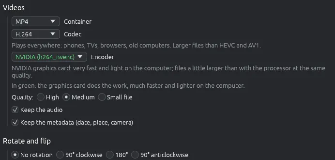

# Convertire i video

Converte i video in un altro formato o in un'altra misura, li ruota, li fa più leggeri o trasforma una clip breve in GIF. Converte anche i file audio in un altro formato audio. Altri tre strumenti lavorano sui video senza convertirli: **Copia con i metadati**, **Copia senza audio** e **Salva l'audio in un file**. Gli originali non cambiano: i file nuovi vanno accanto a loro o dove scegli tu.

## Avviare la conversione

Seleziona i video nella griglia (si possono selezionare anche immagini) e scegli  **Converti…** dalla barra strumenti, dal menu **Strumenti** (**Ctrl + B**) o dal clic destro. Se tra i file ci sono video, la finestra ha una parte **Video**. Rotazione e riflessioni e destinazione funzionano come per le immagini; tra le dimensioni si possono scegliere solo **Invariate**, **Percentuale dell'originale** ed **Entro**: vedi [Convertire e ridimensionare le immagini](convert.md).

## FFmpeg

I video li converte FFmpeg.

- Se sul computer c'è FFmpeg 4.3 o più recente, EyeCanSee usa quello. Altrimenti la finestra propone **Scarica FFmpeg** e ne mostra il peso: si scarica una volta sola nella cartella dei dati dell'app e viene controllato prima dell'uso (vedi [Componenti aggiuntivi](components.md)).
- Se l'FFmpeg del computer è troppo vecchio, la finestra dice quale versione ha trovato. Fa lo stesso quando quell'FFmpeg non sa leggere H.264 e HEVC, i formati in cui registrano i telefoni (per esempio l'FFmpeg di Fedora), se in **Strumenti > Opzioni… > Video** la scelta è Automatica. Quell'FFmpeg si usa comunque per le operazioni che copiano i flussi così come sono, senza leggerli: **Uguale all'originale**, **Copia con i metadati**, **Copia senza audio** e **Salva l'audio in un file**; lo scaricamento viene proposto solo quando scegli una codifica che converte.
- La prima volta EyeCanSee controlla quali codificatori funzionano su questo computer ("Controllo quali codificatori funzionano su questo computer…") e poi mostra solo quelli.
- Quando l'FFmpeg del computer lascia al processore una parte del lavoro della scheda video, e in **Strumenti > Opzioni… > Video** la scelta è Automatica, la finestra lo dice e propone di scaricare quello di EyeCanSee, che si usa dall'avvio successivo.

## Le scelte

- **Contenitore**: MP4 (quello predefinito), MKV, WebM, MOV, AVI o GIF.
- **Codifica**: quelle che il contenitore accetta, tra H.264 (quella predefinita), HEVC, AV1, VP9, VP8, MPEG-4, ProRes e GIF. Una riga dice a che cosa serve la codifica scelta. Una codifica senza codificatori funzionanti su questo computer è grigia.
- **Uguale all'originale (senza ricodifica)**: video e audio vengono copiati così come sono, in pochi secondi e senza nessuna perdita, con i metadati. Rotazione e dimensioni non si applicano. All'inizio il contenitore è quello degli originali (un WebM resta WebM), e l'elenco mostra solo i contenitori che possono contenerne le tracce. Video di formati diversi scelti insieme vengono copiati in MKV, che li contiene tutti. Se poi il contenitore scelto non può contenere le tracce di un video, quel video viene copiato in MKV, così la copia non fallisce per questo.
- **Codificatore**: prima quelli della scheda video, in verde (NVIDIA, Intel Quick Sync, AMD, VA-API su Linux), poi quello di Windows e quelli del processore. La scheda video è molto più veloce e lascia libero il computer; il processore fa file un po' più piccoli a parità di qualità. Una riga dice a che cosa serve il codificatore scelto.
- **Qualità**: **Alta**, **Media** (quella predefinita) o **File piccolo**.
- **Mantieni l'audio** e **Mantieni i metadati (data, posizione, fotocamera)**, tutte e due accese in modo predefinito.

Con un codificatore NVIDIA, Intel Quick Sync o VA-API la scheda video, dove può, anche legge, ruota e ridimensiona il video. Se la scheda non sa leggere un video, il video viene riconvertito da solo con il processore.

## Dashcam e droni

Alcune dashcam tengono la traccia GPS in un file `gps.sqlite` sulla scheda, e i droni DJI scrivono la posizione in un file `.SRT` accanto al video. Con **Mantieni i metadati** il video nuovo riceve il punto di partenza; per le dashcam anche l'altitudine e la velocità media e massima.

## Mentre lavora

Il riquadro in basso a destra mostra a che punto è; la barra avanza anche durante un video lungo. **Annulla** si ferma subito ed elimina il video fatto a metà. I video su un telefono o su un server vengono prima copiati in un file temporaneo su questo computer. Quando la destinazione è su un telefono o su un server, il video nuovo viene fatto in un file temporaneo su questo computer e mandato lì alla fine.

## Copia con i metadati

**Strumenti > Copia con i metadati…** (anche nel clic destro) apre la stessa finestra sui video scelti. Qui la finestra si chiama **Copia con i metadati** e il suo pulsante è **Copia**. È già impostata su **Uguale all'originale**, nel contenitore degli originali (MKV per video di formati diversi), senza rotazione né riflessione. Di solito scegli solo dove mettere la copia. Il video viene riscritto in pochi secondi, con i suoi metadati dentro: per dashcam e droni, anche la posizione presa dai file accanto.

Serve solo per i video: una foto ha già i suoi metadati dentro il file, quindi una copia normale (**Modifica > Copia** e **Incolla**) li conserva. Se insieme ai video scegli foto, file audio o altri file, la voce ha l'**\***: quei file restano fuori e alla fine vengono elencati. Senza nessun video scelto, la voce è grigia; se ci passi sopra col mouse, dice perché.

## Copia senza audio e Salva l'audio in un file

**Strumenti > Copia senza audio…** e **Strumenti > Salva l'audio in un file…** (anche nel clic destro) aprono una finestra breve sui video scelti. Scegli solo la destinazione, che all'inizio è accanto agli originali, poi fai clic su **Copia** (o **Salva** per l'audio).

- **Copia senza audio** crea un video nuovo, uguale all'originale ma senza audio. L'immagine e le altre tracce (sottotitoli, capitoli) vengono copiate così come sono, con i metadati. Il file nuovo prende un nome non ancora usato, per esempio `video (2).mp4`. Anche l'anteprima che la videocamera salva dentro il video (come fa una dashcam) va nel file nuovo. Se non si riesce a scriverla (per esempio perché il disco è pieno), la copia viene rifatta senza, e il riepilogo alla fine nomina quella copia.
- **Salva l'audio in un file** scrive ogni traccia audio in un file suo, copiata così com'è: AAC come `.m4a`, Opus come `.opus`, MP3 come `.mp3`, FLAC come `.flac`, Vorbis come `.ogg`, AC-3 come `.ac3`, E-AC-3 come `.eac3`, AMR come `.amr`, l'audio non compresso per lo più come `.wav`, i formati più rari come `.mka`. Un video con due tracce dà `video.m4a` e `video-2.m4a`. Per un altro formato (per esempio MP3 da AAC) usa Converti… sul file nuovo (vedi sotto).

Un video senza audio resta fuori e alla fine viene elencato.

## Convertire i file audio

**Converti…** lavora anche sui file audio, anche su molti insieme: se tra i file scelti ci sono file audio, la finestra ha una parte **File audio**. Scegli il **Formato** (MP3, AAC (M4A), Opus, FLAC, WAV od Ogg Vorbis; compaiono solo quelli che l'FFmpeg in uso sa scrivere) e, tranne per FLAC e WAV che non perdono niente, la **Qualità**. Poi la destinazione, come per le immagini, e **Converti**. Gli originali non vengono toccati: ogni file nuovo ha il nome dell'originale con la nuova estensione, per esempio `canzone.mp3` da `canzone.flac`.

I tag (titolo, artista, album, traccia…) restano. Resta anche la copertina in MP3, M4A e FLAC; Opus, Ogg Vorbis e WAV non hanno posto per la copertina. Come per i video serve FFmpeg: se il computer non ce l'ha, la finestra propone di scaricarlo.

## Da sapere

- La conversione e questi strumenti funzionano sul computer, sui telefoni e sui server.
- La tabella completa di contenitori, codifiche e codificatori è in [docs/video-formats.md](https://github.com/IoSonoPiero/eyecansee/blob/main/docs/video-formats.md).
