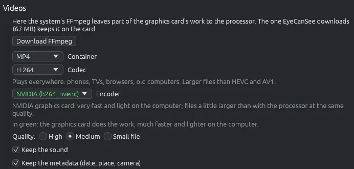

# Convertire i video

Converte i video in un altro formato o in un'altra misura, li ruota, li fa più leggeri o trasforma una clip breve in GIF. Altri tre strumenti lavorano sui video senza convertirli: **Copia con i metadati**, **Copia senza audio** e **Salva l'audio in un file**. Gli originali non vengono mai toccati.

## Avviare la conversione

Seleziona i video nella griglia (si possono selezionare anche immagini) e scegli  **Converti…** dalla barra strumenti, dal menù **Strumenti** (**Ctrl+B**) o dal clic destro. Se tra i file ci sono video, la finestra ha una parte **Video**. Rotazione, dimensioni e destinazione funzionano come per le immagini: vedi [Convertire e ridimensionare le immagini](convert.md).

## FFmpeg

I video li converte FFmpeg.

- Se sul computer c'è FFmpeg 4.3 o più recente, EyeCanSee usa quello. Altrimenti la finestra propone **Scarica FFmpeg**, con il suo peso: si scarica una volta sola nella cartella dei dati dell'app e viene controllato prima dell'uso (vedi [Componenti aggiuntivi](components.md)).
- Se l'FFmpeg del computer è troppo vecchio, la finestra dice quale versione ha trovato. Lo stesso quando non sa leggere H.264 e HEVC, i formati in cui registrano i telefoni (per esempio l'FFmpeg di Fedora), con la scelta Automatica in **Opzioni > Video**. Quell'FFmpeg si usa comunque per ciò che copia i flussi così come sono, senza leggerli: **Uguale all'originale**, **Copia con i metadati**, **Copia senza audio** e **Salva l'audio in un file**; lo scaricamento viene proposto solo quando scegli un codec che converte.
- La prima volta EyeCanSee controlla quali codificatori funzionano su questo computer ("Controllo quali codificatori funzionano su questo computer…") e poi mostra solo quelli.
- Quando l'FFmpeg del computer lascia al processore una parte del lavoro della scheda video, e in **Opzioni > Video** è scelto Automatica, la finestra lo dice e propone di scaricare quello di EyeCanSee, usato dall'avvio successivo.

## Le scelte

- **Contenitore**: MP4 (quello predefinito), MKV, WebM, MOV, AVI o GIF.
- **Codifica**: quelle che il contenitore accetta, tra H.264 (quella predefinita), HEVC, AV1, VP9, VP8, MPEG-4, ProRes e GIF. Una riga dice a che cosa serve la codifica scelta. Una codifica senza codificatori funzionanti su questo computer è grigia.
- **Uguale all'originale (senza ricodifica)**, in MP4, MKV e MOV: video e audio vengono copiati così come sono, in pochi secondi e senza nessuna perdita, con i metadati. Rotazione e dimensioni non si applicano.
- **Codificatore**: prima quelli della scheda video, in verde (NVIDIA, Intel Quick Sync, AMD, VA-API su Linux), poi quello di Windows e quelli del processore. La scheda video è molto più veloce e lascia libero il computer; il processore fa file un po' più piccoli a parità di qualità. Una riga dice a che cosa serve il codificatore scelto.
- **Qualità**: **Alta**, **Media** (quella predefinita) o **File piccolo**.
- **Mantieni l'audio** e **Mantieni i metadati (data, posizione, fotocamera)**, accese all'inizio.

Con un codificatore NVIDIA, Intel Quick Sync o VA-API la scheda video, dove può, anche legge, ruota e ridimensiona il video. Un video che la scheda non sa leggere viene riconvertito da solo con il processore.

## Dashcam e droni

Alcune dashcam tengono la traccia GPS in un file `gps.sqlite` sulla scheda, e i droni DJI scrivono la posizione in un file `.SRT` accanto al video. Con **Mantieni i metadati** il video nuovo riceve il punto di partenza; per le dashcam anche l'altitudine e la velocità media e massima.

## Mentre lavora

Il riquadro in basso a destra mostra a che punto è; la barra avanza anche durante un video lungo. **Annulla** si ferma subito ed elimina il video fatto a metà. I video su un telefono o su un server vengono prima copiati in un file temporaneo su questo computer, e alla fine il risultato viene scritto al suo posto.

## Copia con i metadati

**Strumenti > Copia con i metadati…** (anche nel clic destro) apre la stessa finestra sui video scelti, già impostata su **Uguale all'originale**; gli altri file scelti restano fuori, e alla fine vengono nominati. Di solito scegli solo dove mettere la copia. Il video viene riscritto in pochi secondi, con i suoi metadati dentro: per dashcam e droni anche la posizione presa dai file accanto.

## Copia senza audio e Salva l'audio in un file

**Strumenti > Copia senza audio…** e **Strumenti > Salva l'audio in un file…** (anche nel clic destro) aprono una finestra breve sui video scelti, in cui scegli solo la destinazione. All'inizio è accanto agli originali.

- **Copia senza audio** crea un video nuovo, uguale all'originale ma senza audio. L'immagine e le altre tracce (sottotitoli, capitoli) vengono copiate così come sono, con i metadati. Il file nuovo prende un nome libero, per esempio `video (2).mp4`.
- **Salva l'audio in un file** scrive ogni traccia audio in un file suo, copiata così com'è: AAC come `.m4a`, Opus come `.opus`, MP3 come `.mp3`, FLAC come `.flac`, Vorbis come `.ogg`, AC-3 come `.ac3`, E-AC-3 come `.eac3`, AMR come `.amr`, l'audio non compresso per lo più come `.wav`, i formati più rari come `.mka`. Un video con due tracce dà `video.m4a` e `video-2.m4a`. Per un altro formato (per esempio MP3 da AAC) usa Converti….

Un video senza audio resta fuori, e alla fine viene nominato.

## Da sapere

- Funzionano sul computer, sui telefoni e sui server.
- La tabella completa di contenitori, codifiche e codificatori è in [docs/video-formats.md](https://github.com/IoSonoPiero/eyecansee/blob/main/docs/video-formats.md).
