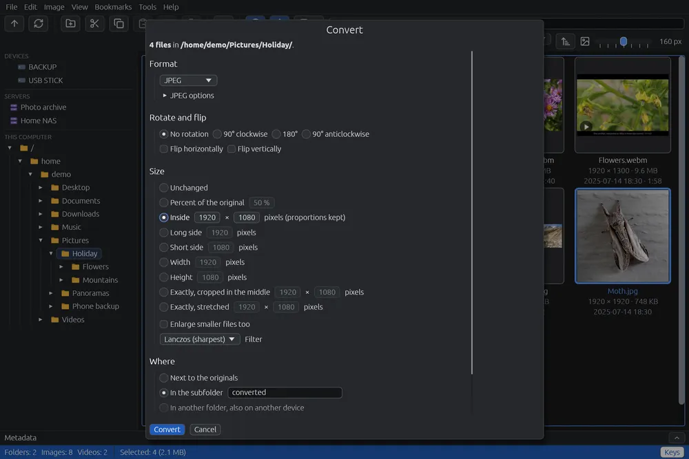

# Convertire e ridimensionare le immagini

Converte tante immagini insieme: in un altro formato, più piccole o più grandi, ruotate o riflesse, nella stessa cartella, in una sottocartella o in un'altra cartella, anche su un altro dispositivo. Gli originali non cambiano: i file nuovi vanno accanto a loro o dove scegli tu.

Converti lavora sui file selezionati nella griglia, così come sono sul disco, tutti con le stesse regolazioni. Per una sola immagine, così come la vedi nel visore o nell'editor, col nome che scegli, c'è [Salva come](save-as.md).

Per una sola immagine con l'anteprima dal vivo usa [Salva come](save-as.md). I video passano dalla stessa finestra: vedi [Convertire i video](convert-video.md).

## Avviare la conversione

1. Nella griglia seleziona le immagini (vedi [Selezionare i file](selection.md)). Se non hai selezionato niente, vale l'immagine su cui sta il cursore.
2. Fai clic su  nella barra strumenti, oppure scegli **Strumenti > Converti…** (**Ctrl + B**), oppure fai clic destro su uno dei file selezionati e scegli **Converti…**. La finestra si apre sul formato, con le dimensioni **Invariate** e senza rotazione né riflessione; **Ridimensiona > Personalizzata…** la apre sulle dimensioni (vedi più sotto).
3. Fai le tue scelte nella finestra e premi **Converti**.

La finestra lavora su foto, video e file audio (vedi [Convertire i video](convert-video.md)). Gli altri file selezionati (modelli 3D, disegni CAD) restano fuori: la finestra dice quanti sono, il riepilogo finale quali. Non funziona dal visore, e si fa una conversione alla volta.

## Ridimensionare con un clic

Per fare solo delle copie più piccole delle foto, senza la finestra: fai clic destro sui file selezionati, oppure apri **Strumenti**, e scegli **Ridimensiona** e una delle sue misure: **Piccola (lato lungo 1280 px)**, **Media (lato lungo 1920 px)**, **Grande (lato lungo 2560 px)** o **Metà (50 %)**. Le misure le puoi cambiare nelle [Opzioni](options.md), nella scheda **Ridimensiona**.

Il lavoro parte subito su tutte le immagini scelte, con lo stesso riquadro e **Annulla** descritti più sotto e il riepilogo finale. Le copie vanno accanto agli originali, nel loro formato e con i loro metadati (una foto **Ultra HDR** resta Ultra HDR), con la misura nel nome: `foto (1920 px).jpg`, `foto (50%).jpg`. Un nome già preso riceve " (2)". Per le immagini che hanno già quella misura, o sono più piccole (non vengono mai ingrandite), non si fa nessuna copia, e il messaggio le elenca: così ridimensionare di nuovo una copia non crea `foto (1920 px) (1920 px).jpg`. Quelle in un formato che EyeCanSee non sa scrivere (HEIC, RAW…) restano fuori, e il messaggio dice perché. Restano fuori anche video, modelli 3D, disegni CAD e file audio, e il messaggio li elenca: se tra i file scelti ce ne sono, **Ridimensiona** è segnata con **\***; se non c'è nessuna immagine, è grigia.

**Ridimensiona > Personalizzata…** apre questa finestra sulle immagini, sulla rotazione e sulle dimensioni. Qui la finestra si chiama **Ridimensiona** e il suo pulsante è **Ridimensiona**; il formato è **Uguale all'originale** e le copie vanno accanto agli originali. Riparte dalla misura e dalla rotazione dell'ultima Personalizzata… (all'inizio **Lato lungo** 1920 px, senza rotazione); **Converti…** invece riparte sempre da **Invariate**, senza rotazione né riflessione. Come con le misure qui sopra, le copie delle immagini davvero ridimensionate hanno la misura nel nome (quelle solo ruotate o riflesse dicono cosa è stato fatto), in qualunque formato e dovunque vadano:

| Dimensioni | Nome della copia |
|---|---|
| Lato lungo, Lato corto, Larghezza o Altezza di 600 px | `foto (600 px).jpg` |
| Entro 800 × 600 | `foto (800x600).jpg` |
| Percentuale dell'originale, 50 | `foto (50%).jpg` |
| Misura esatta 800 × 600, tagliata o deformata | `foto (800x600).jpg` |
| Invariate, ruotata (riflessa o no) | `foto (ruotata).jpg` |
| Invariate, solo riflessa | `foto (riflessa).jpg` |

Con una misura e una rotazione, il nome dice solo la misura. Un'immagine lasciata alla sua misura (già più piccola di quella chiesta, non ingrandita) tiene il suo nome: in un altro formato cambia solo l'estensione, `foto.png`. Un nome già preso riceve " (2)" dopo: `foto (600 px) (2).jpg`, `foto (ruotata) (2).jpg`.

## Formato

- **Uguale all'originale**: ogni immagine resta nel suo formato e viene scritta come la scrive Salva (un JPEG tiene la sua qualità). Le immagini in un formato che EyeCanSee non sa scrivere (HEIC, RAW…) restano fuori.
- Uno dei formati di [Salva come](save-as.md). Le sue opzioni sono sotto **Opzioni JPEG** (con il nome del formato scelto): fai clic sul titolo per aprirle. Lì c'è anche **Metadati**: tutti, tutti tranne il luogo, o nessuno tranne il profilo colore, come in [Salva come](save-as.md).
- Le foto **Ultra HDR** dei telefoni restano HDR solo in JPEG. Se tra i file ci sono dei JPEG e scegli un altro formato, la finestra ti avvisa.

## Rotazione e ribaltamenti

- **Nessuna rotazione**, **90° in senso orario**, **180°** o **90° in senso antiorario**.
- **Rifletti orizzontalmente** e **Rifletti verticalmente**. Con anche una rotazione, prima si riflette e poi si ruota.
- Le foto JPEG solo ruotate, nel loro formato, vengono ruotate senza perdere qualità quando le loro dimensioni lo permettono, come fa Salva.

## Dimensioni

- **Invariate**.
- **Percentuale dell'originale** (50 % all'inizio).
- **Entro** un riquadro di pixel (1920 × 1080 all'inizio): ogni immagine diventa grande quanto entra nel riquadro, con le sue proporzioni, dopo la rotazione.
- **Lato lungo**, **Lato corto**, **Larghezza** o **Altezza** di tanti pixel, con le proporzioni: un lato lungo di 1920 porta le foto orizzontali e quelle verticali a 1920 pixel sul loro lato più lungo.
- **Misura esatta, tagliata al centro**: esattamente la misura scritta; ciò che non entra nelle proporzioni viene tagliato in parti uguali dai due lati.
- **Misura esatta, deformata**: esattamente la misura scritta, con l'immagine allungata o schiacciata.
- Se tra i file scelti ci sono dei video, si possono scegliere solo **Invariate**, **Percentuale dell'originale** ed **Entro**: le altre misure valgono solo per le immagini.
- **Ingrandisci anche i file più piccoli**: spenta all'inizio, così le immagini già più piccole della misura chiesta restano come sono (con una misura esatta, nessun lato diventa più grande di quello dell'originale). Con il formato **Uguale all'originale**, per un'immagine che verrebbe uguale all'originale non si fa nessuna copia, e il messaggio la elenca.
- **Filtro**, cioè come si calcolano i pixel nuovi: **Lanczos** (il più nitido, quello predefinito), **Catmull-Rom**, **Gaussiano** (morbido), **Bilineare** (veloce), **Pixel più vicino** (tiene i bordi netti della pixel art).

Se non cambierebbe niente (stesso formato, stesse dimensioni, nessuna rotazione), **Converti** (o **Ridimensiona**) resta spento e una riga rossa lo dice: le immagini perderebbero solo qualità.

## Dove

- **Accanto agli originali**.
- **Nella sottocartella**, col nome che scrivi ("convertite" all'inizio). Se non c'è, viene creata.
- **In un'altra cartella, anche su un altro dispositivo**: scrivi una cartella o un indirizzo come nella barra degli indirizzi (`mtp://…` per un telefono, `sftp://…` per un server), oppure premi **Sfoglia…**. La finestra di scelta mostra a sinistra la cartella home, i dischi, i telefoni collegati e i server salvati: fai clic su una cartella per entrarci, poi **Usa questa cartella**. Un server salvato si apre nella cartella da cui parte, come nella griglia.  accanto all'indirizzo crea lì una cartella nuova: una piccola finestra ne chiede il nome, come **Nuova cartella** nella griglia ("Nuova cartella" già scritto e selezionato); scrivi quello che vuoi, poi **Invio** o **Crea**. La finestra di scelta entra poi nella cartella nuova.

Un nome già preso riceve " (2)": nessun file viene mai sovrascritto. Così puoi, per esempio, convertire le foto del telefono direttamente in una cartella del computer.

La finestra ricorda le scelte che confermi finché EyeCanSee resta aperto. **Annulla** (o **Esc**) dimentica quelle fatte da quando si è aperta: la volta dopo si riapre com'era prima.

## Mentre lavora

Un riquadro in basso a destra mostra quanti file sono pronti, una barra e il file in lavorazione, con **Annulla**. Intanto puoi continuare a usare EyeCanSee. Annulla si ferma dopo l'immagine in corso.

Alla fine un riepilogo, con il nome del comando come titolo, dice:

- quanti file sono stati salvati e dove; quanti sono stati salvati in JPEG senza una parte dei loro metadati (EXIF, XMP o IPTC) troppo grande per starci, ciascuno elencato in un gruppo con quella parte tra parentesi; quanti sono rimasti fuori; quanti non sono stati fatti, se hai fermato il lavoro (un numero zero non compare);
- quanto tempo ci è voluto e, se sono stati salvati dei file, il loro peso su disco prima e dopo, con la percentuale;
- i file rimasti fuori, divisi per motivo (un altro tipo di file, un formato che EyeCanSee non sa scrivere, già di quella misura, animati o con più pagine, troppo grandi per la memoria di questo computer, FFmpeg mancante, un errore), ogni gruppo con i nomi dei suoi file, in ordine. Un gruppo di più di cinque file è chiuso: fai clic sulla sua riga per aprirlo. Se l'elenco è lungo, scorre.  a destra dei pulsanti copia il riepilogo con tutti i file rimasti fuori, anche quelli dei gruppi chiusi.
- dopo questi, per **Copia senza audio**, le copie salvate senza l'anteprima della videocamera, che non si è potuta scrivere (vedi [Convertire i video](convert-video.md)).

**Apri la cartella** mostra le miniature della cartella in cui sono andati i file, su questo computer, su un telefono o su un server; c'è solo se qualcosa è stato salvato in un'altra cartella, non in quella che stai guardando, ed è grigio mentre una pagina (l'editor, Salva come, la presentazione o i duplicati) copre le miniature. **Chiudi**, **Invio** o **Esc** chiudono il riepilogo.

Quando una copia o uno spostamento finisce mentre questo riepilogo è aperto, o finisce con qualcosa da dire mentre il lavoro va avanti, il resoconto è uno solo, **Lavori finiti**, con una parte per ogni lavoro, nell'ordine in cui sono finiti: **Invio** o **Esc** lo chiudono tutto. Il suo **Apri la cartella** mostra la cartella della conversione; se la conversione non ne ha, quella di una copia andata in una cartella che non è sullo schermo. Un messaggio che arriva mentre un altro è aperto aspetta che si chiuda.

## Da sapere

- Le immagini animate e quelle con più pagine restano fuori: il file nuovo terrebbe solo la prima immagine.
- Un'immagine che, letta tutta, chiederebbe più di metà della memoria del computer (per esempio un HEIC, un TIFF a 16 bit o un JPEG XL di centinaia di megapixel, su un computer da 8 GB) resta fuori, senza domande: il riepilogo la elenca. Non resta fuori un'immagine che hai scelto di aprire comunque da quando EyeCanSee è partito (nel visore, nell'editor, in Salva come o salvando una rotazione), né un JPEG solo ruotato o riflesso senza perdere qualità, che non viene decodificato. Di un file più grande di 32 MB si legge solo l'inizio, quando lì sono scritte le dimensioni dell'immagine.
- Una foto in movimento del telefono tiene il suo video solo se viene soltanto ruotata e resta JPEG; altrimenti il file nuovo è solo la foto, e il video resta nell'originale.
- Funziona su tutte le sorgenti: computer, dischi, telefoni e server.
- Nella finestra **Invio** avvia la conversione (quando non stai scrivendo in un campo) ed **Esc** annulla.
