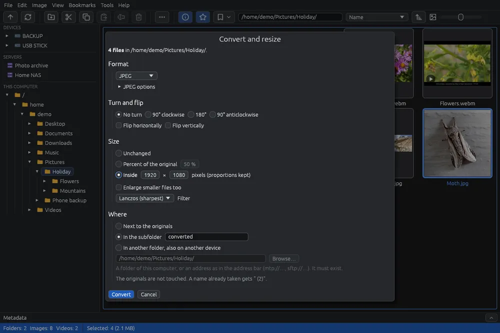

# Convertire e ridimensionare le immagini

Converte tante immagini insieme: in un altro formato, più piccole o più grandi, ruotate o riflesse, nella stessa cartella, in una sottocartella o in un'altra cartella, anche su un altro dispositivo. Gli originali non vengono mai toccati: i file nuovi vanno accanto a loro o dove scegli tu.

Per una sola immagine con l'anteprima dal vivo usa [Salvare in un altro formato](save-as.md). I video passano dalla stessa finestra: vedi [Convertire i video](convert-video.md).

## Avviare la conversione

1. Nella griglia seleziona le immagini (vedi [Selezionare i file](selection.md)). Se non hai selezionato niente, vale l'immagine su cui sta il cursore.
2. Fai clic su  nella barra strumenti, oppure scegli **Strumenti > Converti e ridimensiona…** (**Ctrl+B**), oppure fai clic destro su uno dei file selezionati e scegli **Converti e ridimensiona…**.
3. Fai le tue scelte nella finestra e premi **Converti**.

La finestra lavora su foto e video. Gli altri file selezionati (modelli 3D, disegni CAD, file audio) restano fuori, e la finestra dice quanti sono. Non funziona dal visore, e si fa una conversione alla volta.

## Ridimensionare con un clic

Per fare solo delle copie più piccole delle foto, senza la finestra: fai clic destro sui file selezionati, oppure apri **Strumenti**, e scegli **Ridimensiona** e una delle sue misure: **Piccola (lato lungo 1280 px)**, **Media (lato lungo 1920 px)**, **Grande (lato lungo 2560 px)** o **50 %**. Le misure le puoi cambiare nelle [Opzioni](options.md), nella scheda **Ridimensiona**.

Il lavoro parte subito su tutte le immagini scelte, con lo stesso riquadro e **Annulla** descritti più sotto e il messaggio finale. Le copie vanno accanto agli originali, nel loro formato e con i loro metadati (una foto **Ultra HDR** resta Ultra HDR), con la misura nel nome: `foto (1920 px).jpg`, `foto (50%).jpg`. Un nome già preso riceve " (2)". Le immagini già più piccole della misura vengono copiate così come sono, mai ingrandite. Quelle in un formato che EyeCanSee non sa scrivere (HEIC, RAW…) restano fuori, e il messaggio dice perché. Restano fuori anche video, modelli 3D, disegni CAD e file audio: se tra i file scelti ce ne sono, **Ridimensiona** è segnata con **\***.

**Ridimensiona > Personalizzata…** apre questa finestra sulle immagini, con il formato **Uguale all'originale**.

## Formato

- **Uguale all'originale**: ogni immagine resta nel suo formato e viene scritta come la scrive Salva (un JPEG tiene la sua qualità). Le immagini in un formato che EyeCanSee non sa scrivere (HEIC, RAW…) restano fuori.
- Uno dei formati di [Salvare in un altro formato](save-as.md). Le sue opzioni sono sotto **Opzioni JPEG** (o il nome del formato scelto): fai clic sul titolo per aprirle. Lì c'è anche **Mantieni i metadati**.
- Le foto **Ultra HDR** dei telefoni restano HDR solo in JPEG. Se tra i file ci sono dei JPEG e scegli un altro formato, la finestra te lo ricorda.

## Rotazione e ribaltamenti

- **Nessuna rotazione**, **90° in senso orario**, **180°** o **90° in senso antiorario**.
- **Rifletti orizzontalmente** e **Rifletti verticalmente**. Con anche una rotazione, prima si riflette e poi si ruota.
- Le foto JPEG solo ruotate, nel loro formato, vengono ruotate senza perdere qualità quando le loro dimensioni lo permettono, come fa Salva.

## Dimensioni

- **Invariate**.
- **Percentuale dell'originale** (50 % all'inizio).
- **Entro** un riquadro di pixel (1920 × 1080 all'inizio): ogni immagine diventa grande quanto entra nel riquadro, con le sue proporzioni, dopo la rotazione.
- **Lato lungo**, **Lato corto**, **Larghezza** o **Altezza** di tanti pixel, con le proporzioni: un lato lungo di 1920 porta le foto orizzontali e quelle verticali a 1920 pixel sul loro lato più lungo.
- **Misura esatta, tagliata al centro**: esattamente la misura scritta; ciò che non entra nelle proporzioni viene tagliato in parti uguali dai due lati.
- **Misura esatta, deformata**: esattamente la misura scritta, con l'immagine allungata o schiacciata.
- Se tra i file scelti ci sono dei video si possono scegliere solo **Invariate**, **Percentuale dell'originale** ed **Entro**: le altre misure valgono solo per le immagini.
- **Ingrandisci anche i file più piccoli**: spenta all'inizio, così le immagini già più piccole della misura chiesta restano come sono (con una misura esatta, nessun lato diventa più grande di quello dell'originale).
- **Filtro**, cioè come si calcolano i pixel nuovi: **Lanczos** (il più nitido, quello predefinito), **Catmull-Rom**, **Gaussiano** (morbido), **Bilineare** (veloce), **Pixel più vicino** (tiene i bordi netti della pixel art).

Se non cambierebbe niente (stesso formato, stesse dimensioni, nessuna rotazione), **Converti** resta spento e una riga rossa lo dice: le immagini perderebbero solo qualità.

## Dove

- **Accanto agli originali**.
- **Nella sottocartella**, col nome che scrivi ("convertite" all'inizio). Se non c'è, viene creata.
- **In un'altra cartella, anche su un altro dispositivo**: scrivi una cartella o un indirizzo come nella barra degli indirizzi (`mtp://…` per un telefono, `sftp://…` per un server), oppure premi **Sfoglia…**. La finestra di scelta mostra a sinistra la cartella home, i dischi, i telefoni collegati e i server salvati: fai clic su una cartella per entrarci, poi **Usa questa cartella**. La cartella deve già esistere.

Un nome già preso riceve " (2)": nessun file viene mai sovrascritto. Così puoi, per esempio, convertire le foto del telefono direttamente in una cartella del computer.

La finestra ricorda le tue scelte finché EyeCanSee resta aperto.

## Mentre lavora

Un riquadro in basso a destra mostra quanti file sono pronti, una barra e il file in lavorazione, con **Annulla**. Intanto puoi continuare a usare EyeCanSee. Annulla si ferma dopo l'immagine in corso.

Alla fine un messaggio dice quanti file sono stati salvati e dove, e quali sono rimasti fuori e perché.

## Da sapere

- Le immagini animate e quelle con più pagine restano fuori: il file nuovo terrebbe solo la prima immagine.
- Una foto in movimento del telefono tiene il suo video solo se viene soltanto ruotata e resta JPEG; altrimenti il file nuovo è solo la foto, e il video resta nell'originale.
- Funziona su tutte le sorgenti: computer, dischi, telefoni e server.
- Nella finestra **Invio** avvia la conversione (quando non stai scrivendo in un campo) ed **Esc** annulla.
