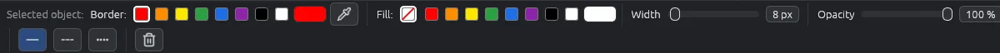

# Colori, linee e contagocce

La barra delle proprietà, sotto gli strumenti, contiene lo stile di ciò che disegni: colore, spessore, opacità e tipo di tratto. Cambia con lo strumento.

## Prossimo oggetto o oggetto selezionato

La barra comincia con una di queste due scritte:

- **Prossimo oggetto:** non c'è niente di selezionato. Lo stile vale per il prossimo oggetto che disegni con questo strumento.
- **Oggetto selezionato:** le modifiche vanno all'oggetto selezionato, e restano per i prossimi dello stesso tipo.

EyeCanSee ricorda l'ultimo stile di ogni tipo di oggetto, anche dopo la chiusura. Gli spessori restano in proporzione all'immagine, così una linea si vede uguale su una foto piccola e su una grande.

## Colori

- Otto colori pronti: rosso, arancione, giallo, verde, blu, viola, nero e bianco. Quello in uso è cerchiato.
- **Altro colore**: il pulsante dopo di loro apre un selettore di colore.
- Rettangoli, ellissi e fumetti hanno due file: **Bordo:** e **Riempimento:**. Il riempimento può anche mancare (il quadratino bianco barrato di rosso).
- Un fumetto ha anche il colore delle sue **Lettere:**.

## Spessore, dimensione e opacità

- **Spessore**: quanto sono grosse linee e bordi, in pixel dell'immagine. Per una lente, 0 vuol dire nessun bordo.
- **Dimensione**: per testi, numeri di passaggio e timbri.
- **Opacità**: dal 5% al 100%. Per un riflettore il cursore si chiama **Intensità**: quanto si scurisce il resto.
- L'evidenziatore e la copertura non hanno spessore: sono grandi quanto li trascini. La copertura non ha opacità: è sempre piena.

## Tratto

Linee, frecce, tratti a mano libera, rettangoli ed ellissi possono essere  **Continuo**,  **Tratteggiato** o  **Puntinato**.

## Il contagocce

 prende un colore dall'immagine, compreso ciò che ci è disegnato sopra.

1. Premi **I**, o fai clic sul contagocce nella barra.
2. Muoviti sopra l'immagine. Un riquadro accanto al puntatore mostra una lente con i pixel intorno (quello preso è incorniciato), il colore nuovo sopra quello in uso, e i suoi codici esadecimale, RGB e HSL.
3. Scegli **1 px**, **3×3** o **5×5**: un pixel, o la media dei pixel intorno.
4. Fai clic. Il colore va allo stile nella barra, il suo codice esadecimale va negli appunti, e la barra di stato mostra i codici per qualche secondo.

Esc annulla. Con uno strumento di disegno, **Alt+clic** prende subito un colore e lo strumento resta.

## Colori da qualsiasi punto dello schermo

- **Linux**: il pulsante del contagocce e **Maiusc+I** aprono il selettore di colore del sistema, per prendere un colore da qualsiasi punto dello schermo. **I** lo prende sull'immagine, con il riquadro.
- **Windows**: il contagocce prende un colore dall'immagine. Per prenderne uno altrove sullo schermo, premi sull'immagine e lascia dove c'è il colore; il riquadro mostra il colore sotto il puntatore.

Il contagocce è nella barra solo dove c'è un colore da scegliere: non con Seleziona senza niente di selezionato, non per un riflettore, un filtro o una zona incollata, non con Ritaglia e ruota.
