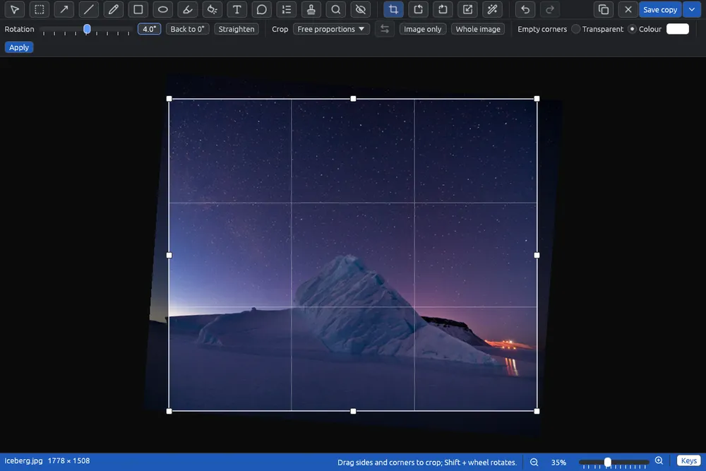

# Ritagliare e ruotare

 **Ritaglia e ruota** (C) raddrizza l'immagine, la ruota di qualsiasi angolo e la ritaglia sulla parte che vuoi. **Immagine > Ruota e ritaglia…** apre l'editor con questo strumento già scelto.

Con questo strumento si vede tutta l'immagine, con sopra la cornice del ritaglio e le parti fuori scurite. Con gli altri strumenti si vede solo il risultato.

## Ruotare

- **Rotazione**: usa il cursore, o scrivi i gradi nel campo accanto, da -180° a 180° a decimi di grado, con una tacca ogni 45°. Vanno bene sia il punto sia la virgola.
- Tieni premuto Maiusc e gira la rotellina sopra l'immagine: 0,1° per scatto. Comodo per allineare l'orizzonte alle linee dei terzi.
- **Torna a 0°** rimette l'angolo a zero.
-  e  nella barra degli strumenti (**Ctrl + Maiusc + R**, **Ctrl + R**) ruotano l'immagine di un quarto di giro, insieme a ciò che ci è disegnato sopra e al ritaglio.

## Raddrizzare

1. Fai clic su **Raddrizza**.
2. Traccia una linea lungo l'orizzonte, o lungo qualcosa di verticale come un muro.
3. Quando lasci, l'immagine ruota per mettere dritta quella linea (in orizzontale o in verticale), e Raddrizza si spegne da solo.

## Ritagliare

- Trascina un angolo o un lato della cornice per ridimensionarla. Trascina dentro la cornice per spostarla. Trascinare fuori dalla cornice sposta la vista.
- **Ritaglio**: le proporzioni. **Proporzioni libere**, **Come l'originale**, 1:1, 5:4, 4:3, 3:2, 16:9, o **Personalizzate** con i tuoi numeri. Con proporzioni fisse si trascinano solo gli angoli.
-  passa da proporzioni orizzontali a verticali e viceversa.
- **Solo immagine**: il ritaglio più grande senza angoli vuoti. Segue la rotazione, ed è quello predefinito.
- **Tutta l'immagine**: tutta l'immagine ruotata, con gli angoli vuoti.

La misura del risultato è nella barra di stato. Il ritaglio si ferma a 20.000 pixel per lato e a 200 megapixel in tutto (o alla misura di una foto più grande), e la barra di stato lo dice.

## Angoli vuoti

Dove il ritaglio va oltre l'immagine, gli angoli sono **Trasparenti** (si vedono a quadretti grigi) o riempiti con un **Colore** che scegli. Il JPEG non ha trasparenza: lì diventano bianchi.

## Applicare

**Applica** (o Invio) torna allo strumento che usavi prima e mostra il risultato ritagliato. **Ctrl + Z** annulla il ritaglio.

## Da sapere

- Esc durante un trascinamento rimette il ritaglio com'era; altrimenti con questo strumento Esc chiude la pagina (chiedendo prima, se ci sono modifiche non salvate).
- Puoi tornare a questo strumento e cambiare rotazione e ritaglio in qualsiasi momento.
- Una foto Ultra HDR resta HDR: la sua parte HDR viene ruotata e ritagliata insieme alla foto.
- Per ruotare o riflettere soltanto un'immagine nel visore, senza l'editor, vedi [Ruotare e riflettere](rotate.md).
