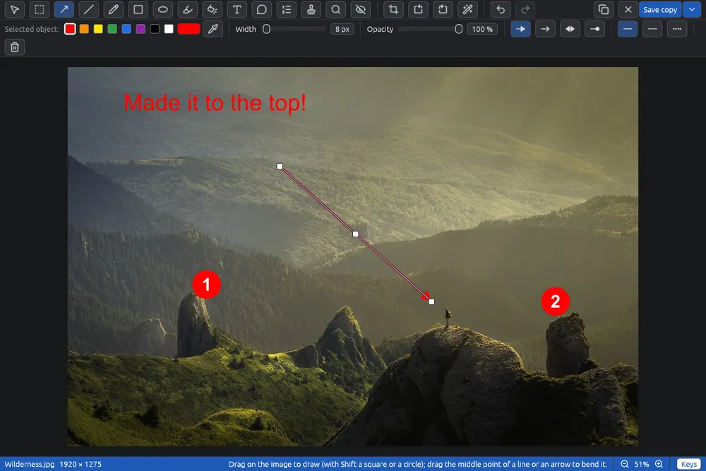

# Modificare un'immagine

L'editor è una pagina a sé dove disegni su un'immagine, copri i dati privati, aggiungi filtri, la ruoti e la ritagli. Il file originale non cambia mai, a meno che tu non scelga di sovrascriverlo.

## Aprire l'editor

- **Immagine > Modifica immagine…** (Ctrl+E), il pulsante  nella barra degli strumenti, oppure **Modifica immagine…** nel menù del clic destro.
- **Immagine > Ruota e ritaglia…** apre la stessa pagina con lo strumento del ritaglio già scelto. Vedi [Ritagliare e ruotare](editor-crop.md).
- **File > Nuova immagine…** (Ctrl+N) apre un'immagine vuota nell'editor. Vedi [Nuova immagine](new-image.md).

L'editor lavora su un'immagine alla volta. Con più immagini selezionate queste voci sono spente; per girare più immagini insieme usa [Ruotare e riflettere](rotate.md) o [Convertire e ridimensionare le immagini](convert.md). Sono spente anche per un'immagine animata o con più pagine, nella griglia come nel visore, perché si salverebbe solo la prima.

## La pagina

- **Barra degli strumenti** (in alto): un pulsante per strumento, poi  e , , ,  e . A destra: ,  e **Salva copia** (o **Sovrascrivi…**, cioè Sovrascrivi l'originale…, se scelto nelle [Opzioni](options.md)) con la sua freccia . Lo strumento in uso è evidenziato. Passando sopra un pulsante vedi il nome e il tasto; su un pulsante spento anche il perché.
- **Barra delle proprietà** (sotto gli strumenti): lo stile dell'oggetto selezionato, o del prossimo che lo strumento disegnerà. Con lo strumento del ritaglio contiene i comandi del ritaglio. Vedi [Colori, linee e contagocce](editor-colors.md).
- **Barra di stato** (in basso): il nome del file, la misura del risultato in pixel, un breve suggerimento sullo strumento, l'ingrandimento e il pulsante **Tasti**.

## Gli strumenti

| Strumento | Tasto | Pagina |
|---|---|---|
|  Seleziona | V | questa pagina |
|  Selezione | M | [Selezionare un'area](editor-marquee.md) |
|  Freccia | A | [Linee e frecce](editor-lines.md) |
|  Linea | L | [Linee e frecce](editor-lines.md) |
|  Mano libera | P | [Penna, evidenziatore e forme](editor-draw.md) |
|  Rettangolo | R | [Penna, evidenziatore e forme](editor-draw.md) |
|  Ellisse | E | [Penna, evidenziatore e forme](editor-draw.md) |
|  Evidenziatore | H | [Penna, evidenziatore e forme](editor-draw.md) |
|  Riflettore | S | [Lente e riflettore](editor-lens.md) |
|  Testo | T | [Testo, fumetti e passi](editor-text.md) |
|  Fumetto | U | [Testo, fumetti e passi](editor-text.md) |
|  Numeri di passaggio | N | [Testo, fumetti e passi](editor-text.md) |
|  Timbri | K | [Timbri](editor-stamps.md) |
|  Lente | Z | [Lente e riflettore](editor-lens.md) |
|  Copertura | B | [Coprire parti dell'immagine](editor-cover.md) |
|  Ritaglia e ruota | C | [Ritagliare e ruotare](editor-crop.md) |

I tasti degli strumenti sono lettere sole, senza Ctrl. Mentre scrivi in un campo non fanno niente.

## Selezionare e cambiare gli oggetti

Tutto ciò che disegni resta un oggetto a sé fino al salvataggio: puoi spostarlo, cambiarne lo stile o eliminarlo in qualsiasi momento.

1. Scegli  **Seleziona** (V).
2. Fai clic su un oggetto per selezionarlo. La barra delle proprietà mostra il suo stile: cambialo lì.
3. Trascina l'oggetto per spostarlo. Trascina un angolo o un capo per ridimensionarlo; tieni premuto Maiusc per mantenere le proporzioni di un riquadro.
4. Premi **Canc**, o fai clic su  nella barra delle proprietà, per toglierlo.

Da sapere:

- Con uno strumento di disegno, un clic seleziona solo un oggetto del suo tipo (una freccia con Freccia, un numero con Numeri di passaggio). Altrove lo strumento fa il suo lavoro, anche sopra altri oggetti.
- Gli angoli dell'oggetto selezionato si trascinano con qualsiasi strumento.
- Una forma, una linea o un fumetto disegnati tutti sulla zona scura intorno all'immagine non restano: resta solo ciò che arriva sull'immagine.
- Un rettangolo o un'ellisse senza riempimento si prende dal bordo, non dall'interno vuoto.
- Filtri, evidenziatori e riflettori stanno sotto gli altri oggetti: un clic li prende solo dove non c'è nient'altro.
- Gli oggetti stanno uno sopra l'altro nell'ordine in cui li disegni.
- Cambiare strumento deseleziona l'oggetto (tranne quando scegli Seleziona).

## Annullare e ripetere

 **Annulla** (Ctrl+Z) e  **Ripeti** (Ctrl+Y o Ctrl+Maiusc+Z) vanno avanti e indietro tra tutte le modifiche, rotazione e ritaglio compresi. Mentre scrivi in un campo di testo, Ctrl+Z annulla ciò che hai scritto in quel campo.

## Ridimensionare l'immagine

 **Ridimensiona** (Ctrl+Alt+I) cambia la dimensione dell'immagine, per esempio per rimpicciolire una schermata annotata da mettere in un documento.

1. Fai clic su  **Ridimensiona**. La finestra mostra la dimensione attuale del risultato.
2. Scrivi la nuova larghezza o altezza, in **pixel** o **per cento** della dimensione attuale. Con **Mantieni le proporzioni** acceso (come all'inizio), l'altro lato segue.
3. Scegli il **Filtro**, se vuoi: Lanczos (il più nitido) per rimpicciolire, Catmull-Rom per ingrandire, a meno che tu ne scelga un altro. **Pixel più vicino** tiene i bordi netti della pixel art.
4. Fai clic su **Ridimensiona** (o Invio).

Ciò che hai disegnato segue l'immagine: frecce, riquadri, testi e gli spessori delle linee crescono o calano con lei, e così il ritaglio. Poi gli strumenti lavorano in pixel della nuova dimensione.

Buono a sapersi:

- **Annulla** (Ctrl+Z) riporta l'immagine alla dimensione che aveva, in un passo. Ridimensionare di nuovo riparte sempre dall'originale, così l'immagine non perde qualità due volte.
- Con l'immagine ruotata di un angolo (vedi [Ritagliare e ruotare](editor-crop.md)) le proporzioni restano quelle: con altre verrebbe storta.
- La nuova dimensione va nei metadati del file salvato; il resto dei metadati resta. Una foto Ultra HDR resta HDR.
- Al massimo 20000 pixel per lato. Per ridimensionare molte immagini insieme usa [Convertire e ridimensionare le immagini](convert.md).

## Muoversi nell'immagine

- Rotellina del mouse (o Ctrl+rotellina, o il pizzico): ingrandisce intorno al puntatore.
- **+** e **−**: ingrandiscono intorno al centro. **0**, un clic sulla percentuale o un doppio clic: tutto in vista.
- Trascina col tasto destro o centrale per spostare la vista. Con Seleziona sposta la vista anche trascinare su un punto vuoto.
- I pulsanti  e  sono nella barra di stato.

## Tasti

Il pulsante **Tasti** nella barra di stato elenca i tasti e i movimenti del mouse dello strumento in uso. Passaci sopra per vedere l'elenco, o fai clic per tenerlo aperto.

- **Ctrl+C** (o  **Copia**) mette negli appunti tutto il risultato, a piena grandezza, da incollare in un altro programma. Con Selezione copia solo la zona scelta.
- **Ctrl+R** e **Ctrl+Maiusc+R** girano l'immagine di un quarto a destra o a sinistra.
- **Ctrl+Alt+I** apre Ridimensiona.
- **Esc** fa una cosa alla volta: ferma il contagocce o un trascinamento, finisce il testo che stai scrivendo, lascia la zona o l'oggetto selezionati. Quando non c'è più niente da fermare, chiude la pagina.

## Chiudere

 **Chiudi**, la ✕ della finestra o Esc chiudono la pagina. Con modifiche non salvate EyeCanSee chiede prima se **Salva…** (il salvataggio principale: una copia, come Salva copia, a meno che nelle Opzioni sia scelto Sovrascrivi; la pagina si chiude appena il file è scritto), **Salva come…** o **Non salvare**; **Annulla** torna alla pagina. Vedi [Salvare un'immagine modificata](editor-save.md).

## Telefoni e server

Un'immagine su un telefono o su un server si modifica in una copia su questo computer, e la barra di stato lo dice. Quando salvi, il risultato viene rimandato lì. Vedi [Salvare un'immagine modificata](editor-save.md).
