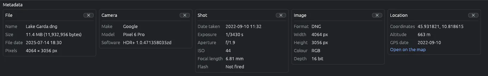

# Informazioni sul file

Sotto la griglia, il pannello dei metadati mostra quello che si sa del file selezionato: il nome e il peso, e quello che la fotocamera o il telefono ci hanno scritto dentro (quando, con quale fotocamera, dove).

## I riquadri

- **File**: nome, peso (anche in byte), data del file e dimensioni in pixel. C'è per ogni file, anche senza metadati. Gli stessi dettagli compaiono tenendo il mouse fermo su un file nella griglia (vedi [La griglia delle miniature](grid.md)).
- **Fotocamera**: marca, modello, obiettivo e software.
- **Scatto**: data dello scatto, esposizione, diaframma, ISO, lunghezza focale e flash.
- **Immagine**: formato, larghezza e altezza, colore e bit per canale, spazio colore. Per una foto RAW sono quelli dell'immagine che EyeCanSee ne sviluppa (ritagliata come dice la fotocamera); un disegno SVG ha le sue dimensioni e niente colore né bit.
- **Posizione**: coordinate GPS e altitudine, con **Apri sulla mappa**, che apre il posto su OpenStreetMap nel browser.
- **Descrizione**: quello che è stato scritto sulla foto nel suo XMP: titolo, didascalia, parole chiave, valutazione (da 1 a 5, o scartata), etichetta colore, autore e copyright. I programmi possono scrivere la didascalia in tre posti, EXIF, IPTC e XMP: EyeCanSee li legge tutti e tre e, se sono diversi, sceglie come dicono le linee guida del Metadata Working Group: prima l'EXIF, poi l'XMP, poi l'IPTC, ma prima l'IPTC quando dopo l'ha cambiato un programma che conosce solo l'IPTC. Quello che alcune fotocamere ci scrivono da sole, come "OLYMPUS DIGITAL CAMERA" o "SONY DSC", non compare.

## Le foto RAW e i loro file .xmp

Lightroom, Camera Raw, darktable e digiKam non scrivono dentro una foto RAW: tengono quello che imposti (valutazione, etichetta, parole chiave, titolo, posizione) in un piccolo file accanto, con lo stesso nome e l'estensione `.xmp`, un "sidecar". EyeCanSee lo legge: i riquadri Descrizione e Posizione mostrano quello che contiene, e il riquadro dice da quale file arriva. Si trovano tutti e due i nomi: `IMG_0001.CR2.xmp` (darktable, digiKam) e `IMG_0001.xmp` (Lightroom, Camera Raw); se ci sono tutti e due vale il primo, che non può essere di un altro file. Un `IMG_0001.xmp` che dice di essere di un altro file con lo stesso nome (il JPEG di una coppia RAW + JPEG) non si usa per la foto RAW. Come in Lightroom, il file .xmp vale al posto dell'XMP dentro la foto RAW, la sua didascalia al posto di quella dentro la foto RAW, e la sua posizione al posto di quella della fotocamera.

Quando converti una foto RAW o la salvi in un altro formato, quello che il file .xmp contiene va nel file nuovo, la posizione anche nel suo EXIF, così la copia lo tiene da sola. Le impostazioni di sviluppo di Lightroom, Camera Raw e darktable restano fuori: EyeCanSee sviluppa la foto senza di esse.

I file .xmp non compaiono nella griglia e restano dove sono quando copi, sposti, rinomini o elimini la foto RAW: copiali con un gestore di file se ti servono accanto alla copia.

Un riquadro dice "Nessun dato" quando il file non ha niente per lui, e "Questo file non contiene metadati" quando il file non ha nessun metadato.

## Video

Per un video il pannello mostra, quando il file li contiene: marca e modello del telefono o della videocamera (e la versione di Android), data e ora della ripresa, durata, fotogrammi al secondo, dimensioni, formato video e audio, bit rate, e il posto in cui è stato girato. Alcune dashcam tengono la traccia GPS in un file accanto ai video: allora il pannello mostra dove parte il video, l'altitudine e la velocità media e massima durante il video. Vedi [Riprodurre i video](video.md). Questi dati li legge il motore video, anche per i file audio: senza, il pannello mostra solo il riquadro File e, accanto, una nota che lo dice e spiega come scaricarlo, vedi [Componenti aggiuntivi](components.md).

## Mostrare e nascondere i riquadri

- Ogni riquadro si chiude con la sua  e si riapre da **Visualizza > Riquadri dei metadati**.
-  nella barra strumenti chiude tutti i riquadri se ce n'è almeno uno aperto, altrimenti li riapre tutti.
-  a destra della barra del titolo del pannello, o un clic sulla barra stessa, riduce il pannello alla sola barra e lo riapre. Finché il pannello è compresso, i metadati non vengono letti.

EyeCanSee si ricorda quali riquadri sono aperti e se il pannello è compresso.

## Da sapere

- Il pannello segue il file selezionato nella griglia; nel visore non c'è. La barra di stato del visore mostra la data dello scatto se i metadati sono già stati letti nella griglia (vedi [Guardare le immagini](viewer.md)).
- Per leggere i metadati EyeCanSee rilegge il file, quindi su un telefono o su un server ci vuole un attimo. Una volta letti restano salvati con le miniature e la volta dopo compaiono subito, finché il file non cambia.
- Quando converti o salvi una foto, i suoi metadati, risoluzione (dpi) compresa, restano nel file nuovo, se il formato li sa contenere. Vedi [Salva come](save-as.md).
