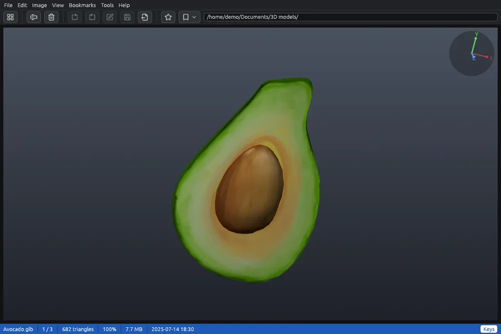

# Modelli 3D

I modelli 3D compaiono nella griglia insieme alle foto, con un'immagine del modello come miniatura. Nel visore li disegna la scheda video, e puoi girarli e guardarli da ogni lato.

## Quali modelli

- **STL**, **3MF** e **AMF** (stampa 3D), **OBJ** (con i colori dei suoi materiali, dal file `.mtl` accanto), **PLY** (anche scansioni 3D; le nuvole di punti si vedono a puntini).
- **glTF** (`.glb`, e `.gltf` con i suoi file), **FBX**, **Collada** (`.dae`, `.zae`), **3DS**, **OFF**, **VRML** e **X3D**.
- **IFC**: modelli di edifici (muri, solai, finestre, strutture) nei loro colori.
- **STEP**, **IGES** e **BREP**, i modelli solidi dei programmi CAD meccanici. Hanno bisogno del motore CAD, da scaricare una volta sola: lo propone il primo che apri, e anche il pulsante rosso **Scarica il motore CAD** nella barra dei menù. Fino ad allora la loro miniatura è un cubo  con il simbolo di download. Vedi [Componenti aggiuntivi](components.md).

L'elenco completo è in [Formati supportati](formats.md).

## Guardare un modello

Fai doppio clic su un modello, oppure selezionalo e premi **Invio**.

| Tasto o mouse | Cosa fa |
|---|---|
| Frecce, o trascinare | Girano il modello (tenendo premuta una freccia continua a girare) |
| Maiusc+trascinare, o trascinare col tasto centrale | Spostano il modello nella finestra |
| Rotellina, + e − | Ingrandiscono e rimpiccioliscono |
| 0 | Torna alla vista di partenza |
| Pag↓, Spazio | File successivo |
| Pag↑, Backspace | File precedente |
| Inizio, Fine | Primo, ultimo file |
| Esc, doppio clic | Torna alla griglia |
| F11 | Schermo intero: solo il modello |

Qui le frecce girano il modello, quindi non cambiano file. Il pulsante **Tasti** nella barra di stato elenca questi tasti.

In alto a destra gli assi del file (X rosso, Y verde, Z blu) girano col modello, come nei programmi CAD. La barra di stato mostra quanti triangoli ha il modello, l'ingrandimento e, mentre si muove, quanti fotogrammi al secondo vengono disegnati.

## Cosa si vede

Si vedono i colori scritti nel file e, in molti formati, anche le immagini sulle superfici (texture). Un modello senza colori è grigio chiaro. Le superfici curve sono morbide e gli spigoli restano netti, anche nei modelli che non salvano queste informazioni.

Senza una scheda video che EyeCanSee possa usare, il visore mostra l'immagine ferma del modello.

## Salvare

- **Ctrl+Maiusc+S**, o **Salva come…** nel menù File o nel menù del clic destro del visore, salva il modello come si vede, come immagine, di almeno 1920 pixel sul lato lungo. Vedi [Salva come](save-as.md).
- **Esporta come modello 3D…** lo salva in un altro formato 3D. Vedi [Esportare i modelli 3D](model-export.md).

Le rotazioni e i ribaltamenti del menù Immagine non valgono per i modelli: un modello si gira col mouse e con le frecce.
