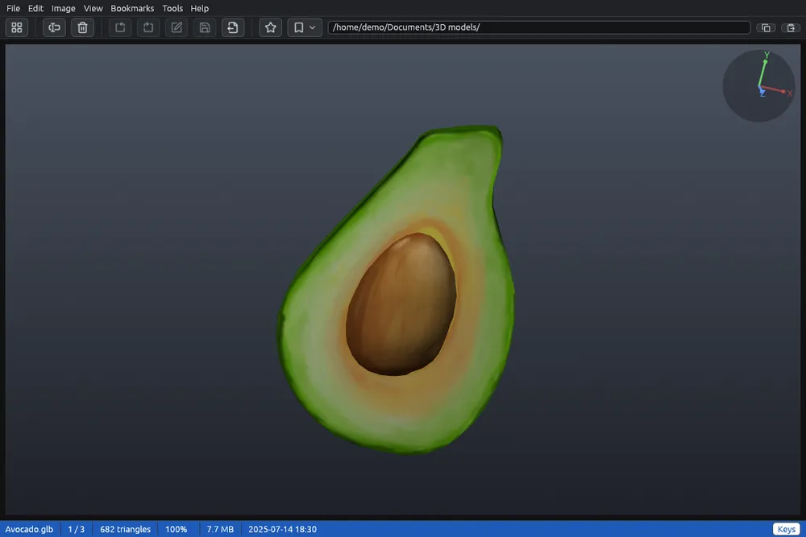

# Modelli 3D

I modelli 3D compaiono nella griglia insieme alle foto, con un'immagine del modello come miniatura. Nel visore li disegna la scheda video, e puoi girarli e guardarli da ogni lato.

## Quali modelli

- **STL**, **3MF** e **AMF** (stampa 3D), **OBJ** (con i colori dei suoi materiali, dal file `.mtl` accanto), **PLY** (anche scansioni 3D; le nuvole di punti si vedono a puntini).
- **glTF** (`.glb`, e `.gltf` con i suoi file), **FBX**, **Collada** (`.dae`, `.zae`), **3DS**, **OFF**, **VRML** e **X3D**.
- **IFC**: modelli di edifici (muri, solai, finestre, strutture) nei loro colori.
- **STEP**, **IGES** e **BREP**, i modelli solidi dei programmi CAD meccanici. Hanno bisogno del motore CAD, da scaricare una volta sola: lo propone il primo che apri, e anche il pulsante rosso **Scarica il motore CAD** nella barra dei menù. Fino ad allora la loro miniatura è un cubo  con il simbolo di download. Vedi [Componenti aggiuntivi](components.md).

Un `.gltf` senza accanto il suo file dei dati (di solito `.bin`) non si apre: il visore dice quale file manca.

L'elenco completo è in [Formati supportati](formats.md).

## Guardare un modello

Fai doppio clic su un modello, oppure selezionalo e premi **Invio**.

| Tasto o mouse | Cosa fa |
|---|---|
| Frecce, o trascinare | Girano il modello (tenendo premuta una freccia continua a girare) |
| Maiusc+trascinare, o trascinare col tasto centrale | Spostano il modello nella finestra |
| Rotellina, + e − | Ingrandiscono e rimpiccioliscono |
| 0 | Torna alla vista di partenza |
| M | Misura |
| S | Sezione |
| Pag↓, Spazio | File successivo |
| Pag↑, Backspace | File precedente |
| Inizio, Fine | Primo, ultimo file |
| Esc, doppio clic | Torna alla griglia |
| F11 | Schermo intero: solo il modello |

Qui le frecce girano il modello, quindi non cambiano file. Il pulsante **Tasti** nella barra di stato elenca questi tasti; con la Misura accesa, i tasti della Misura.

In alto a destra gli assi del file (X rosso, Y verde, Z blu) girano col modello, come nei programmi CAD. La barra di stato mostra quanti triangoli ha il modello, l'ingrandimento e, mentre si muove, quanti fotogrammi al secondo vengono disegnati.

## Misurare

**M**, o **Visualizza > Misura**, accende lo strumento Misura: la barra di stato mostra l'ingombro del modello lungo X, Y e Z, la sua superficie e il suo volume. Il volume c'è solo per un modello chiuso (ogni spigolo condiviso da due triangoli, come deve essere un modello per la stampa 3D); altrimenti la barra di stato dice quanti spigoli sono aperti. Fai clic su due punti del modello per la loro distanza, scritta accanto al puntatore e nella barra di stato; un terzo clic ricomincia. Le misure sono nell'unità del file quando il formato o il file la dice (glTF, IFC, X3D e VRML in metri, STEP e IGES in millimetri, 3MF e AMF come dicono); STL, OBJ, PLY e altri non hanno unità, e la barra di stato lo dice. **Copia** nella barra di stato, o **Ctrl+C**, mette i risultati negli appunti; **Esc** cancella i punti, **Esc** di nuovo o **M** chiudono lo strumento. Trascinare gira ancora il modello.

## Sezione

**S** taglia il modello con un piano, per vederci dentro: ciò che sta oltre il piano non si vede, e dove il piano attraversa il solido è riempito di rosso, così pareti e spessori risaltano. Il piano parte dal centro del modello, attraverso Z per un modello con Z in alto (per un edificio IFC, la pianta del piano che attraversa), altrimenti attraverso Y. La barra di stato dice l'asse e dove sta il piano, in percentuale (da una faccia del modello all'altra) e come distanza dalla prima faccia, con un cursore che lo sposta, con una tacca ogni decimo del modello; oppure coi tasti:

- **X**, **Y**, **Z**: l'asse che il piano attraversa;
- **Alt** e la rotellina del mouse, **,** e **.**, o il cursore nella barra di stato: spostano il piano;
- **F**: tiene l'altro lato;
- **S** di nuovo: il modello intero.

Mentre il piano si sposta, un rettangolo azzurro trasparente mostra per un attimo dove taglia, poi sparisce. Chiudendo il visore il taglio si toglie: riaperto, il modello torna intero.

**Salva come…** salva il modello con la sua sezione, come si vede. Il riempimento rosso c'è solo per i modelli chiusi (ogni spigolo condiviso da due triangoli, come deve essere un modello per la stampa 3D), in qualunque verso siano girati i loro triangoli: un modello con dei buchi nella superficie non ha un interno noto, quindi il suo taglio resta vuoto e la barra di stato lo dice.

## Cosa si vede

Si vedono i colori scritti nel file e, in molti formati, anche le immagini sulle superfici (texture). Un modello senza colori è grigio chiaro. I materiali dei modelli glTF e FBX, e dei modelli OBJ (il loro file `.mtl`), mostrano anche quanto una superficie è lucida o metallica, la luce che emette (una lampada) e i piccoli rilievi di una normal map. Le superfici curve sono morbide e gli spigoli restano netti, anche nei modelli che non salvano queste informazioni.

Un modello glTF che mette una sua parte in più punti della gerarchia, cosa che il formato non permette, mostra quella parte una volta sola, e la barra di stato lo dice.

Senza una scheda video che EyeCanSee possa usare, il modello lo disegna il processore, più lentamente: si gira, si ingrandisce, si misura e si taglia allo stesso modo, e ogni vista nuova arriva dopo un momento.

## Salvare

- **Ctrl+Maiusc+S**, o **Salva come…** nel menù File o nel menù del clic destro del visore, salva il modello come si vede, come immagine, di almeno 1920 pixel sul lato lungo. Vedi [Salva come](save-as.md).
- **Esporta come modello 3D…** lo salva in un altro formato 3D. Vedi [Esportare i modelli 3D](model-export.md).

Le rotazioni e i ribaltamenti del menù Immagine non valgono per i modelli: un modello si gira col mouse e con le frecce.
