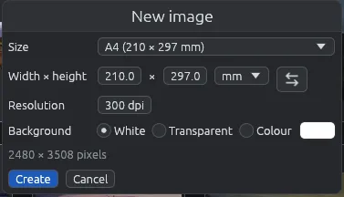

# Nuova immagine

**File > Nuova immagine…** (Ctrl+N) crea un'immagine vuota e la apre nell'editor, per disegnare uno schema, un cartello o un'immagine per i social.

## Creare un'immagine nuova

1. Nella griglia scegli **File > Nuova immagine…** o premi Ctrl+N.
2. Scegli una **Misura**, o scrivi la tua.
3. Scegli lo **Sfondo**.
4. Fai clic su **Crea** (o premi Invio).

Nel visore **Nuova immagine…** è grigia e Ctrl+N non fa niente: prima torna alla griglia (Esc).

## Misura

- Misure pronte: A3, A4, A5, Lettera, Legale (fogli), Full HD, 4K UHD, HD (schermi), **Quadrata** (1080 × 1080) e **Verticale per le storie** (1080 × 1920).
- **Larghezza × altezza**: i tuoi numeri, in px, mm, cm o in (pollici). Cambiando un numero o l'unità la misura diventa **Personalizzata**.
-  scambia larghezza e altezza, per l'orizzontale o il verticale.
- **Risoluzione**: per le misure in millimetri, centimetri o pollici, quanti punti per pollice. Sotto, la finestra mostra quanti pixel fanno. All'inizio è A4 a 300 dpi.

Nessun lato può superare i 20.000 pixel.

## Sfondo

**Bianco**, **Trasparente**, o **Colore** con il pulsante del colore accanto.

## Salvarla

L'immagine nuova non ha ancora un file. Nell'editor il suo pulsante principale è **Salva come…** (anche Ctrl+S): apre [Salvare in un altro formato](save-as.md), dove scegli nome, formato e cartella. Propone sempre un PNG di nome `Nuova immagine.png`, come la chiama l'editor, anche dopo un Salva come… in un altro formato; chiudendola senza salvare torni all'editor col disegno. **Sovrascrivi l'originale…** è spento.

Se chiudi l'editor senza aver disegnato niente, non viene chiesto niente e non viene salvato niente. Con un disegno, alla chiusura viene chiesto prima: **Salva…** e **Salva come…** aprono entrambi Salvare in un altro formato, **Non salvare** perde il disegno, **Annulla** torna al disegno.

Per il resto funziona come qualsiasi immagine: vedi [Modificare un'immagine](editor.md).
