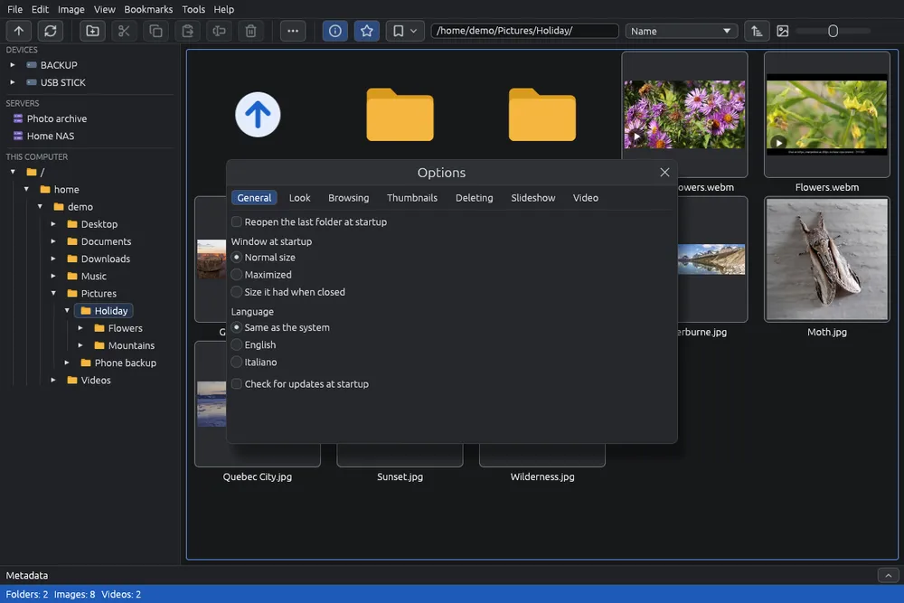

# Opzioni

Le opzioni cambiano come EyeCanSee si avvia, il suo aspetto, come passa da un'immagine all'altra, come elimina, come mostra il carosello, come riproduce i video e come salva l'editor.

## Aprire le opzioni

Scegli **Strumenti > Opzioni…** (). La finestra è divisa in schede: **Generale**, **Aspetto**, **Navigazione**, **Miniature**, **Eliminazione**, **Carosello**, **Video** e **Editor**. Passando sopra molte opzioni compare una breve spiegazione.

Ogni modifica viene salvata subito in `settings.json`: in `~/.config/eyecansee` su Linux e in `%APPDATA%\eyecansee` su Windows. È un file di testo che puoi anche modificare a mano.

## Generale

- **Riapri l'ultima cartella all'avvio** (accesa): quando EyeCanSee parte senza una cartella, per esempio dal menù delle applicazioni, apre la cartella che stavi guardando alla chiusura. Se quella cartella non esiste più, o il suo disco o telefono non è collegato, apre la tua cartella home. Un server salvato si apre con la sua password salvata; un server FTP con utente che non è salvato apre **File > Apri indirizzo…** con tutto compilato tranne la password.
- **Finestra all'avvio**: **Dimensione normale**, **Massimizzata** (riempie lo schermo lasciando visibili le barre del sistema) o **Dimensione che aveva alla chiusura** (se era massimizzata, si riapre massimizzata).
- **Lingua**: **Come il sistema** (inglese se la lingua del sistema non c'è) o una delle lingue elencate, ognuna scritta nella sua lingua. La modifica vale subito, anche per questa guida.
- **Controlla gli aggiornamenti all'avvio** (accesa): vedi [Aggiornamenti](updates.md). Non compare nelle copie del Microsoft Store e nel Flatpak, che si aggiornano da sé.

## Aspetto

- **Colori**: **Come il sistema** (chiari o scuri come il sistema, e lo seguono quando cambia), **Chiari** o **Scuri**. La modifica vale subito.

## Navigazione

- **Ricorda la posizione di scorrimento di ogni cartella** (spenta): tornando in una cartella già vista, la griglia riparte da dove l'avevi lasciata. Vale finché EyeCanSee resta aperto.
- **Nel visore, dopo l'ultima immagine ricomincia dalla prima** (spenta): e dalla prima immagine, tornando indietro, mostra l'ultima. Spenta, il visore si ferma alla prima e all'ultima immagine.
- **Nel visore, la X della finestra torna alla griglia** (accesa): la X in alto a destra fa come Esc. Spenta, la X chiude EyeCanSee anche dal visore.
- **Rotellina del mouse nel visore**: **Ingrandisce e rimpicciolisce** (predefinita) oppure **Mostra l'immagine successiva o precedente**. Tenendo premuto Ctrl, la rotellina ingrandisce sempre.
- **Ingrandimento massimo nel visore** (2000% all'inizio): fin dove la rotellina e **+** possono ingrandire un'immagine.

## Miniature

- **Pulizia della cache miniature** (spenta): una volta per sessione, per ogni posto che apri, toglie le miniature delle immagini eliminate e rifà quelle delle immagini cambiate; poi toglie le miniature usate meno di recente finché la cache sta entro il **Limite della cache** (1024 MB all'inizio). Le cartelle che non si trovano o non si raggiungono vengono saltate, così un disco scollegato o un NAS spento non perdono le loro miniature.
- **Svuota la cache miniature…**: elimina tutte le miniature salvate, dopo una conferma che dice quante sono e quanto spazio si libera. Le tue immagini non vengono toccate: le miniature della cartella aperta vengono rifatte subito, le altre quando apri la loro cartella.

## Eliminazione

- **Elimina i file del computer definitivamente, senza cestino (pericoloso)** (spenta): i file eliminati non si possono recuperare.
- **Eliminare su telefoni e server (non hanno un cestino)**: **Sposta nella cartella nascosta .EyeCanSee-trash accanto all'immagine** (predefinita) oppure **Elimina definitivamente**.

Vedi [Eliminare e cestino](delete.md).

## Carosello

- **Ogni immagine resta per** un certo numero di secondi (5 all'inizio).
- **Passaggio tra le immagini**: **Nessuno (stacco netto)**, **Dissolvenza incrociata** (predefinito), **Dissolvenza al nero**, **Scorrimento**, **Zoom e dissolvenza**.
- **Ricomincia dopo l'ultima immagine** (accesa).

Vedi [Carosello](slideshow.md).

## Video

**Motore video (libmpv) e FFmpeg da usare**: libmpv riproduce i video, FFmpeg li converte.

- **Automatica: la migliore per questo computer** (predefinita): quelli del sistema quando sono abbastanza recenti e sanno riprodurre H.264 e HEVC, i formati in cui registrano i telefoni, altrimenti quelli scaricati; per FFmpeg anche quello scaricato quando fa fare più lavoro alla scheda video.
- **Sempre di sistema, qualunque versione sia**: non si scarica niente.
- **Sempre quello scaricato**.

La scheda mostra anche quali sono in uso adesso, con le loro versioni. Una modifica vale dal prossimo avvio di EyeCanSee. Vedi [Componenti aggiuntivi](components.md).

## Editor

- **Pulsante principale di salvataggio (anche Ctrl+S)**: **Salva copia** (predefinito) o **Sovrascrivi l'originale**. L'altro resta nel menu della freccia accanto; anche **Salva…** nella domanda alla chiusura segue la stessa scelta. Dove l'originale non si può sovrascrivere (HEIC, RAW…) il pulsante principale è Salva copia.
- **Dopo il salvataggio**: cosa succede dopo **Salva copia**, **Aggiorna copia** o **Sovrascrivi l'originale…**. **Resta nell'editor** (predefinito): l'editor resta aperto per continuare a modificare. **Torna da dove eri (miniature o visore)**: l'editor si chiude appena il file è scritto; se era aperto dalla griglia, la griglia seleziona l'immagine salvata, se era aperto dal visore, il visore la mostra. **Torna alle miniature**: l'editor si chiude e torni sempre alle miniature con l'immagine salvata selezionata, anche se l'avevi aperto dal visore.

Vedi [Salvare un'immagine modificata](editor-save.md).
