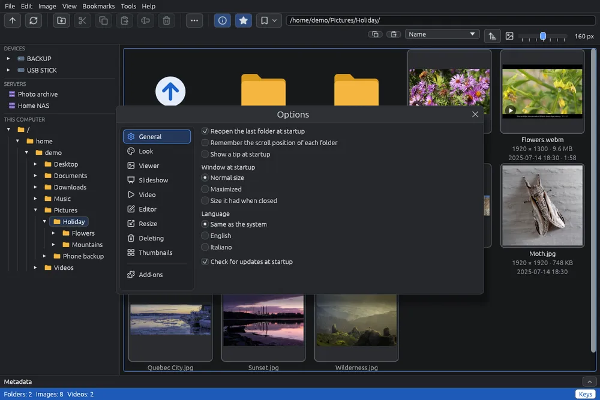

# Opzioni

Le opzioni cambiano come EyeCanSee si avvia, il suo aspetto, come passa da un'immagine all'altra, come elimina, come mostra il carosello, come riproduce i video, come salva l'editor e se scrive un registro di diagnosi.

## Aprire le opzioni

Scegli **Strumenti > Opzioni…** (). La finestra è divisa in schede: **Generale**, **Aspetto**, **Visore**, **Carosello**, **Video**, **Editor**, **Ridimensiona**, **Eliminazione**, **Miniature**, **Diagnosi** e **Componenti aggiuntivi**, in colonna a sinistra. Passando sopra molte opzioni compare una breve spiegazione. **Esc** o la ✕ della finestra la chiudono.

Ogni modifica viene salvata subito in `settings.json`: in `~/.config/eyecansee` su Linux e in `%APPDATA%\eyecansee` su Windows. È un file di testo che puoi anche modificare a mano. Se EyeCanSee non riesce a leggerlo (per esempio perché è stato salvato in UTF-16 o non è JSON valido), il file viene messo da parte come `settings.json.bad` ed EyeCanSee parte con le impostazioni predefinite. Se invece riesce a leggerlo ma non conosce uno dei valori, quell'impostazione prende il valore predefinito e le altre restano; una copia del file com'era va in `settings.json.bad`.

Su Windows **Strumenti > Crea icona sul desktop**, appena sopra **Opzioni…**, mette un'icona di EyeCanSee sul desktop. Se c'è già un'icona che avvia questa copia, lo dice e non ne crea un'altra. La copia del Microsoft Store riceve un'icona come quella trascinata da Start; la disinstallazione della copia dell'installer toglie anche l'icona creata da questa voce.

## Generale

- **Riapri l'ultima cartella all'avvio** (accesa): quando EyeCanSee parte senza una cartella, per esempio dal menu delle applicazioni, apre la cartella che stavi guardando alla chiusura. Se quella cartella non esiste più, o il suo disco o telefono non è collegato, apre la tua cartella home. Un server salvato si apre con la sua password salvata; un server FTP con un utente non salvato apre **File > Apri indirizzo…** con tutto compilato tranne la password.
- **Ricorda la posizione di scorrimento di ogni cartella** (spenta): tornando in una cartella già vista, la griglia riparte da dove l'avevi lasciata. Vale finché EyeCanSee resta aperto.
- **Mostra un suggerimento all'avvio** (accesa): una volta al giorno, all'avvio di EyeCanSee, una finestra mostra una cosa che sa fare (vedi [Per cominciare](start.md)). Si spegne anche da **Non mostrare più all'avvio** in quella finestra.
- **Finestra all'avvio**: **Dimensione normale**, **Massimizzata** (riempie lo schermo lasciando visibili le barre del sistema) o **Dimensione che aveva alla chiusura** (il valore predefinito; se era massimizzata, si riapre massimizzata; al primo avvio una dimensione non c'è ancora, e la finestra si apre alla dimensione normale). Su Windows la finestra non massimizzata si apre al centro dell'area libera del suo schermo, sopra la barra delle applicazioni, e più piccola se non ci sta.
- **Lingua**: **Come il sistema** (inglese se la lingua del sistema non c'è) o una delle lingue elencate, ognuna scritta nella sua lingua. La modifica vale subito, anche per questa guida.
- **Controlla gli aggiornamenti all'avvio** (accesa): vedi [Aggiornamenti](updates.md). Non compare nel Flatpak né nel pacchetto Fedora, aggiornati dal sistema; nella copia del Microsoft Store chiede allo Store.

## Aspetto

- **Colori**: **Come il sistema** (chiari o scuri come il sistema, e lo seguono quando cambia), **Chiari** o **Scuri**. La modifica vale subito.
- **Ammorbidisci le immagini mostrate sotto il 100%** (accesa): un'immagine mostrata più piccola dei suoi pixel viene filtrata, così i bordi restano lisci e i dettagli fini (erba, capelli, righe sottili) non diventano grana o strisce; nel visore, nel carosello, nell'editor e nelle miniature. Spenta, le immagini si vedono come fino alla versione 0.76, un po' più nitide ma con scalini e grana. Sopra il 100% non cambia nulla. La modifica vale subito. Sotto, il filtro: **Preciso: dall'immagine intera** (predefinito), quasi senza falsi disegni sui dettagli più fini; **Veloce: dalle copie dimezzate**, più leggero per la scheda video, ma qualche debole falso disegno può restare; **Morbido: Mitchell dall'immagine intera**, con meno aloni intorno ai bordi e un po' meno nitido.
- **Grafica: disegna con** (solo su Windows): **DirectX 12** (predefinito) o **Vulkan**, i due modi in cui EyeCanSee può disegnare sulla scheda video. Con DirectX 12 la schermata non lampeggia entrando a schermo intero (F11, carosello). Vulkan è quello usato da EyeCanSee fino alla versione 0.76: da scegliere se con DirectX 12 immagini o video non si vedono bene. La modifica vale dal prossimo avvio di EyeCanSee. Se un avvio con Vulkan si interrompe prima di mostrare la finestra (un driver della scheda video che chiude EyeCanSee), l'avvio successivo torna da solo a DirectX 12, lo rimette qui e lo dice. Se la scheda video non sa disegnare nemmeno con DirectX 12, EyeCanSee disegna senza la scheda, più lentamente, e all'avvio che se ne accorge dice di aggiornare il driver; scegliendo Vulkan qui si riprova la scheda (vedi [Limiti noti](limits.md)).

## Visore

- **Dopo l'ultima immagine ricomincia dalla prima** (spenta): e dalla prima immagine, tornando indietro, mostra l'ultima. Spenta, il visore si ferma alla prima e all'ultima immagine.
- **La ✕ della finestra torna alla griglia** (accesa): la ✕ in alto a destra fa come Esc, un passo alla volta: prima chiude l'editor, poi il visore, poi EyeCanSee. Spenta, la ✕ chiude EyeCanSee anche dal visore e dall'editor, e lo stesso fa **Esc** nel visore (dalla versione 0.78; a schermo intero il primo Esc esce dallo schermo intero, e tenere premuto Esc non chiude EyeCanSee); con modifiche non salvate chiede una volta sola se salvarle. Esc nell'editor chiude comunque solo l'editor, e **Invio** nel visore torna sempre alla griglia.
- **Rotellina del mouse nel visore**: **Ingrandisce e rimpicciolisce** (predefinita) oppure **Mostra l'immagine successiva o precedente**. Tenendo premuto Ctrl, la rotellina ingrandisce sempre.
- **Doppio clic nel visore**: **Torna alla griglia** (predefinita) oppure **Va a schermo intero**: allora a schermo intero un altro doppio clic torna alla finestra, come Esc. Mentre misuri, il doppio clic resta della misura.
- **Ingrandimento massimo nel visore** (2000% come valore predefinito): fin dove la rotellina e **+** possono ingrandire un'immagine, in percentuale dei suoi pixel (per un disegno SVG più piccolo di 2048 pixel, dei 2048 pixel a cui viene disegnato).

## Carosello

- **Ogni immagine resta per** un certo numero di secondi (5 come valore predefinito).
- **Passaggio tra le immagini**: **Nessuno (stacco netto)**, **Dissolvenza incrociata** (predefinito), **Dissolvenza al nero**, **Scorrimento**, **Zoom e dissolvenza**.
- **Ricomincia dopo l'ultima immagine** (accesa).

Vedi [Carosello](slideshow.md).

## Video

**Motore video (libmpv) e FFmpeg da usare**: libmpv riproduce i video, FFmpeg li converte.

- **Automatica: la migliore per questo computer** (predefinita): quelli del sistema quando sono abbastanza recenti e sanno riprodurre H.264 e HEVC, i formati in cui registrano i telefoni, altrimenti quelli scaricati; per FFmpeg anche quello scaricato quando fa fare più lavoro alla scheda video.
- **Sempre di sistema, qualunque versione sia**: non si scarica niente.
- **Sempre quello scaricato**.

La scheda mostra anche quali sono in uso adesso, con le loro versioni. Una modifica vale dal prossimo avvio di EyeCanSee. Vedi [Componenti aggiuntivi](components.md).

## Editor

- **Pulsante principale di salvataggio (anche Ctrl + S)**: **Salva copia** (predefinito) o **Sovrascrivi l'originale**. L'altro resta nel menu della freccia accanto; anche **Salva…** nella domanda alla chiusura segue la stessa scelta. Dove l'originale non si può sovrascrivere (HEIC, RAW…) il pulsante principale è Salva copia.
- **Dopo il salvataggio**: cosa succede dopo **Salva copia**, **Aggiorna copia** o **Sovrascrivi l'originale…**. **Resta nell'editor** (predefinito): l'editor resta aperto per continuare a modificare. **Torna da dove eri (miniature o visore)**: l'editor si chiude appena il file è scritto; se l'avevi aperto dalla griglia, la griglia seleziona l'immagine salvata; se l'avevi aperto dal visore, il visore la mostra. **Torna alle miniature**: l'editor si chiude e torni sempre alle miniature con l'immagine salvata selezionata, anche se l'avevi aperto dal visore.

Vedi [Salvare un'immagine modificata](editor-save.md).

## Ridimensiona

Le misure di **Ridimensiona**, nel menu del clic destro sulle miniature e in **Strumenti** (vedi [Convertire e ridimensionare le immagini](convert.md)). Quelle predefinite sono **Piccola** (lato lungo 1280 px), **Media** (lato lungo 1920 px), **Grande** (lato lungo 2560 px) e **Metà** (50%).

Ogni riga è una misura: il suo **Nome** (può restare vuoto: il menu mostra allora solo la misura), il tipo (**Percentuale dell'originale**, **Entro**, **Lato lungo**, **Lato corto**, **Larghezza**, **Altezza**, **Misura esatta, tagliata al centro**, **Misura esatta, deformata**) e i pixel o la percentuale.  la toglie, **Aggiungi** ne aggiunge una, **Rimetti quelle di partenza** rimette le quattro misure iniziali. Finché non le cambi, i loro nomi seguono la lingua di EyeCanSee.

## Eliminazione

- **Elimina i file del computer definitivamente, senza cestino (pericoloso)** (spenta): i file eliminati non si possono recuperare.
- **Eliminare su telefoni e server (non hanno un cestino)**: **Sposta nella cartella nascosta .EyeCanSee-trash accanto all'immagine** (predefinita) oppure **Elimina definitivamente**.

Vedi [Eliminare e cestino](delete.md).

## Miniature

- **Sotto le miniature**: cosa viene scritto sotto ogni miniatura. **Nome**, **Dimensioni in pixel**, **Peso**, **Data**, **Durata** e **Numero e revisione del disegno**, tutte spuntate in modo predefinito. Dimensioni e peso stanno su una riga ("1920 × 1080 · 350 KB"; per un disegno DWG o DXF prima il suo numero e la revisione, "A-101 rev. C · 350 KB", dal cartiglio o altrimenti dal titolo e dal numero di revisione del disegno), la data e la durata di video e audio sulla riga sotto; con le miniature piccole resta solo il nome. La data è quella dello scatto, se il file la dice, altrimenti quella di modifica del file: passandoci sopra col mouse, un suggerimento dice quale delle due ("Scattata il…" o "Modificata il…"). Dimensioni e data di scatto vengono lette da ogni foto e conservate insieme alla sua miniatura, così la volta dopo arrivano subito, anche da telefoni e server. Le dimensioni, la data di registrazione e la durata di un video o di un file audio vengono lette una volta, come le legge il riquadro File, e conservate allo stesso modo; il suggerimento sulla sua data dice "Registrato il…".
- **Pulizia della cache miniature** (spenta): una volta per sessione, per ogni posto che apri, toglie le miniature delle immagini eliminate e rifà quelle delle immagini cambiate; poi toglie le miniature usate meno di recente finché la cache sta entro il **Limite della cache** (1024 MB come valore predefinito). Le cartelle che non si trovano o non si raggiungono vengono saltate, così un disco scollegato o un NAS spento non perdono le loro miniature.
- **Svuota la cache miniature…**: elimina tutte le miniature salvate, dopo una conferma che dice quante sono e quanto spazio si libera. Le tue immagini non vengono toccate: le miniature della cartella aperta vengono rifatte subito, le altre quando apri la loro cartella.

## Diagnosi

- **Scrivi un registro di diagnosi, dal prossimo avvio** (spento): ogni avvio di EyeCanSee scrive poi ciò che fa in un file suo, `eyecansee-<data>_<ora>.log`, con in testa la versione, il sistema e la scheda video, e gli errori che incontra. Allegalo quando segnali un problema. Il registro contiene i nomi delle cartelle e dei file che apri, e gli indirizzi e i nomi utente dei tuoi server: leggilo prima di allegarlo a una segnalazione pubblica. Un file che arriva a 5 MB continua in uno nuovo, e si tengono solo i 10 file più recenti: i più vecchi si cancellano. Un avvio che passa soltanto un file all'EyeCanSee già aperto non scrive nessun registro.
- **Apri la cartella dei registri**: la cartella nel gestore dei file. È `logs` nella cartella dei dati di EyeCanSee: `~/.local/share/eyecansee/logs` su Linux, `%LOCALAPPDATA%\eyecansee\logs` su Windows.

La scheda dice anche in quale file scrive questa sessione. Se è impostata la variabile d'ambiente `EYECANSEE_LOG`, decide lei dove va il registro (`1` sull'uscita degli errori, altrimenti il file che nomina) e l'interruttore è grigio.

## Componenti aggiuntivi

Le parti di EyeCanSee che si scaricano solo se le vuoi (il motore video, FFmpeg, il motore CAD), una scheda ciascuna, con a cosa serve, quanto pesa e dove si trova: **Scaricato**, **Già presente su questo computer** (quello del sistema, quando va bene), una versione più recente, o l'avanzamento mentre scarica. **Scarica** o **Aggiorna** avvia lo stesso scaricamento dei pulsanti rossi, ed EyeCanSee usa il componente appena arriva. Vedi [Componenti aggiuntivi](components.md).
