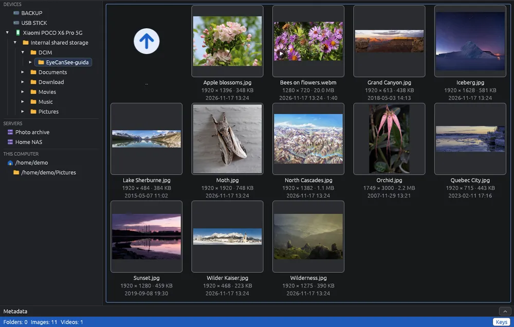

# Telefoni Android

Collega un telefono Android con il cavo USB per guardare le sue foto e i suoi video, copiarli sul computer, convertirli o eliminarli, senza altri programmi. EyeCanSee parla direttamente con il telefono, molto più velocemente del gestore dei file del desktop, soprattutto nelle cartelle con centinaia di foto.

## Collegare il telefono

1. Collega il telefono con il cavo e sbloccalo.
2. Nella notifica USB del telefono scegli **Trasferimento file** (MTP) per vedere tutta la memoria, oppure **Trasferimento foto** (PTP) per vedere solo le cartelle delle foto (`DCIM`, `Pictures`).
3. Il telefono compare nel blocco **Dispositivi** in alto a sinistra con l'icona , entro un paio di secondi. Fai clic per aprirlo.

Il primo livello mostra le memorie del telefono (per esempio "Memoria condivisa interna"; il nome lo dà il telefono, nella sua lingua): aprine una per vedere le cartelle. Due memorie con lo stesso nome mostrano dopo il nome il loro numero tra parentesi. Sotto **Questo computer** c'è la tua cartella home, per tornare al computer.

## Che cosa puoi fare

Tutto quello che fai con le cartelle del computer: guardare foto e video, copiarli e spostarli dal computer e verso il computer (vedi [Copiare e spostare](copy-move.md)), rinominare, eliminare, convertire, cercare i duplicati, creare cartelle. Quando salvi un'immagine modificata, viene prima tenuta su questo computer e poi mandata al telefono: se l'invio non riesce (cavo staccato), l'originale sul telefono resta com'era, e una finestra dice dov'è l'immagine modificata, con **Riprova**, **Salva come…** e **Apri la cartella**.

Le foto scattate, eliminate o spostate sul telefono mentre la sua cartella è aperta compaiono e spariscono da sole, pochi secondi dopo che il telefono ha finito. Se il file era aperto nel visore, il visore si chiude e un messaggio dice quale file è stato tolto.

## Messaggi che puoi vedere

- **"Il dispositivo non mostra nessuna memoria"**: il telefono era bloccato o in sola ricarica quando l'hai collegato. Sbloccalo e scegli Trasferimento file: EyeCanSee riprova da solo ogni 2 secondi.
- **"Il dispositivo non è stato trovato"**: il telefono si sta ricollegando (lo fa quando scegli Trasferimento file) oppure è stato scollegato. EyeCanSee riprova da solo ogni 2 secondi.
- **"EyeCanSee non riesce ad aprire il dispositivo"**: il telefono lo sta usando un altro programma. Se l'aveva collegato il desktop, EyeCanSee passa da solo a quel collegamento (più lento). Altrimenti chiudi il gestore dei file e gli altri programmi che usano il telefono e premi **F5**, oppure scollega il telefono, ricollegalo, scegli Trasferimento file e aprilo prima in EyeCanSee.
- **"Aperto tramite il gestore dei file: più lento"**: il collegamento diretto non è riuscito ed EyeCanSee usa quello del desktop. Nelle cartelle con centinaia di file fa circa una miniatura al secondo.
- Un telefono che non risponde a una richiesta: la barra di stato lo dice, con i secondi e il file. EyeCanSee riprende da solo appena il telefono risponde.
- **"Attendi: il telefono sta scrivendo …"**, nella barra di stato mentre quel telefono è aperto: il telefono sta scrivendo un file grande e non risponde a niente finché non ha finito, quindi le sue cartelle si aprono allora. Le cartelle del computer si aprono subito.

## File grandi: passano dal computer

Un file di 32 MB o più copiato o spostato tra la memoria interna e la scheda di memoria dello stesso telefono passa da questo computer: EyeCanSee lo legge dal telefono, poi lo scrive dove va. Il riquadro della copia dice quale delle due cose sta facendo, con **Perché passa dal computer?** che apre questa sezione.

- Mentre il telefono copia un file da solo, non risponde a niente finché non ha finito e non può dire a che punto è: niente barra vera, **Annulla** aspetta la fine del file, e le sue cartelle aspettano.
- Passando dal computer la barra, la velocità e il tempo che manca sono veri. **Annulla** ferma subito la lettura; la scrittura si ferma alla fine del file, perché un telefono che riceve mezzo file smette di rispondere.
- Ci vuole di più: 2 GB verso la scheda di memoria in circa 3 minuti e mezzo invece di 2.
- Serve spazio libero su questo computer, quanto il file e un po' di più: se non basta, la copia si ferma prima di cominciare e lo dice. Il file sta nella cartella della cache di EyeCanSee e viene tolto appena è stato scritto, anche dopo un errore o **Annulla**.
- **Su Windows** passa dal computer anche un file grande copiato dentro una memoria: più di 1 GB dentro la memoria interna, più di 128 MB dentro una scheda di memoria. Windows aspetta il telefono solo mezzo minuto; se la copia dura di più la perde di vista, e il file comparirebbe solo dopo aver scollegato e ricollegato il telefono. Su Linux il telefono copia da solo file di ogni dimensione.
- I file sotto i 32 MB e tutto ciò che resta dentro una memoria li fa il telefono: uno spostamento lì è solo un cambio di cartella, fatto subito, e una copia è veloce (2 GB in circa 20 secondi, sei volte meno che passando dal computer). Per quel poco le sue cartelle aspettano, con **Attendi** nella barra di stato; una copia dentro una memoria invece ferma tutto EyeCanSee (vedi la sezione dopo).

## Copie dentro una memoria: il telefono fa da solo

Una copia dentro una memoria del telefono (da una cartella della memoria interna a un'altra, per esempio) la fa il telefono stesso, un file alla volta, molto più in fretta che passando dal computer (su Windows i file più grandi passano dal computer, vedi la sezione prima: la stessa finestra dice allora se sta leggendo o scrivendo, con una barra vera). Mentre copia un file il telefono non risponde a niente, nemmeno a EyeCanSee, e non può dire a che punto è. Per questo, per tutta la copia, una finestra al centro, **Il telefono sta copiando**, fa aspettare il resto di EyeCanSee, anche le cartelle del computer. **Perché devo aspettare?** nella finestra apre questa sezione.

- La finestra mostra solo ciò che si sa: il nome del file in copia, la sua dimensione e da quanto tempo è cominciato. Con più file anche quale file è (**File 2 di 5**), quanti dati sono già copiati, contati alla fine di ogni file, e una barra che avanza un file alla volta.
- Mentre il telefono lavora su un file, nella barra scorre una striscia: non misura niente, dice solo che il telefono sta lavorando. Con un file solo c'è soltanto la striscia.
- La velocità e il tempo che manca vengono solo dai file grandi (da 32 MB) già copiati in questo Incolla: prima che finisca il primo, non ci sono.
- **Annulla**: il telefono non si può interrompere a metà file. Finisce il file in copia, poi EyeCanSee toglie quella copia e si ferma. I file copiati prima restano, gli altri non vengono copiati; l'originale non viene toccato. Finché il telefono non ha finito, la finestra resta aperta e dice **Annullata**. **Esc** non chiude la finestra.
- **Smetti di aspettare**, che compare dopo Annulla: EyeCanSee smette di aspettare il telefono, e la finestra si chiude entro pochi secondi (fino a mezzo minuto se in quel momento stava leggendo il telefono). Il telefono può finire il file da solo: in quel caso la copia resta sul telefono, e finché lavora il telefono non risponde.
- La ✕ di EyeCanSee, mentre il telefono copia da solo, prima chiede. **Chiudi EyeCanSee** smette di aspettare e chiude il programma appena la copia lo permette, al più tardi dopo 40 secondi; **Continua ad aspettare** lascia tutto com'è.
- Dopo 3 minuti sullo stesso file la finestra lo dice. Scollegare il telefono non ferma la sua copia: il telefono la finisce da solo, ed EyeCanSee smette solo di aspettare. Lascialo collegato finché la finestra non si chiude.
- Uno spostamento dentro una memoria cambia solo la cartella, subito: nessuna finestra.

## Linux: GNOME e KDE

- Su GNOME e KDE, aprire il telefono in EyeCanSee lo toglie al gestore dei file. Per rivederlo lì, chiudi EyeCanSee e fai clic sul telefono nel gestore dei file, oppure scollegalo e ricollegalo.
- Una foto del telefono aperta dal gestore dei file (doppio clic nell'app File di GNOME) si apre anch'essa con il collegamento diretto, e la barra di stato lo dice.
- Su KDE EyeCanSee chiede prima: per prendere il telefono deve chiudere il servizio kiod di KDE, che dimentica anche le password delle cartelle di rete aperte in Dolphin. **Annulla** lascia il telefono a KDE; **F5** chiede di nuovo.
- **Flatpak su KDE**: il telefono può restare tenuto da kiod anche dopo aver chiuso Dolphin. EyeCanSee propone **Libera il telefono**: chiudi Dolphin e premilo. Quando EyeCanSee lascia il telefono (alla chiusura, o andando in un'altra cartella), KDE lo rivede.

## Windows

- Subito dopo aver scattato una foto, o eliminato un file, sul telefono, Windows può smettere di parlare con il telefono per circa sei minuti. Dopo 15 secondi un messaggio lo dice (un file grande che si sta scrivendo sul telefono conta solo quando i dati smettono di passare), e si chiude da solo quando il telefono risponde di nuovo. Staccare il cavo e ricollegarlo (poi Trasferimento file) lo sblocca subito. Di più in [Windows smette di parlare con il telefono](https://github.com/IoSonoPiero/eyecansee/blob/main/docs/phone-stall.it.md).
- Un video sul telefono viene prima copiato tutto sul computer e poi parte, con una barra che mostra quanto è stato letto.
- Una foto del telefono aperta con un doppio clic in Esplora file è una copia temporanea fatta da Windows, non il file sul telefono: EyeCanSee non può salvarci sopra, e la barra di stato lo dice. Usa **Salva come…**.

## Da sapere

- Scollegando il telefono mentre una sua cartella è aperta si apre la cartella home, e la barra di stato dice quale dispositivo è stato scollegato (vedi [Dischi e chiavette](devices.md)).
- Eliminare su un telefono sposta il file in una cartella nascosta `.EyeCanSee-trash` accanto a lui, a meno che tu non abbia scelto altro nelle opzioni (vedi [Eliminare e cestino](delete.md)).
- Un telefono accetta nomi di file lunghi al massimo 254 caratteri (un'emoji conta per due): un nome più lungo viene rifiutato, e non viene copiato niente.
- Su un telefono i video ricevono la miniatura dopo le foto, perché per farla un video spesso va letto tutto.
- Si apre un solo EyeCanSee alla volta, perché un telefono può essere usato da un solo programma.
