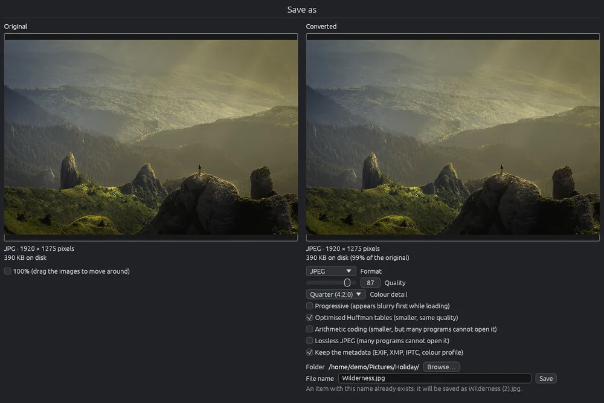

# Salva come

Salva un'immagine come file nuovo, nel formato e nella cartella che scegli: per esempio una foto HEIC del telefono come JPEG, o un PNG come WebP più leggero. Prima di salvare vedi esattamente come sarà il file nuovo e quanto pesa. L'originale non viene mai toccato.

Per convertire o ridimensionare tante immagini insieme usa [Convertire e ridimensionare le immagini](convert.md).

## Aprire la pagina

- Nella griglia seleziona un'immagine e fai clic su  nella barra strumenti, oppure scegli **File > Salva come…**, oppure fai clic destro sull'immagine e scegli **Salva come…**.
- Nel visore premi **Ctrl+Maiusc+S**, o usa le stesse voci di menù. Se nel visore hai ruotato o riflesso l'immagine, viene salvata ruotata.
- Nel visore anche un modello 3D o un disegno CAD si possono salvare come immagine, così come si vedono: un modello di almeno 1920 pixel sul lato lungo, un disegno con il layout che stai guardando. Su un modello 3D fa lo stesso anche **Ctrl+S**.
- Nell'editor, **Salva come…** apre questa pagina con l'immagine modificata (vedi [Salvare un'immagine modificata](editor-save.md)). Chiudendola senza salvare torni all'editor, con le modifiche.

## Che cosa mostra la pagina

La pagina occupa tutta la finestra. A sinistra c'è l'originale, a destra l'immagine convertita, ciascuna con il formato, le dimensioni in pixel e il peso su disco; per quella convertita anche in percentuale dell'originale. Un'immagine nuova dell'editor non ha ancora un file, quindi il suo peso su disco e la percentuale non compaiono.

L'immagine a destra è il file vero: ogni volta che cambi un'opzione, EyeCanSee rifà il file e lo mostra. Mentre lavora, il peso dice "Calcolo della dimensione in corso…" e **Salva** aspetta: così il peso che vedi è sempre quello del file che otterrai.

Spunta **100%** per vedere i pixel veri. Poi trascina una delle due immagini per spostarle entrambe e confrontare lo stesso punto.

## Salvare

1. Scegli il **Formato**. La pagina si apre sul formato dell'ultima immagine salvata da qui finché EyeCanSee resta aperto; la prima volta su JPEG. Un'immagine nuova dell'editor si apre sempre su PNG. Un'immagine troppo grande per quel formato (WebP tiene al massimo 16383 pixel per lato, JPEG 65500, GIF e TGA 65535) si apre su JPEG o PNG come la prima volta. Le opzioni del formato partono come descritto qui sotto.
2. Se vuoi, cambia le sue opzioni (vedi sotto).
3. Controlla la cartella in **Cartella**: all'inizio è quella dell'originale. Per salvare altrove fai clic su **Sfoglia…** e scegli un'altra cartella, anche su un altro dispositivo: un telefono, un disco o un server salvato, come in [Convertire e ridimensionare le immagini](convert.md). **Invio** o **Usa questa cartella** la sceglie, **Esc** o **Annulla** tiene la cartella che avevi.
4. Controlla il nome in **Nome del file** e fai clic su **Salva**.

Se il nome è già preso in quella cartella, viene aggiunto " (2)" e la pagina lo dice prima che tu salvi. Dopo il salvataggio la pagina si chiude.

**Esc** o la X della finestra chiudono la pagina senza salvare.

## Formati e opzioni

| Formato | Opzioni |
|---|---|
| JPEG | Qualità, Dettaglio del colore, Progressivo, Tabelle di Huffman ottimizzate, Codifica aritmetica, JPEG senza perdita |
| PNG | Livello di compressione (da 0 a 9), Filtro |
| WebP | Con perdita (Qualità, Bordi dei colori più nitidi) o Senza perdita (Quasi senza perdita); Sforzo |
| AVIF | Qualità, Qualità della trasparenza (per le immagini con trasparenza), Velocità, 10 bit per canale, RGB dentro il file |
| TIFF | Compressione (Nessuna, LZW, Deflate veloce, normale o massima, PackBits), Predittore orizzontale |
| GIF | Qualità della riduzione dei colori (al massimo 256 colori) |
| TGA | Compresso (RLE) |
| BMP, QOI, ICO, PNM, OpenEXR, Radiance HDR, Farbfeld | nessuna |

- Per un originale JPEG vengono proposti la sua qualità e il suo dettaglio del colore, letti dal file; altrimenti qualità 90 e dettaglio Un quarto (4:2:0).
- Sotto le opzioni una riga dice quando il file nuovo tiene esattamente gli stessi pixel ("Senza perdita").
- Codifica aritmetica e JPEG senza perdita fanno file più piccoli o identici, ma molti programmi non li aprono.

## Metadati

**Mantieni i metadati (EXIF, XMP, IPTC, profilo colore)** è acceso all'inizio. Conserva la fotocamera, la data dello scatto, il luogo (GPS), autore, copyright, descrizioni, parole chiave e il profilo colore.

- Solo JPEG, PNG, WebP, AVIF e TIFF possono contenere metadati. Con un altro formato, o se l'originale non ne ha, la casella è grigia; passandoci sopra si legge il perché.
- L'orientamento viene messo dritto, perché i pixel salvati sono già ruotati, e le dimensioni scritte dentro sono quelle dell'immagine nuova.
- Restano fuori: le piccole anteprime che le fotocamere mettono nel file, le impostazioni di Lightroom e Camera Raw e il video della foto in movimento, che il file nuovo non ha.
- Una foto **Ultra HDR** del telefono resta HDR se la salvi in JPEG con i metadati, anche dall'editor: la sua parte HDR viene ruotata, ritagliata e coperta insieme alla foto. In un altro formato, o senza i metadati, perde l'HDR, e la pagina te lo dice prima di salvare.

## Da sapere

- JPEG e Radiance HDR non hanno la trasparenza: le parti trasparenti diventano bianche. La pagina lo dice.
- Un'icona (ICO) contiene al massimo 256 × 256 pixel: un'immagine più grande viene ridotta. La pagina lo dice.
- Un'immagine animata (GIF, WebP, APNG, AVIF) o con più pagine (TIFF) viene salvata come l'immagine mostrata, il suo primo fotogramma o la prima pagina: il file nuovo ha solo quella. La pagina lo dice.
- EyeCanSee non sa scrivere HEIC né JPEG XL: vedi [Formati supportati](formats.md).
- Solo JPEG, PNG, WebP, AVIF, TIFF, BMP, GIF, QOI e i file PSD (appiattiti) si possono anche riscrivere sopra l'originale dopo una rotazione (vedi [Ruotare e riflettere](rotate.md)); gli altri formati solo da questa pagina.
- La tabella di ogni formato con le sue opzioni è in [Formati supportati](formats.md).
