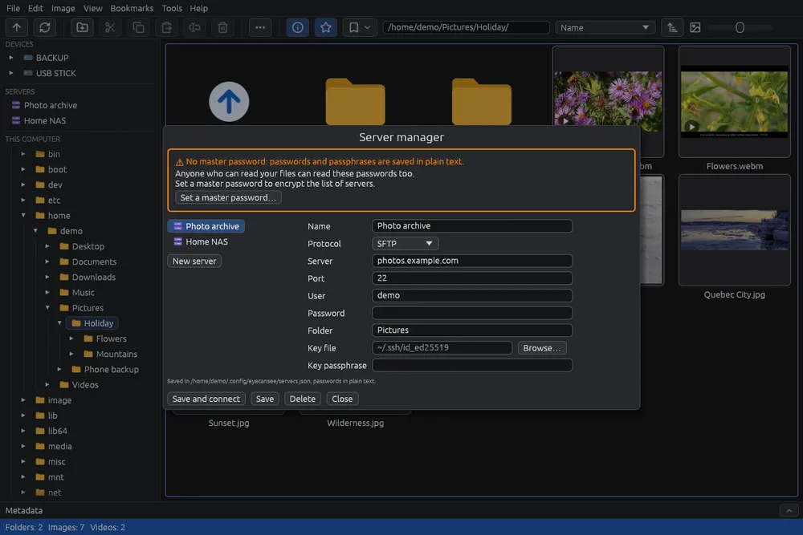

# Gestire i server

La gestione server tiene i server che usi, con la loro password o chiave, così si aprono con un clic dal pannello a sinistra, come un disco. Funziona come il gestore dei siti di FileZilla o WinSCP.

## Aprirla

Scegli **File > Gestione server…** (). Se i server salvati sono protetti da una password principale, EyeCanSee la chiede prima (vedi [Password salvate](passwords.md)).

## La finestra

- In alto, il riquadro della password principale: dice se l'elenco dei server è cifrato (vedi [Password salvate](passwords.md)).
- A sinistra, i server salvati; sotto di loro **Nuovo server** svuota i campi per uno nuovo.
- A destra, i campi del server scelto: **Nome** (vuoto: si usa il nome del server), **Protocollo** (FTP, FTPS o SFTP), **Server**, **Porta**, **Utente**, **Password** e **Cartella**. Per SFTP anche **File della chiave** (**Sfoglia…** apre la finestra del sistema nella cartella `~/.ssh`, o nella tua home se non c'è) e **Passphrase della chiave**.
- In fondo, il file in cui sono salvati i server.

## I pulsanti

- **Salva e connetti**: salva il server e lo apre.
- **Salva**: salva le modifiche, o aggiunge il server nuovo.
- **Elimina**: chiede "Eliminare … dai server salvati?" al posto dei pulsanti; **Elimina** lo toglie, **Annulla** lo tiene.
- **Chiudi** (o **Esc**): chiude la finestra.

## Come entra un server salvato

Un server salvato entra **solo** con la password e la chiave salvate qui, mai con l'agente SSH o con le chiavi del sistema in `~/.ssh`. Se la chiave non si apre (passphrase sbagliata, file mancante), non entra, e la gestione server si apre su quel server per correggerlo.

Anche un indirizzo che corrisponde a un server salvato (stesso protocollo, server, porta e utente), scritto nella barra degli indirizzi o riaperto all'avvio, usa la sua password e la sua chiave.

## La sezione Server del pannello

Ogni server salvato compare nel pannello a sinistra, nella sezione **Server** sotto i dispositivi, con l'icona .

- Un clic lo apre. Tornando a un server, o al computer, ritrovi l'ultima cartella in cui eri, finché EyeCanSee resta aperto.
- Clic destro: **Chiudi connessione** (se è aperto torni alla tua cartella home; non durante una copia) e **Modifica…**, che apre la gestione server su quel server.
- Con un server o un telefono aperto, il pannello mostra anche **Questo computer**, con la tua cartella home e l'ultima cartella del computer in cui eri.

## Da sapere

- Senza password principale, password e passphrase vengono salvate in chiaro: la prima volta che salvi un server, EyeCanSee te lo dice una volta. Vedi [Password salvate](passwords.md).
- La porta si può lasciare vuota: FTP usa la 21, SFTP la 22.
- Dal pannello copi e incolli tra server, computer, dischi e telefoni come tra due cartelle (vedi [Copiare e spostare](copy-move.md)).
