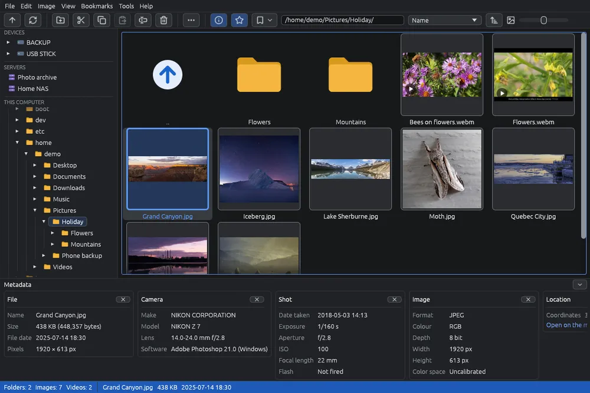

# Per cominciare

EyeCanSee mostra le foto, i video, i modelli 3D e i disegni CAD di una cartella come miniature, e li apre uno alla volta. Funziona allo stesso modo sulle cartelle di questo computer, sui dischi e sulle chiavette, sui telefoni Android e sui server (FTP e SFTP).

## La finestra

- **Barra dei menù** in alto: File, Modifica, Immagine, Visualizza, Segnalibri, Strumenti e Aiuto.
- **Barra strumenti** subito sotto: i pulsanti delle operazioni più comuni, i segnalibri e la barra degli indirizzi. Passando col mouse su un pulsante compaiono il suo nome e il suo tasto; su un pulsante grigio, anche il motivo per cui ora non si può usare.
- **Pannello laterale** a sinistra: i tuoi dischi, i telefoni, i server salvati e le cartelle di questo computer. Vedi [Cartelle e pannello laterale](folders.md).
- **Griglia** al centro: le sottocartelle e i file della cartella aperta, come miniature. Vedi [La griglia delle miniature](grid.md).
- **Pannello dei metadati** sotto la griglia: le informazioni sul file selezionato. Vedi [Informazioni sul file](metadata.md).
- **Barra di stato** in fondo: quante cartelle e quanti file ci sono, e nome, peso e data del file selezionato (di una cartella, il nome).

## Aprire una cartella

- Fai clic su una cartella nel pannello laterale, oppure doppio clic su una cartella nella griglia.
- Scrivi l'indirizzo di una cartella nella barra degli indirizzi e premi Invio. Vedi [Barra degli indirizzi e Apri indirizzo](address.md).
- Scegli uno dei tuoi [segnalibri](bookmarks.md).

All'avvio EyeCanSee riapre la cartella che stavi guardando quando l'hai chiuso (si può spegnere nelle [Opzioni](options.md)), oppure la tua cartella home. Se apri una foto con EyeCanSee da un altro programma, mostra quella foto.

EyeCanSee resta aperto in una sola copia: se è già aperto, una foto o una cartella aperta di nuovo con EyeCanSee compare nella finestra che c'è già.

## Guardare una foto

Fai doppio clic su una miniatura, oppure selezionala e premi **Invio**: la foto riempie la finestra. Per tornare indietro premi **Esc**, fai doppio clic sulla foto o usa  **Torna alla griglia**. Vedi [Guardare le immagini](viewer.md).

## Menù, pulsanti e tasti

- Il **clic destro** su qualunque cosa (una miniatura, una cartella, uno spazio vuoto della griglia, la foto nel visore) apre un menù con quello che puoi farci.
- Ogni azione ha una voce di menù, con il tasto scritto accanto. L'elenco di tutti i tasti è in [Scorciatoie da tastiera](keyboard.md).
- Quando la finestra è stretta, alcuni pulsanti della barra strumenti passano nel menù  **Altre operazioni**.
- **F11** mette la finestra a schermo intero, e la riporta com'era.

## Aiuto

Premi **F1** in qualunque momento: questa guida si apre sulla pagina di ciò che stai facendo. Premi di nuovo **F1** per chiuderla. **Aiuto > Manuale** apre l'elenco di tutte le pagine.

## Da dove continuare

- [La griglia delle miniature](grid.md) e [Selezionare i file](selection.md), per muoverti e scegliere i file.
- [Copiare e spostare](copy-move.md) ed [Eliminare e cestino](delete.md), per mettere in ordine le foto.
- [Telefoni Android](phone.md) e [Server (FTP e SFTP)](servers.md), per lavorare sulle foto di un telefono o di un NAS.
- [Modificare un'immagine](editor.md), per disegnare su una foto, ritagliarla o nasconderne delle parti.
