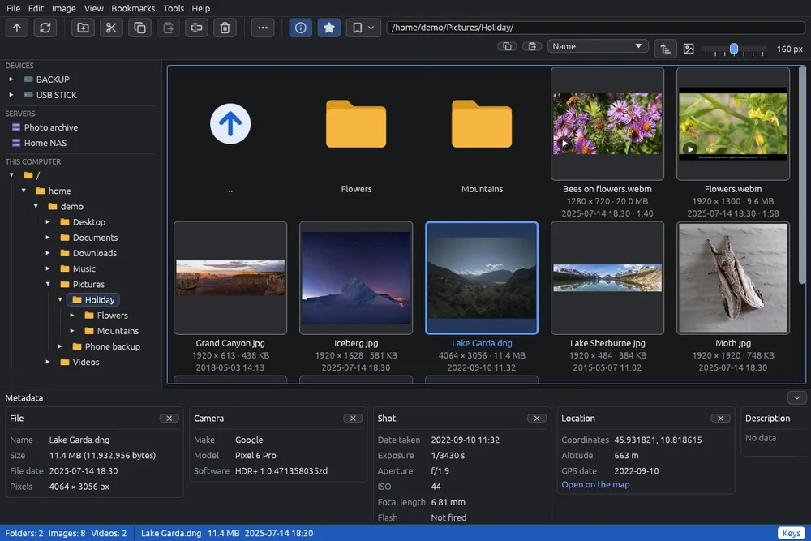
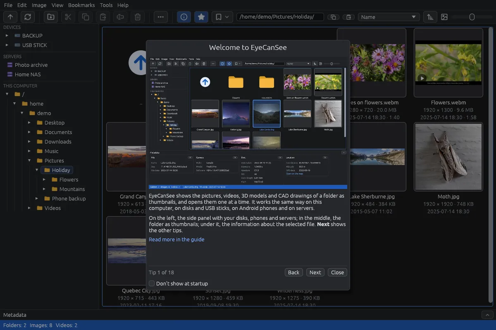

# Per cominciare

EyeCanSee mostra le foto, i video, i modelli 3D e i disegni CAD di una cartella come miniature, e li apre uno alla volta. Funziona allo stesso modo sulle cartelle di questo computer, sui dischi e sulle chiavette, sui telefoni Android e sui server (FTP e SFTP).

## La finestra

- **Barra dei menu** in alto: File, Modifica, Immagine, Visualizza, Segnalibri, Strumenti e Aiuto. Passando col mouse su una voce grigia compare il motivo per cui ora non si può usare.
- **Barra strumenti** subito sotto: i pulsanti delle operazioni più comuni, i segnalibri e la barra degli indirizzi. Passando col mouse su un pulsante compaiono il suo nome e il suo tasto; su un pulsante grigio, anche il motivo per cui ora non si può usare.
- **Pannello laterale** a sinistra: i tuoi dischi, i telefoni, i server salvati e le cartelle di questo computer. Vedi [Cartelle e pannello laterale](folders.md).
- **Griglia** al centro: le sottocartelle e i file della cartella aperta, come miniature. Vedi [La griglia delle miniature](grid.md).
- **Pannello dei metadati** sotto la griglia: le informazioni sul file selezionato. Vedi [Informazioni sul file](metadata.md).
- **Barra di stato** in fondo: quante cartelle e quanti file ci sono, e nome, peso e data del file selezionato (per una cartella, solo il nome).

## Aprire una cartella

- Fai clic su una cartella nel pannello laterale, oppure doppio clic su una cartella nella griglia.
- Scrivi l'indirizzo di una cartella nella barra degli indirizzi e premi Invio. Vedi [Barra degli indirizzi e Apri indirizzo](address.md).
- Scegli uno dei tuoi [segnalibri](bookmarks.md).

All'avvio EyeCanSee riapre la cartella che stavi guardando quando l'hai chiuso (si può spegnere nelle [Opzioni](options.md)), oppure la tua cartella home. Se apri una foto con EyeCanSee da un altro programma, mostra quella foto.

EyeCanSee resta aperto in una sola copia: se è già aperto, una foto o una cartella aperta di nuovo con EyeCanSee compare nella finestra che c'è già. Se quella finestra non risponde entro pochi secondi (è bloccata), la foto o la cartella si apre in una finestra nuova.

## Guardare una foto

Fai doppio clic su una miniatura, oppure selezionala e premi **Invio**: la foto riempie la finestra. Per tornare indietro premi **Esc**, fai doppio clic sulla foto o usa  **Torna alla griglia**. Nelle Opzioni il doppio clic si può impostare per andare invece a schermo intero. Vedi [Guardare le immagini](viewer.md).

## Menù, pulsanti e tasti

- Il **clic destro** su qualunque cosa (una miniatura, una cartella, uno spazio vuoto della griglia, la foto nel visore) apre un menu con quello che puoi farci.
- Ogni azione ha una voce di menu, con il tasto scritto accanto. L'elenco di tutti i tasti è in [Scorciatoie da tastiera](keyboard.md).
- Quando la finestra è stretta, i pulsanti della barra strumenti che non ci stanno passano nel menu  **Altre operazioni**: prima quelli dell'immagine e degli strumenti, poi le operazioni sui file, il pulsante dei metadati, la stella dei segnalibri e Aggiorna. La barra degli indirizzi resta sempre in vista, e i menu e la barra di stato vanno a capo su più righe invece di essere tagliati.
- Ogni cursore ha delle tacche sotto: una per ogni passo su cui si ferma, oppure una per ogni valore tondo. Il suo valore è scritto accanto o prima.
- **F11**, oppure **Visualizza > Schermo intero**, mette la finestra a schermo intero e la riporta com'era.

## Aiuto

Premi **F1** in qualunque momento: questa guida si apre sulla pagina di ciò che stai facendo. Premi di nuovo **F1** per chiuderla, oppure premi **Esc** due volte di seguito col puntatore sopra la guida. Quando la guida è sopra un'altra finestra, per esempio un messaggio, due **Esc** chiudono la guida ovunque sia il puntatore, e l'altra finestra resta aperta. **Aiuto > Guida** apre l'elenco di tutte le pagine.

Il campo in alto a sinistra cerca in tutte le pagine, e ci puoi scrivere appena la guida si apre. Ogni risultato apre la sua pagina, con le parole trovate evidenziate. L'evidenziazione segue ciò che c'è nel campo, e  lo svuota.

## Suggerimenti all'avvio

Al primo avvio del giorno una finestra mostra un suggerimento: una cosa che EyeCanSee sa fare, con un'immagine o i passi da seguire. La primissima volta il primo suggerimento arriva appena chiudi con **Fine** la finestra del primo avvio. Se la chiudi con **Salta** o **Esc**, i suggerimenti cominciano il giorno dopo.

- **Avanti** e **Indietro** (o i tasti → e ←) mostrano gli altri suggerimenti; l'avvio successivo mostra quello dopo l'ultimo che hai visto.
- **Leggi di più nella guida** apre la pagina di quel suggerimento.
- **Chiudi** (o **Invio** o **Esc**) chiude la finestra. Finché è aperta, gli altri tasti non arrivano alla griglia dietro (**F1** apre comunque questa guida).
- **Non mostrare più all'avvio** ferma i suggerimenti. Per riaverli, spunta **Mostra un suggerimento all'avvio** in **Strumenti > Opzioni… > Generale** (vedi [Opzioni](options.md)).

I suggerimenti non compaiono quando un altro programma avvia EyeCanSee per aprire un'immagine o una cartella.

## Una copia delle tue foto

Prima di spostare, convertire o modificare molti file insieme, tieni una copia delle tue foto altrove, per esempio su un altro disco o in un backup: una copia le protegge da un errore, da un guasto o da un disco che si rompe.

## Da dove continuare

- [La griglia delle miniature](grid.md) e [Selezionare i file](selection.md), per muoverti e scegliere i file.
- [Copiare e spostare](copy-move.md) ed [Eliminare e cestino](delete.md), per mettere in ordine le foto.
- [Telefoni Android](phone.md) e [Server (FTP e SFTP)](servers.md), per lavorare sulle foto di un telefono o di un NAS.
- [Modificare un'immagine](editor.md), per disegnare su una foto, ritagliarla o nasconderne delle parti.

## Crediti delle immagini

Le foto, i video, i modelli 3D e i disegni che si vedono nelle immagini di questa guida sono di pubblico dominio o liberi da usare. Autori, licenze e fonti sono elencati in [CREDITS.md](https://github.com/IoSonoPiero/eyecansee/blob/main/docs/help/img/CREDITS.md) (in inglese).
